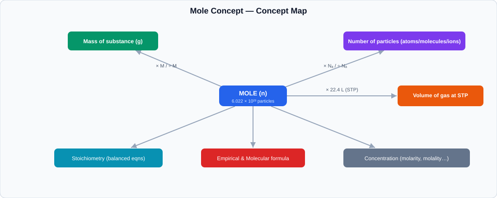
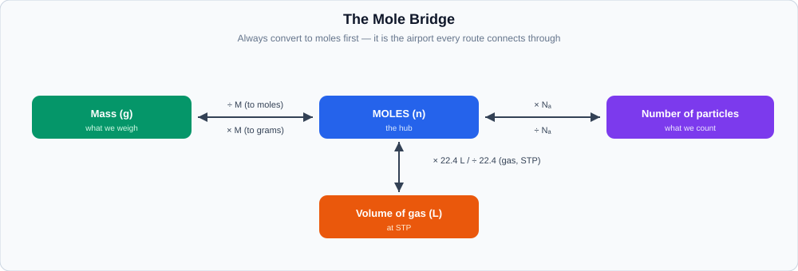
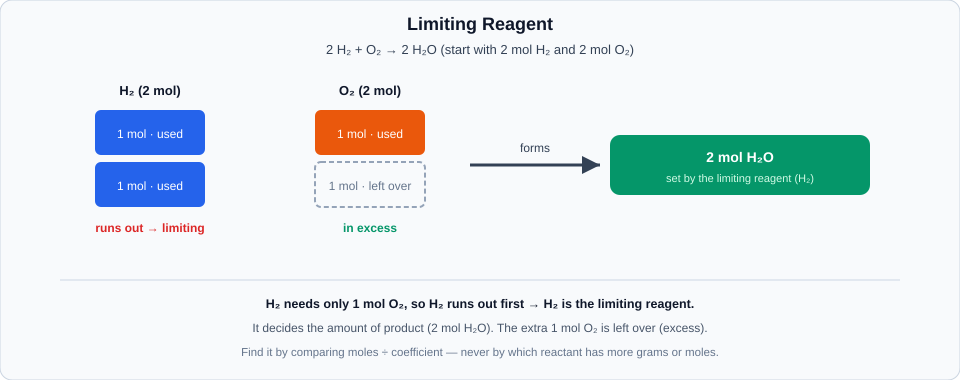

# Mole Concept — Concepts

> **Class 11 · Chemistry · Chapter 1** — Some Basic Concepts of Chemistry
> **Branch:** Physical Chemistry
> **Prerequisites:** basic atomic structure, simple algebra, ratios
> **JEE weightage:** High & foundational — the mole is the "currency" of all of chemistry; stoichiometry questions appear every year, and this chapter underpins Physical and Inorganic numericals.

<!-- RENDERING: inside math use \cdot (not ·), \to (not →). Units as \text{} or \mathrm{}. Concept map is an SVG. -->

---

## 📑 Index

1. [Why we need the mole](#1-why-we-need-the-mole)
2. [Laws of chemical combination](#2-laws-of-chemical-combination)
3. [Atomic, molecular and formula mass](#3-atomic-molecular-and-formula-mass)
4. [The mole and Avogadro's number](#4-the-mole-and-avogadros-number)
5. [The mole bridge — converting between mass, number and volume](#5-the-mole-bridge--converting-between-mass-number-and-volume)
6. [Percentage composition and formulae](#6-percentage-composition-and-formulae)
7. [Stoichiometry and the limiting reagent](#7-stoichiometry-and-the-limiting-reagent)
8. [Concentration of solutions](#8-concentration-of-solutions)

Related: [Solved Numericals](./02-solved-numericals.md) · [Practice Range](./03-practice.md) · [Deep Dive](./04-deep-dive.md) · [Formula Recap](./05-formula-recap.md)

---

## 🗺️ Concept map

---

## 1. Why we need the mole

Atoms and molecules are unimaginably small — a single drop of water holds more molecules than there are stars in the observable universe. We cannot count them one by one, and we cannot weigh one atom on a balance. So chemistry needs a **counting unit** that links the invisible world of atoms to the grams we can actually measure in the lab.

That unit is the **mole**. Just as "a dozen" always means 12 and "a ream" always means 500, **a mole always means $6.022\times10^{23}$ particles**. The genius of the mole is that *one mole of any substance, in grams, equals its atomic or molecular mass*. So 1 mole of carbon weighs 12 g, 1 mole of water weighs 18 g — and both contain the same number of particles.

> [!NOTE]
> The mole is the bridge between two worlds: the **microscopic** (atoms, molecules — things we count) and the **macroscopic** (grams, litres — things we measure). Almost every calculation in this chapter is really "convert to moles, do the ratio, convert back."

---

## 2. Laws of chemical combination

Before the mole, chemists discovered simple weight-ratio rules by careful experiment. These laws are *why* the mole idea works.

| Law | Statement | Example |
|---|---|---|
| **Conservation of mass** (Lavoisier) | Mass is neither created nor destroyed in a reaction. | Total mass of reactants = total mass of products. |
| **Definite proportions** (Proust) | A given compound always has the same elements in the same mass ratio. | Water is always 1 : 8 (H : O) by mass. |
| **Multiple proportions** (Dalton) | When two elements form more than one compound, the masses of one that combine with a fixed mass of the other are in small whole-number ratios. | $\text{CO}$ and $\text{CO}_2$: O per 12 g C is 16 g vs 32 g → ratio 1 : 2. |
| **Gay-Lussac (gaseous volumes)** | Gases react in simple whole-number volume ratios (same T, P). | $\text{H}_2 + \text{Cl}_2 \to 2\text{HCl}$: 1 : 1 : 2 by volume. |
| **Avogadro's law** | Equal volumes of all gases, at the same T and P, contain equal numbers of molecules. | This is what connects gas volume to number of molecules. |

> [!TIP]
> **Multiple proportions** is a favourite short MCQ: fix the mass of one element, compare the masses of the other across the two compounds, and show the ratio is small whole numbers.

---

## 3. Atomic, molecular and formula mass

- **Atomic mass** is measured in **atomic mass units (u)**, defined so that one carbon-12 atom weighs exactly $12\ \text{u}$. So $1\ \text{u} = \tfrac{1}{12}$ of a C-12 atom.
- **Average atomic mass** accounts for isotopes — it is the weighted average by natural abundance:
$$\bar{A} = \sum (\text{fractional abundance}\times\text{isotope mass})$$
For chlorine: $0.75(35) + 0.25(37) = 35.5\ \text{u}$.
- **Molecular mass** = sum of atomic masses of all atoms in a molecule. For $\text{H}_2\text{O}$: $2(1) + 16 = 18\ \text{u}$.
- **Formula mass** is used for ionic compounds (which have no discrete molecules). For $\text{NaCl}$: $23 + 35.5 = 58.5\ \text{u}$.

> [!IMPORTANT]
> **Gram atomic / molecular mass** is the atomic/molecular mass expressed in **grams** — and that quantity is exactly **one mole**. 12 u → 12 g = 1 mol of C atoms. This single idea is what makes "mass in grams" and "number of moles" interchangeable.

---

## 4. The mole and Avogadro's number

**Avogadro's number (constant):**
$$N_A = 6.022\times10^{23}\ \text{particles per mole}$$

**One mole** is the amount of substance containing $N_A$ elementary entities (atoms, molecules, ions, electrons — you must say *of what*).

**Molar mass ($M$)** is the mass of one mole, in $\text{g mol}^{-1}$. Numerically it equals the atomic/molecular/formula mass in u.

The three defining relationships:
$$n = \frac{\text{mass } (m)}{\text{molar mass } (M)}, \qquad N = n\times N_A, \qquad V_{gas} = n\times 22.4\ \text{L (at STP)}$$

> [!WARNING]
> "One mole of oxygen" is ambiguous — **1 mole of $\text{O}_2$ molecules** ($32\ \text{g}$, $N_A$ molecules, $2N_A$ atoms) is different from **1 mole of O atoms** ($16\ \text{g}$, $N_A$ atoms). Always track whether you are counting atoms, molecules or ions.

> **STP note:** JEE/NCERT now uses the current STP (273.15 K, 1 bar) giving molar volume $22.711\ \text{L}$. The older value $22.4\ \text{L}$ (at 1 atm) is still widely used. **Read the question** — use the value it specifies; we use $22.4\ \text{L}$ here unless stated.

---

## 5. The mole bridge — converting between mass, number and volume

Almost every problem is a trip across this bridge. Moles sit in the middle; everything else is one multiply or divide away.

$$\boxed{\;\text{mass (g)} \;\xrightleftharpoons[\;\times M\;]{\;\div M\;}\; \text{MOLES } (n) \;\xrightleftharpoons[\;\div N_A\;]{\;\times N_A\;}\; \text{number of particles}\;}$$
$$\text{MOLES } (n) \;\xrightleftharpoons[\;\div 22.4\;]{\;\times 22.4\ \text{L}\;}\; \text{volume of gas at STP}$$

**Worked mini-example.** How many molecules are in $9\ \text{g}$ of water?
$$n = \frac{9}{18} = 0.5\ \text{mol} \;\Rightarrow\; N = 0.5\times6.022\times10^{23} = 3.011\times10^{23}\ \text{molecules}$$

> [!TIP]
> Never jump straight from grams to molecules or from grams to litres. **Always land on moles first.** Moles is the airport every route connects through.

---

## 6. Percentage composition and formulae

**Percentage composition** — the mass % of each element in a compound:
$$\%\,\text{element} = \frac{(\text{number of atoms})\times(\text{atomic mass})}{\text{molar mass}}\times 100$$

**Empirical formula** — the *simplest whole-number ratio* of atoms (e.g. $\text{CH}_2\text{O}$).
**Molecular formula** — the *actual* number of atoms (e.g. glucose $\text{C}_6\text{H}_{12}\text{O}_6$).

$$\text{Molecular formula} = (\text{Empirical formula})\times n, \qquad n = \frac{\text{molar mass}}{\text{empirical formula mass}}$$

**Steps to find the empirical formula from % composition:**
1. Take 100 g of compound → the % values become grams.
2. Divide each element's mass by its atomic mass → moles of each.
3. Divide all mole values by the smallest → simplest ratio.
4. Round to whole numbers (multiply up if you get .5, .33, .25).

---

## 7. Stoichiometry and the limiting reagent

A **balanced equation** is a recipe in moles. The coefficients are **mole ratios**:
$$2\text{H}_2 + \text{O}_2 \to 2\text{H}_2\text{O} \quad\text{means}\quad 2\ \text{mol H}_2 : 1\ \text{mol O}_2 : 2\ \text{mol H}_2\text{O}$$

**The limiting reagent** is the reactant that runs out first — it decides how much product forms. The other reactant is "in excess" and some is left over.

**How to find the limiting reagent:**
1. Convert each reactant's mass to moles.
2. Divide each by its coefficient in the balanced equation.
3. The **smallest** result marks the **limiting reagent**.
4. Base all product amounts on the limiting reagent.

> [!WARNING]
> You **cannot** tell the limiting reagent just by which reactant has fewer grams or fewer moles — you must compare *moles ÷ coefficient*. A reactant can be present in a larger amount and still run out if the recipe demands a lot of it.

**Percentage yield** compares what you actually got to the theoretical maximum:
$$\%\,\text{yield} = \frac{\text{actual yield}}{\text{theoretical yield}}\times 100$$

---

## 8. Concentration of solutions

How much solute sits in a given amount of solvent or solution. Learn which quantity is in the denominator — that is what makes each term different.

| Term | Formula | Denominator | Depends on T? |
|---|---|---|---|
| **Molarity ($M$)** | $\dfrac{\text{moles of solute}}{\text{litres of solution}}$ | volume of **solution** | Yes (volume expands) |
| **Molality ($m$)** | $\dfrac{\text{moles of solute}}{\text{kg of solvent}}$ | mass of **solvent** | No (mass fixed) |
| **Mole fraction ($x$)** | $\dfrac{\text{moles of component}}{\text{total moles}}$ | total moles | No |
| **Mass %** | $\dfrac{\text{mass of solute}}{\text{mass of solution}}\times100$ | mass of solution | No |
| **ppm** | $\dfrac{\text{mass of solute}}{\text{mass of solution}}\times10^{6}$ | mass of solution | No |

**Dilution** (adding solvent keeps moles of solute fixed):
$$M_1 V_1 = M_2 V_2$$

**From density and mass %** (a common Advanced step), molarity is:
$$M = \frac{10\times d\times(\text{mass }\%)}{\text{molar mass}} \qquad (d \text{ in g/mL})$$

> [!TIP]
> Molarity changes with temperature (the solution expands); **molality and mole fraction do not**, because they are built on mass, not volume. That is why molality is preferred for temperature-dependent work.

---

## ✅ One-line summary

> The mole links grams to numbers of particles: $n = m/M$, $N = nN_A$, $V = 22.4n$ L at STP.
> Balanced equations are mole-ratio recipes; the limiting reagent sets the yield; and
> concentration terms differ only in what sits in their denominator.

**Next:** [Solved Numericals →](./02-solved-numericals.md)
