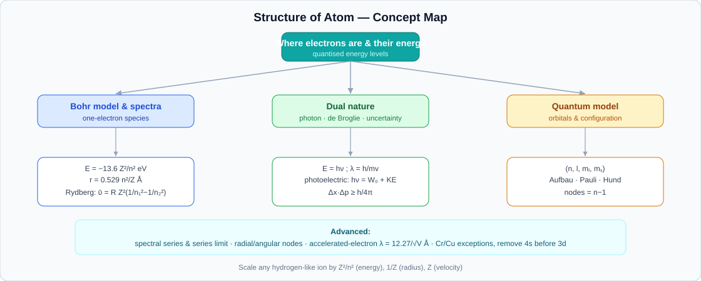
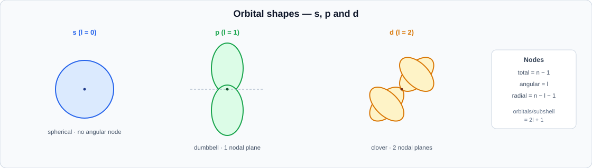

# Structure of Atom — Concepts

> **Class 11 · Chemistry · Chapter 2** — Structure of Atom (atomic models, Bohr theory, dual nature, quantum numbers, electronic configuration)
> **Branch:** Physical / Atomic Chemistry
> **Prerequisites:** basic atomic idea (protons, neutrons, electrons), powers of ten & logarithms, simple algebra
> **JEE weightage:** Very High — Bohr-model numericals, de Broglie / photoelectric effect, quantum numbers and electronic configuration are asked every year in Main and underpin the periodic table, bonding and coordination chemistry.

<!-- RENDERING: inside math use \cdot (not ·), \to for arrows, \lambda \nu for wavelength/frequency, superscripts for configs. Concept map is an SVG. -->

---

## 📑 Index

1. [Subatomic particles and early models](#1-early-models)
2. [Electromagnetic radiation and atomic spectra](#2-spectra)
3. [Bohr's model of the hydrogen atom](#3-bohr)
4. [Dual nature: photoelectric effect and de Broglie](#4-dual-nature)
5. [Heisenberg's uncertainty principle](#5-uncertainty)
6. [Quantum numbers and orbitals](#6-quantum-numbers)
7. [Electronic configuration: Aufbau, Pauli, Hund](#7-configuration)

**Advanced (JEE Main & Advanced depth):**

8. [Hydrogen spectral series and the Rydberg formula](#8-spectral-series)
9. [Nodes, orbital counting and quantum-number depth](#9-nodes)
10. [Numerical depth: photoelectric, de Broglie, and configuration exceptions](#10-numerical-depth)

Related: [Solved Numericals](./02-solved-numericals.md) · [Practice Range](./03-practice.md) · [Deep Dive](./04-deep-dive.md) · [Formula Recap](./05-formula-recap.md)

---

## 🗺️ Concept map

---

## 1. Subatomic particles and early models

An atom is built from three subatomic particles:

| Particle | Charge | Mass | Discovered by |
|---|---|---|---|
| Electron | $-1$ ($1.6\times10^{-19}$ C) | $9.1\times10^{-31}$ kg | J.J. Thomson (cathode rays) |
| Proton | $+1$ | $1.67\times10^{-27}$ kg | Goldstein (anode/canal rays) |
| Neutron | $0$ | $1.67\times10^{-27}$ kg | Chadwick |

- **Atomic number** $Z$ = number of protons; **mass number** $A$ = protons + neutrons.
- **Thomson's model** ("plum pudding"): electrons embedded in a positive sphere — failed to explain scattering.
- **Rutherford's model** (gold-foil experiment): a tiny, dense, positive **nucleus** with electrons around it — but couldn't explain why orbiting electrons don't spiral into the nucleus (classical physics predicts they radiate energy).

> [!NOTE]
> **Isotopes** have the same $Z$, different $A$ (same element, different neutrons: ${}^{1}\text{H}, {}^{2}\text{H}, {}^{3}\text{H}$). **Isobars** have the same $A$, different $Z$. **Isotones** have the same number of neutrons. **Isoelectronic** species have the same number of electrons ($\text{Na}^+$, $\text{Mg}^{2+}$, $\text{Ne}$).

---

## 2. Electromagnetic radiation and atomic spectra

Light is electromagnetic radiation characterised by:
$$c = \nu\lambda, \qquad \bar\nu = \frac{1}{\lambda}, \qquad E = h\nu = \frac{hc}{\lambda}$$

where $c = 3\times10^8\ \mathrm{m/s}$, $h = 6.626\times10^{-34}\ \mathrm{J\,s}$ (Planck's constant), $\nu$ = frequency, $\lambda$ = wavelength, $\bar\nu$ = wavenumber.

- **Continuous spectrum:** all wavelengths (white light through a prism).
- **Line (atomic) spectrum:** only certain discrete wavelengths — a "fingerprint" of each element. Hydrogen's visible lines form the **Balmer series**.

> [!IMPORTANT]
> The existence of **discrete lines** is the key clue: atoms emit/absorb only specific energies, so electron energies inside the atom must be **quantised** (not continuous). This is exactly what Bohr's model explains.

---

## 3. Bohr's model of the hydrogen atom

Bohr postulated that electrons orbit the nucleus only in certain **stationary states** (fixed energy), where the angular momentum is quantised:
$$mvr = \frac{nh}{2\pi}, \qquad n = 1, 2, 3, \dots$$

For a hydrogen-like species (nuclear charge $Z$, electron in level $n$):

| Quantity | Formula | Hydrogen ($Z=1$) |
|---|---|---|
| Radius | $r_n = 0.529\,\dfrac{n^2}{Z}\ \text{Å}$ | $0.529\,n^2$ Å |
| Energy | $E_n = -13.6\,\dfrac{Z^2}{n^2}\ \text{eV}$ | $-\dfrac{13.6}{n^2}$ eV |
| Velocity | $v_n = 2.18\times10^6\,\dfrac{Z}{n}\ \text{m/s}$ | $\dfrac{2.18\times10^6}{n}$ |

Energy released/absorbed in a jump from $n_2 \to n_1$:
$$\Delta E = 13.6\,Z^2\left(\frac{1}{n_1^2} - \frac{1}{n_2^2}\right)\ \text{eV}$$

> [!WARNING]
> Energy is **negative** (bound electron) and gets **less negative** (higher) as $n$ increases; $E = 0$ at $n = \infty$ (ionisation). The ground state of hydrogen is $-13.6\ \mathrm{eV}$, so its **ionisation energy is $13.6\ \mathrm{eV}$**. Bohr's model works only for **one-electron** species (H, He⁺, Li²⁺).

---

## 4. Dual nature: photoelectric effect and de Broglie

**Photoelectric effect:** light shone on a metal ejects electrons, but only if the frequency exceeds a **threshold** $\nu_0$ — proving light behaves as **particles (photons)** of energy $h\nu$.
$$h\nu = h\nu_0 + \tfrac12 mv^2 = W_0 + KE_{\max}$$
where $W_0 = h\nu_0$ is the **work function**.

**de Broglie:** if light is both wave and particle, so is matter. A particle of momentum $p = mv$ has a wavelength:
$$\boxed{\lambda = \frac{h}{mv} = \frac{h}{p}}$$

> [!IMPORTANT]
> The photoelectric effect depends on **frequency, not intensity**: below $\nu_0$ no electrons are emitted no matter how bright the light; above $\nu_0$, intensity controls the *number* of electrons while frequency controls their *energy*. de Broglie wavelength is significant only for very light particles (electrons) — negligible for everyday objects.

---

## 5. Heisenberg's uncertainty principle

You cannot simultaneously know a particle's exact position and momentum:
$$\boxed{\Delta x \cdot \Delta p \ge \frac{h}{4\pi}} \qquad (\Delta x \cdot \Delta v \ge \frac{h}{4\pi m})$$

> [!NOTE]
> This is why Bohr's neat "orbits" (a precise path) are unphysical for electrons — we can only speak of the **probability** of finding an electron in a region. That probability picture is the **orbital** of the quantum-mechanical model.

---

## 6. Quantum numbers and orbitals

The quantum-mechanical model (Schrödinger) describes each electron by **four quantum numbers**:

| Symbol | Name | Values | Tells you |
|---|---|---|---|
| $n$ | Principal | $1, 2, 3,\dots$ | shell, size & energy |
| $l$ | Azimuthal | $0$ to $(n-1)$ | subshell/shape ($0{=}s, 1{=}p, 2{=}d, 3{=}f$) |
| $m_l$ | Magnetic | $-l$ to $+l$ | orbital orientation |
| $m_s$ | Spin | $+\tfrac12$ or $-\tfrac12$ | electron spin direction |

- Number of orbitals in a subshell $= 2l+1$; in a shell $= n^2$.
- Maximum electrons in a shell $= 2n^2$; in a subshell $= 2(2l+1)$.

> [!TIP]
> Read $(n, l, m_l, m_s)$ like an address: $n$ = which building (shell), $l$ = which floor type (subshell shape), $m_l$ = which room (orientation), $m_s$ = which of two seats (spin). No two electrons in an atom share all four (Pauli).

---

## 7. Electronic configuration: Aufbau, Pauli, Hund

Electrons fill orbitals according to three rules:

1. **Aufbau principle:** fill lowest-energy orbitals first. Order by increasing $(n+l)$; for equal $(n+l)$, lower $n$ first:
   $$1s\,2s\,2p\,3s\,3p\,4s\,3d\,4p\,5s\,4d\,5p\,6s\dots$$
2. **Pauli exclusion principle:** no two electrons have all four quantum numbers identical (so an orbital holds at most 2, with opposite spins).
3. **Hund's rule:** within a subshell, electrons occupy orbitals **singly first** (all with parallel spin) before pairing.

**Example — oxygen (Z = 8):** $1s^2\,2s^2\,2p^4$.

> [!WARNING]
> **Half-filled and fully-filled subshells have extra stability** (symmetry + exchange energy), causing the famous exceptions: chromium is $[\text{Ar}]3d^5 4s^1$ (not $3d^4 4s^2$) and copper is $[\text{Ar}]3d^{10}4s^1$ (not $3d^9 4s^2$).

---

<!-- ===== ADVANCED CLUSTER (required on every chapter) ===== -->

## 8. Hydrogen spectral series and the Rydberg formula

Every line in hydrogen's spectrum is a jump from a higher level $n_2$ to a lower level $n_1$, with wavenumber:
$$\bar\nu = \frac{1}{\lambda} = R_H Z^2\left(\frac{1}{n_1^2} - \frac{1}{n_2^2}\right), \qquad R_H = 1.097\times10^7\ \mathrm{m^{-1}}$$

| Series | $n_1$ | Region |
|---|---|---|
| Lyman | 1 | ultraviolet |
| Balmer | 2 | visible |
| Paschen | 3 | infrared |
| Brackett | 4 | far IR |
| Pfund | 5 | far IR |

- The **series limit** ($n_2 \to \infty$) gives the shortest wavelength of a series.
- Number of spectral lines from level $n$ to ground $= \dfrac{n(n-1)}{2}$.

> [!IMPORTANT]
> The Lyman series lands on $n=1$ and is highest-energy (UV); Balmer lands on $n=2$ and is the visible one you actually see. For hydrogen-like ions multiply by $Z^2$, so He⁺ lines are 4× the energy of the corresponding H lines.

---

## 9. Nodes, orbital counting and quantum-number depth

A **node** is a region of zero probability. For an orbital with quantum numbers $n, l$:
$$\text{total nodes} = n-1, \quad \text{angular (nodal planes)} = l, \quad \text{radial nodes} = n-l-1$$

| Orbital | $n$ | $l$ | Radial nodes | Angular nodes |
|---|---|---|---|---|
| $1s$ | 1 | 0 | 0 | 0 |
| $2s$ | 2 | 0 | 1 | 0 |
| $2p$ | 2 | 1 | 0 | 1 |
| $3d$ | 3 | 2 | 0 | 2 |

**Counting shortcuts:** orbitals in a subshell $= 2l+1$; electrons in a shell $= 2n^2$; number of electrons with a given $(n,l)$ when full $= 2(2l+1)$.

> [!TIP]
> Node counting is a guaranteed-mark topic: just remember **total nodes $= n-1$**, of which $l$ are angular (nodal planes/cones) and the rest ($n-l-1$) are radial (spherical shells). Everything else follows.

---

## 10. Numerical depth: photoelectric, de Broglie, and configuration exceptions

**Photoelectric numericals.** Convert the work function (often in eV) and incident energy consistently, then $KE_{\max} = h\nu - W_0$; the stopping potential $V_0$ satisfies $eV_0 = KE_{\max}$.

**de Broglie for an accelerated electron** (through potential $V$): $\lambda = \dfrac{h}{\sqrt{2meV}} = \dfrac{12.27}{\sqrt{V}}\ \text{Å}$ (with $V$ in volts).

**Energy–wavelength shortcuts:** $E(\text{eV}) = \dfrac{12400}{\lambda(\text{Å})}$ — handy for photon energy from wavelength.

**Configuration exceptions** (half/fully-filled stability): Cr $[\text{Ar}]3d^5 4s^1$, Cu $[\text{Ar}]3d^{10}4s^1$, and similarly Mo, Ag, Au. Always write ions by removing electrons from the **highest $n$ first** (4s before 3d): Fe²⁺ is $[\text{Ar}]3d^6$, not $3d^4 4s^2$.

> [!IMPORTANT]
> Two reusable constants save time: $hc = 1240\ \mathrm{eV\,nm}$ (photon energy) and $\lambda = 12.27/\sqrt{V}\ \text{Å}$ (electron de Broglie wavelength from accelerating voltage). And for ions, **remove 4s before 3d** — the most-tested configuration subtlety.

---

## ✅ One-line summary

> Atoms have a dense nucleus ($Z$ protons) with electrons in **quantised** energy levels. Bohr gives
> $E_n = -13.6\,Z^2/n^2$ eV, $r_n = 0.529\,n^2/Z$ Å for one-electron species; light and matter are
> **dual** ($E = h\nu$, $\lambda = h/mv$), and position/momentum obey $\Delta x\,\Delta p \ge h/4\pi$. The
> quantum model labels electrons by $(n,l,m_l,m_s)$; configurations follow **Aufbau, Pauli, Hund**, with
> half/fully-filled stability giving the Cr/Cu exceptions.

**Next:** [Solved Numericals →](./02-solved-numericals.md)
