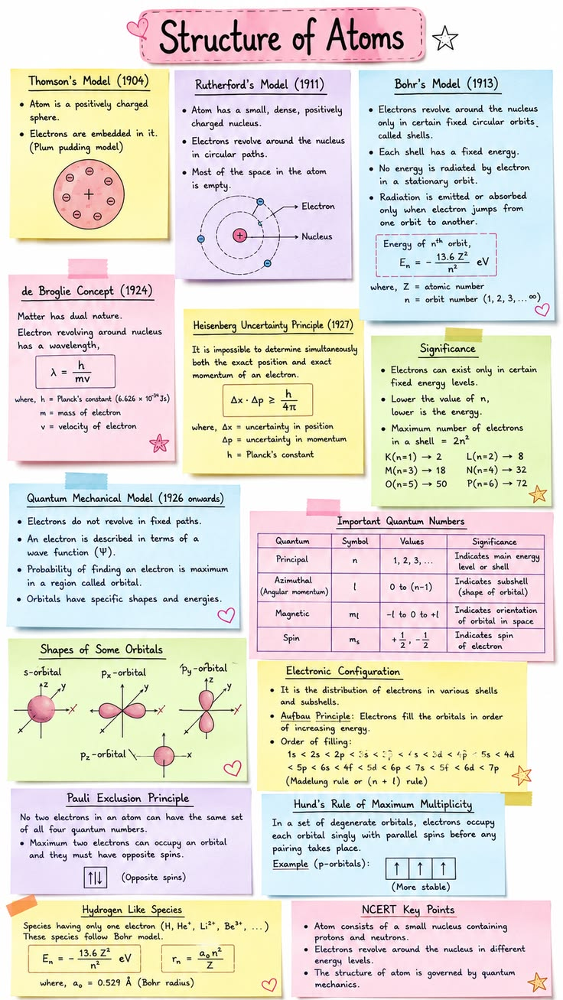
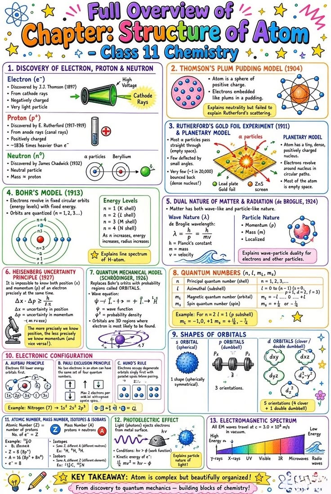

# Structure of Atom — Quick Formula Recap

> One-page revision for atomic models, Bohr theory, dual nature and quantum numbers. If anything is
> unfamiliar, jump back to [Concepts](./01-concepts.md) or the [Deep Dive](./04-deep-dive.md).

<!-- RENDERING: inside math use \cdot (not ·), \to for arrows, \lambda \nu. -->

---

## 📑 Index

- [Radiation & photon](#radiation)
- [Bohr model](#bohr)
- [Spectra (Rydberg)](#spectra)
- [Dual nature & uncertainty](#dual)
- [Quantum numbers & nodes](#quantum)
- [Configuration rules](#config)
- [Constants & cheat values](#constants)

---

## Radiation & photon

$$c = \nu\lambda, \qquad \bar\nu = \frac{1}{\lambda}, \qquad E = h\nu = \frac{hc}{\lambda}$$

- $E(\text{eV}) = \dfrac{1240}{\lambda(\text{nm})}$.

---

## Bohr model (hydrogen-like, charge $Z$)

| Quantity | Formula |
|---|---|
| Angular momentum | $mvr = \dfrac{nh}{2\pi}$ |
| Radius | $r_n = 0.529\,\dfrac{n^2}{Z}$ Å |
| Energy | $E_n = -13.6\,\dfrac{Z^2}{n^2}$ eV |
| Velocity | $v_n = 2.18\times10^6\,\dfrac{Z}{n}$ m/s |
| Transition | $\Delta E = 13.6\,Z^2\left(\dfrac{1}{n_1^2} - \dfrac{1}{n_2^2}\right)$ eV |

Ionisation energy from level $n$: $13.6\,Z^2/n^2$ eV.

---

## Spectra (Rydberg)

$$\bar\nu = \frac{1}{\lambda} = R_H Z^2\left(\frac{1}{n_1^2} - \frac{1}{n_2^2}\right), \qquad R_H = 1.097\times10^7\ \mathrm{m^{-1}}$$

| Series | $n_1$ | Region |
|---|---|---|
| Lyman | 1 | UV |
| Balmer | 2 | visible |
| Paschen | 3 | IR |

- Lines from level $n$ to ground $= \dfrac{n(n-1)}{2}$.

---

## Dual nature & uncertainty

$$\lambda = \frac{h}{mv} = \frac{h}{p}, \qquad h\nu = W_0 + KE_{\max}, \qquad \Delta x\,\Delta p \ge \frac{h}{4\pi}$$

- Accelerated electron: $\lambda = \dfrac{12.27}{\sqrt{V}}$ Å ($V$ in volts).
- Stopping potential: $eV_0 = KE_{\max}$.

---

## Quantum numbers & nodes

| Number | Range | Meaning |
|---|---|---|
| $n$ | $1,2,3\dots$ | shell ($2n^2$ e⁻) |
| $l$ | $0\dots n-1$ | subshell ($2(2l+1)$ e⁻) |
| $m_l$ | $-l\dots+l$ | orientation ($2l+1$ orbitals) |
| $m_s$ | $\pm\tfrac12$ | spin |

$$\text{total nodes} = n-1, \quad \text{angular} = l, \quad \text{radial} = n-l-1$$

---

## Configuration rules

- **Aufbau:** increasing $(n+l)$; ties → lower $n$ first. Order $1s\,2s\,2p\,3s\,3p\,4s\,3d\,4p\dots$
- **Pauli:** no two electrons share all four quantum numbers.
- **Hund:** singly fill a subshell before pairing.
- **Exceptions:** Cr $[\text{Ar}]3d^5 4s^1$, Cu $[\text{Ar}]3d^{10}4s^1$.
- **Ions:** remove highest-$n$ (4s before 3d).

---

## Constants & cheat values

| Quantity | Value |
|---|---|
| $h$ | $6.626\times10^{-34}$ J s |
| $c$ | $3\times10^8$ m/s |
| $m_e$ | $9.1\times10^{-31}$ kg |
| $R_H$ | $1.097\times10^7$ m⁻¹ |
| $hc$ | $1240$ eV nm |
| H ground-state energy | $-13.6$ eV |

> [!TIP]
> If stuck: for hydrogen-like ions **scale by $Z^2/n^2$**; for photons use $E = 1240/\lambda$ (nm→eV); for
> configurations apply Aufbau→Pauli→Hund and remove 4s before 3d for cations.

---

## 📸 Handwritten Notes (originals)

Your own formula sheets for this chapter, filed under [`notes/scans/`](./notes/scans/), plus the full chapter notes PDF.

📄 Full chapter notes (from Google Drive): [`class_11_chem_ch02_structure-of-atom.pdf`](./notes/scans/class_11_chem_ch02_structure-of-atom.pdf)

---

**Back to:** [Concepts](./01-concepts.md) · [Solved Numericals](./02-solved-numericals.md) · [Practice](./03-practice.md) · [Deep Dive](./04-deep-dive.md)
