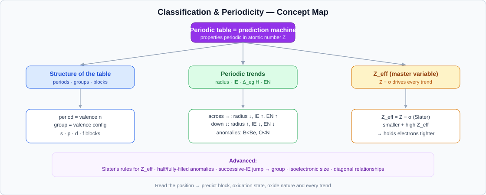

# Classification of Elements & Periodicity — Concepts

> **Class 11 · Chemistry · Chapter 3** — Classification of Elements and Periodicity in Properties
> **Branch:** Inorganic / Physical
> **Prerequisites:** [Structure of Atom](../02-structure-of-atom/01-concepts.md) (electronic configuration, quantum numbers, effective nuclear charge)
> **JEE weightage:** High — periodic trends (atomic radius, ionisation enthalpy, electronegativity) and their anomalies are asked every year, and this chapter is the backbone of inorganic chemistry (bonding, s/p-block, coordination).

<!-- RENDERING: inside math use \cdot (not ·), \to for arrows, Z_eff for effective nuclear charge, superscripts for configs. Concept map is an SVG. -->

---

## 📑 Index

1. [Why classify, and the genesis of the table](#1-genesis)
2. [Modern periodic law and the long form](#2-modern-law)
3. [Electronic configuration and the s, p, d, f blocks](#3-blocks)
4. [Atomic and ionic radii](#4-radii)
5. [Ionisation enthalpy](#5-ionisation)
6. [Electron gain enthalpy](#6-electron-gain)
7. [Electronegativity and property trends](#7-electronegativity)

**Advanced (JEE Main & Advanced depth):**

8. [Effective nuclear charge, screening and Slater's rules](#8-zeff)
9. [Anomalies: half/fully-filled stability and successive ionisation](#9-anomalies)
10. [Diagonal relationship and predicting properties from position](#10-diagonal)

Related: [Solved Problems](./02-solved-numericals.md) · [Practice Range](./03-practice.md) · [Deep Dive](./04-deep-dive.md) · [Formula Recap](./05-formula-recap.md)

---

## 🗺️ Concept map

---

## 1. Why classify, and the genesis of the table

With 118 known elements, a systematic arrangement lets us **predict** properties rather than memorise them.

| Attempt | Idea | Limitation |
|---|---|---|
| Döbereiner's triads | middle element ≈ average of the other two | only a few triads worked |
| Newlands' octaves | every 8th element similar | failed after calcium |
| **Mendeleev** | arranged by **atomic mass**; grouped by similar properties | left gaps (predicted Ga, Ge, Sc), but had mass-order anomalies (Ar/K, Co/Ni) |
| **Moseley** | properties depend on **atomic number $Z$**, not mass | — (resolved Mendeleev's anomalies) |

> [!IMPORTANT]
> Mendeleev's great success was **leaving gaps and predicting** eka-aluminium (gallium), eka-silicon
> (germanium) with remarkable accuracy. His key error — ordering by atomic mass — was fixed by Moseley:
> the true periodic property is the **atomic number**.

---

## 2. Modern periodic law and the long form

> **Modern periodic law:** the physical and chemical properties of elements are a **periodic function of their atomic number.**

The **long form** (18 columns) arranges elements by increasing $Z$:
- **Periods** (horizontal rows, 1–7): the period number = the highest principal quantum number $n$ of the valence shell.
- **Groups** (vertical columns, 1–18): elements with the same valence-shell configuration, hence similar chemistry.

| Period | Elements | Fills |
|---|---|---|
| 1 | 2 | $1s$ |
| 2, 3 | 8 each | $2s2p$, $3s3p$ |
| 4, 5 | 18 each | add $3d$, $4d$ |
| 6 | 32 | add $4f$ (lanthanoids) |
| 7 | 32 | add $5f$ (actinoids) |

> [!NOTE]
> The number of elements in a period equals the number of orbitals filled in that period × 2. The $f$-block
> (lanthanoids/actinoids) is placed separately below to keep the table compact, but it belongs in periods 6 and 7.

---

## 3. Electronic configuration and the s, p, d, f blocks

Elements are divided into **blocks** by the subshell their last electron enters:

| Block | Groups | Valence config | Character |
|---|---|---|---|
| **s** | 1–2 (+ He) | $ns^{1-2}$ | reactive metals (alkali, alkaline earth) |
| **p** | 13–18 | $ns^2 np^{1-6}$ | metals, metalloids, non-metals |
| **d** | 3–12 | $(n-1)d^{1-10}ns^{0-2}$ | transition metals |
| **f** | lanthanoids/actinoids | $(n-2)f^{1-14}$ | inner-transition metals |

- **Representative (main-group)** elements = s + p blocks.
- **Transition** = d block; **inner transition** = f block.

> [!TIP]
> To find an element's position from its configuration: the **period** = largest $n$; the **block** = subshell
> of the last electron; the **group** follows from the valence electrons (s-block: group = $ns$ electrons;
> p-block: group = $10 + (ns + np)$ electrons; d-block: group = $(n-1)d + ns$ electrons).

---

## 4. Atomic and ionic radii

**Atomic radius** is the effective size of an atom (covalent/metallic/van der Waals radius).

| Trend | Across a period (→) | Down a group (↓) |
|---|---|---|
| Atomic radius | **decreases** ($Z_{\text{eff}}$ rises, same shell) | **increases** (new shells added) |

**Ionic radii:**
- **Cations** are **smaller** than their parent atom (lost a shell / more pull per electron).
- **Anions** are **larger** than their parent atom (added electrons, more repulsion).
- Across an **isoelectronic series**, radius **decreases** as nuclear charge increases: $\text{N}^{3-} > \text{O}^{2-} > \text{F}^- > \text{Na}^+ > \text{Mg}^{2+} > \text{Al}^{3+}$.

> [!IMPORTANT]
> Across a period the radius shrinks because the **nuclear charge rises while electrons enter the same shell**
> (poor mutual screening). Down a group it grows because **a whole new shell** is added each time, outweighing
> the larger nuclear charge. For isoelectronic species, "more protons → smaller."

---

## 5. Ionisation enthalpy

**Ionisation enthalpy (IE)** is the energy to remove the most loosely bound electron from a gaseous atom:
$$\text{M}(g) \to \text{M}^+(g) + e^-, \qquad \Delta_i H_1$$

| Trend | Across a period (→) | Down a group (↓) |
|---|---|---|
| Ionisation enthalpy | **increases** (smaller, higher $Z_{\text{eff}}$) | **decreases** (electron farther, more screened) |

**Factors:** IE rises with nuclear charge and falls with atomic size and screening; **half-filled/fully-filled**
configurations give extra stability (higher IE than expected).

> [!WARNING]
> Two famous anomalies across period 2: IE of **boron < beryllium** (B removes an easily-lost $2p$ electron,
> while Be has a stable $2s^2$), and IE of **oxygen < nitrogen** (N has a stable half-filled $2p^3$; O must
> remove a paired $2p$ electron). Expect these dips in every "arrange by IE" question.

---

## 6. Electron gain enthalpy

**Electron gain enthalpy ($\Delta_{eg}H$)** is the energy change when a gaseous atom gains an electron:
$$\text{X}(g) + e^- \to \text{X}^-(g)$$

- Usually **negative** (energy released); more negative = greater tendency to gain an electron.
- **Across a period:** becomes more negative (atom smaller, higher $Z_{\text{eff}}$).
- **Down a group:** becomes less negative (electron added farther out).

> [!NOTE]
> **Halogens** have the most negative electron gain enthalpies (one electron short of a noble-gas octet).
> A key exception: **chlorine's $\Delta_{eg}H$ is more negative than fluorine's** — fluorine's very small size
> causes strong electron–electron repulsion in the compact $2p$ subshell. Noble gases have **positive**
> $\Delta_{eg}H$ (stable octet, no tendency to gain).

---

## 7. Electronegativity and property trends

**Electronegativity** is the tendency of an atom to attract the shared pair in a bond (a relative scale,
e.g. Pauling). Unlike IE/electron gain enthalpy, it is a **property in a molecule**, not of an isolated atom.

| Property | Across a period (→) | Down a group (↓) |
|---|---|---|
| Electronegativity | increases | decreases |
| Metallic character | decreases | increases |
| Non-metallic character | increases | decreases |
| Nature of oxides | basic → amphoteric → acidic | more basic down a group |

- **Fluorine** is the most electronegative element; **caesium/francium** the least.

> [!TIP]
> One mental model threads the whole chapter: **smaller atom + higher effective nuclear charge → holds and
> attracts electrons more strongly** → higher IE, more negative electron gain enthalpy, higher
> electronegativity, more non-metallic/acidic. Size is the master variable.

---

<!-- ===== ADVANCED CLUSTER (required on every chapter) ===== -->

## 8. Effective nuclear charge, screening and Slater's rules

Inner electrons **screen** (shield) the valence electrons from the full nuclear charge. The net charge felt
is the **effective nuclear charge**:
$$Z_{\text{eff}} = Z - \sigma$$
where $\sigma$ is the screening constant. **Slater's rules** estimate $\sigma$:
- Electrons in the same group as the one considered contribute $0.35$ each ($0.30$ for $1s$).
- Electrons in $(n-1)$ shell contribute $0.85$ each (for an $s/p$ electron); deeper shells $1.00$ each.
- For a $d/f$ electron, all electrons to its left contribute $1.00$ (inner $s,p$ of same $n$ included).

> [!IMPORTANT]
> $Z_{\text{eff}}$ is the quantitative engine behind every trend: across a period $Z$ rises but screening
> barely changes, so $Z_{\text{eff}}$ climbs (radius ↓, IE ↑); down a group the added shell increases
> screening, so $Z_{\text{eff}}$ per valence electron grows only slowly while distance jumps (radius ↑, IE ↓).

---

## 9. Anomalies: half/fully-filled stability and successive ionisation

**Successive ionisation enthalpies** always increase ($\Delta_i H_1 < \Delta_i H_2 < \dots$) because each
electron is pulled from an increasingly positive ion. A **large jump** signals that a noble-gas core is
being broken into — this reveals the group (valency):
- Na: huge jump after the 1st IE → group 1.
- Mg: huge jump after the 2nd → group 2.

**Half/fully-filled stability** explains the B<Be and O<N dips (Section 5) and similar dips (e.g. IE of
$\text{Al} < \text{Mg}$, $\text{S} < \text{P}$ in period 3).

> [!WARNING]
> Use the **"jump in successive IE"** to assign group number in exam problems: the electron whose removal
> causes a sudden spike is the first core electron, so the number of electrons removed *before* the jump =
> the group's common valency. This is a favourite data-interpretation question.

---

## 10. Diagonal relationship and predicting properties from position

Certain period-2 elements resemble the period-3 element one group to their **lower right** (a **diagonal
relationship**), because moving right (↑ charge density) roughly cancels moving down (↓ charge density):
$$\text{Li} \sim \text{Mg}, \quad \text{Be} \sim \text{Al}, \quad \text{B} \sim \text{Si}.$$

**Periodicity of valence and oxidation states:** group number predicts the common valence — groups 1,2 show
+1,+2; group 13–17 show variable states; the maximum oxidation state of a main-group element often equals
its group number (for high groups, group − 10).

> [!TIP]
> Given only an element's **position** (period + group), you can predict: block & configuration, metallic
> character, common oxidation state, nature of its oxide, and rough trends in radius/IE/electronegativity.
> This "read the position, predict the chemistry" skill is exactly what JEE inorganic rewards.

---

## ✅ One-line summary

> Elements are arranged by **atomic number** (modern periodic law) into periods (valence shell $n$) and
> groups (valence configuration), split into s/p/d/f blocks. The master variable is **size / effective
> nuclear charge**: across a period radius ↓, IE ↑, electronegativity ↑, metallic character ↓; down a group
> the reverse. Watch the half/fully-filled anomalies (B<Be, O<N; Cl more negative than F), use the
> successive-IE jump to find valency, and read chemistry straight off an element's position.

**Next:** [Solved Problems →](./02-solved-numericals.md)
