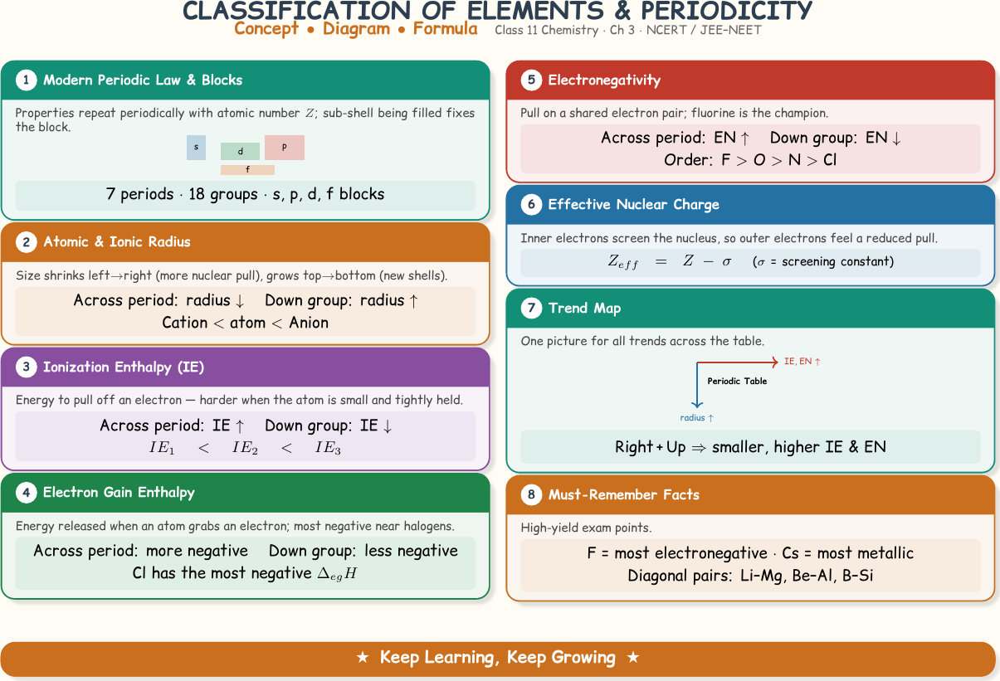

# Classification & Periodicity — Quick Recap

> One-page revision of the table's structure and every periodic trend. If anything is unfamiliar, jump back
> to [Concepts](./01-concepts.md) or the [Deep Dive](./04-deep-dive.md).

<!-- RENDERING: inside math use \cdot (not ·), \to for arrows, Z_eff, superscripts for configs. -->

---

## 📑 Index

- [The table at a glance](#table)
- [Blocks & position](#blocks)
- [Trends across & down](#trends)
- [Key anomalies](#anomalies)
- [Effective nuclear charge](#zeff)
- [Oxidation states & oxides](#oxides)

---

## The table at a glance

- **Modern periodic law:** properties are a periodic function of **atomic number $Z$**.
- **Period** = highest valence $n$ (7 periods). **Group** = valence configuration (18 groups).
- Elements per period: 2, 8, 8, 18, 18, 32, 32.

---

## Blocks & position

| Block | Valence config | Groups |
|---|---|---|
| s | $ns^{1-2}$ | 1–2 |
| p | $ns^2 np^{1-6}$ | 13–18 |
| d | $(n-1)d^{1-10}ns^{0-2}$ | 3–12 |
| f | $(n-2)f^{1-14}$ | lanthanoids/actinoids |

- Group (s-block) $=$ valence $s$ electrons; (p-block) $= 10 + (ns+np)$; (d-block) $= (n-1)d + ns$.

---

## Trends across (→) & down (↓)

| Property | Across → | Down ↓ |
|---|---|---|
| Atomic radius | decreases | increases |
| Ionisation enthalpy | increases | decreases |
| Electron gain enthalpy | more negative | less negative |
| Electronegativity | increases | decreases |
| Metallic character | decreases | increases |
| Oxide character | basic → acidic | more basic |

- Cation < atom < anion. Isoelectronic: more protons → smaller.
- Most electronegative: **F**; least: **Cs/Fr**.

---

## Key anomalies

- **IE:** B < Be, Al < Mg (filled $s^2$); O < N, S < P (half-filled $p^3$).
- **Electron gain enthalpy:** Cl **more** negative than F (F's small size → repulsion); noble gases positive.
- **Successive IE:** a large jump marks the noble-gas core → electrons before the jump = group valency.

---

## Effective nuclear charge (Slater)

$$Z_{\text{eff}} = Z - \sigma$$

| Contributing electrons | $\sigma$ each |
|---|---|
| Same group ($ns, np$) | $0.35$ ($0.30$ for $1s$) |
| $(n-1)$ shell (for an $s/p$ electron) | $0.85$ |
| $(n-2)$ and deeper | $1.00$ |
| Any inner electron (for a $d/f$ electron) | $1.00$ |

---

## Oxidation states & oxides

- Max oxidation state of a main-group element $\approx$ group number (group − 10 for groups 13–18).
- Oxide trend across a period: **basic → amphoteric (Al₂O₃, BeO, ZnO) → acidic**.
- Diagonal relationships: Li~Mg, Be~Al, B~Si.

> [!TIP]
> If stuck: everything follows from **size / $Z_{\text{eff}}$**. Smaller + higher $Z_{\text{eff}}$ → higher
> IE, more negative $\Delta_{eg}H$, higher electronegativity, more non-metallic/acidic.

---

## 📸 Formula sheet & notes (from Google Drive)

Reference sheets for this chapter, filed under [`notes/scans/`](./notes/scans/).

📄 Full chapter notes (from Google Drive): [`class_11_chem_ch03_classification-and-periodicity.pdf`](./notes/scans/class_11_chem_ch03_classification-and-periodicity.pdf)
📄 Formula sheet PDF (vector original): [`class_11_chem_ch03_formula-sheet.pdf`](./notes/scans/class_11_chem_ch03_formula-sheet.pdf)

---

**Back to:** [Concepts](./01-concepts.md) · [Solved Problems](./02-solved-numericals.md) · [Practice](./03-practice.md) · [Deep Dive](./04-deep-dive.md)
