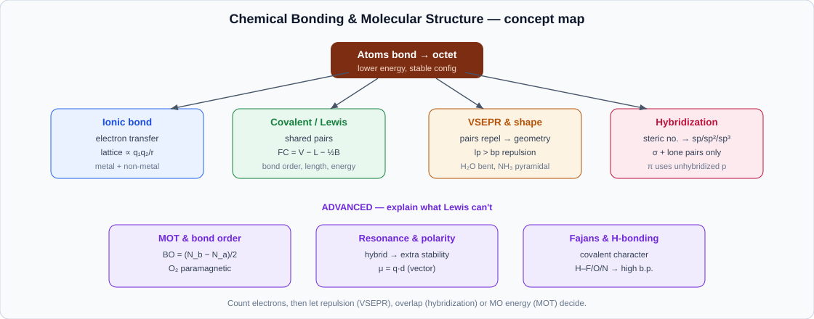

# Chemical Bonding & Molecular Structure — Concepts

> **Class 11 · Chemistry · Chapter 4** — Chemical Bonding and Molecular Structure (ionic & covalent bonding, VSEPR, hybridization, VBT, MOT, hydrogen bonding)
> **Prerequisites:** atomic structure (orbitals, electron configuration), periodic trends (electronegativity, size)
> **JEE weightage:** Very High — VSEPR shapes, hybridization, molecular-orbital bond order/magnetism, dipole moment and hydrogen bonding are tested every year in Main and underpin all of organic and inorganic chemistry.

<!-- RENDERING: inside math use \cdot (not ·), \to (not →), \text{...} for formulae, subscripts. Concept map is an SVG. -->

---

## 📑 Index

1. [Why atoms bond: the octet rule and its limits](#1-octet)
2. [Ionic (electrovalent) bonding and lattice enthalpy](#2-ionic)
3. [Covalent bonding, Lewis structures and formal charge](#3-covalent)
4. [Bond parameters: length, energy, order, angle, polarity](#4-parameters)
5. [VSEPR theory and molecular shapes](#5-vsepr)
6. [Valence bond theory and hybridization](#6-hybridization)
7. [Molecular orbital theory (MOT) and bond order](#7-mot)

**Advanced (JEE Main & Advanced depth):**

8. [Resonance, formal charge and the best structure](#8-resonance)
9. [Dipole moment, percentage ionic character and Fajans' rules](#9-dipole)
10. [Hydrogen bonding and its consequences](#10-hbond)

Related: [Solved Numericals](./02-solved-numericals.md) · [Practice Range](./03-practice.md) · [Deep Dive](./04-deep-dive.md) · [Formula Recap](./05-formula-recap.md)

---

## 🗺️ Concept map

---

## 1. Why atoms bond: the octet rule and its limits

Atoms combine to achieve a **stable noble-gas electron configuration** (usually eight electrons in the valence
shell — the **octet rule**). Bonding **lowers the energy** of the system.

**Exceptions to the octet rule:**
- **Incomplete octet:** $\text{BeCl}_2$ (4 e⁻), $\text{BF}_3$ (6 e⁻).
- **Expanded octet:** $\text{PCl}_5$ (10 e⁻), $\text{SF}_6$ (12 e⁻) — only for period-3+ elements with available $d$-orbitals.
- **Odd-electron species:** $\text{NO}$, $\text{NO}_2$ (cannot pair all electrons).

> [!IMPORTANT]
> The octet rule is a **useful guide, not a law**. Know its three failure types — incomplete octet (Be, B),
> expanded octet (P, S, period ≥ 3), and odd-electron molecules. These exceptions are a favourite JEE trap.

---

## 2. Ionic (electrovalent) bonding and lattice enthalpy

An **ionic bond** forms by **complete transfer** of electrons from a metal (low ionization energy) to a non-metal
(high electron affinity), giving oppositely charged ions held by **electrostatic attraction**.

**Lattice enthalpy** (energy released when gaseous ions form 1 mol of solid) measures ionic-bond strength:
$$\text{Lattice enthalpy} \propto \frac{q_1 q_2}{r}$$
— larger for **higher charges** and **smaller ions**.

Ionic character favoured by: low IE of metal, high electron gain enthalpy of non-metal, and high lattice enthalpy.
The **Born–Haber cycle** applies Hess's law to find lattice enthalpy from measurable steps.

> [!IMPORTANT]
> Lattice enthalpy $\propto \dfrac{q_1 q_2}{r}$ is the master relation: **charge dominates** (doubling a charge
> roughly doubles the numerator), and **smaller ions bond more strongly**. This explains melting points and
> solubility trends across ionic solids.

---

## 3. Covalent bonding, Lewis structures and formal charge

A **covalent bond** forms by **sharing** electron pairs so each atom completes its octet. **Lewis (electron-dot)
structures** show bonding pairs (lines) and lone pairs (dots).

**Steps to draw a Lewis structure:** count total valence electrons → place the least electronegative atom central
→ form single bonds → distribute remaining electrons as lone pairs (octets) → make multiple bonds if the central
atom is electron-deficient.

**Formal charge** on an atom:
$$\boxed{\text{FC} = V - L - \tfrac12 B}$$
where $V$ = valence electrons, $L$ = lone-pair (non-bonding) electrons, $B$ = bonding (shared) electrons.

> [!TIP]
> **Formal charge picks the best Lewis structure:** the preferred structure has formal charges closest to zero,
> and any negative formal charge on the **most electronegative** atom. Always check your total electron count
> before assigning bonds.

---

## 4. Bond parameters: length, energy, order, angle, polarity

| Parameter | Meaning / trend |
|---|---|
| **Bond length** | internuclear distance; **decreases** as bond order increases ($\text{C–C} > \text{C=C} > \text{C≡C}$) |
| **Bond enthalpy** | energy to break 1 mol of bonds; **increases** with bond order |
| **Bond order** | number of bonds between two atoms (1, 2, 3) |
| **Bond angle** | angle between two bonds at an atom (set by VSEPR / hybridization) |
| **Bond polarity** | unequal sharing when electronegativities differ → partial charges |

> [!IMPORTANT]
> The key inverse relationship: **higher bond order ⟹ shorter, stronger bond**. Bond length order
> $\text{single} > \text{double} > \text{triple}$ and bond energy order is the reverse — a reliable way to rank
> bonds without data.

---

## 5. VSEPR theory and molecular shapes

**Valence Shell Electron Pair Repulsion (VSEPR):** electron pairs around the central atom arrange to **minimise
repulsion**, fixing the geometry. Repulsion order: **lone pair–lone pair > lone pair–bond pair > bond pair–bond
pair**, so lone pairs compress bond angles.

| Electron pairs | Geometry | Bond angle | Example (no lone pairs) |
|---|---|---|---|
| 2 | Linear | $180°$ | $\text{BeCl}_2$ |
| 3 | Trigonal planar | $120°$ | $\text{BF}_3$ |
| 4 | Tetrahedral | $109.5°$ | $\text{CH}_4$ |
| 5 | Trigonal bipyramidal | $120°, 90°$ | $\text{PCl}_5$ |
| 6 | Octahedral | $90°$ | $\text{SF}_6$ |

Lone pairs change the **shape**: $\text{H}_2\text{O}$ (bent, $104.5°$), $\text{NH}_3$ (pyramidal, $107°$).

> [!IMPORTANT]
> Count the **total electron pairs** (bonds + lone pairs) on the central atom to get the electron geometry, then
> subtract lone pairs for the molecular **shape**. Lone pairs push harder, so $\text{NH}_3$ ($107°$) and
> $\text{H}_2\text{O}$ ($104.5°$) have angles **below** the tetrahedral $109.5°$.

---

## 6. Valence bond theory and hybridization

**Valence bond theory (VBT):** a bond forms by **overlap** of half-filled atomic orbitals; greater overlap ⟹
stronger bond. **Sigma ($\sigma$)** bonds form by head-on (axial) overlap; **pi ($\pi$)** bonds by sideways
overlap.

**Hybridization** = mixing of atomic orbitals to give equivalent hybrid orbitals that match the observed geometry:

| Hybridization | Shape | Angle | Example |
|---|---|---|---|
| $sp$ | Linear | $180°$ | $\text{BeCl}_2$, $\text{C}_2\text{H}_2$ |
| $sp^2$ | Trigonal planar | $120°$ | $\text{BF}_3$, $\text{C}_2\text{H}_4$ |
| $sp^3$ | Tetrahedral | $109.5°$ | $\text{CH}_4$, $\text{NH}_3$ |
| $sp^3d$ | Trigonal bipyramidal | $120°, 90°$ | $\text{PCl}_5$ |
| $sp^3d^2$ | Octahedral | $90°$ | $\text{SF}_6$ |

**Quick count:** steric number = (σ-bonds + lone pairs) gives the hybridization (2 → $sp$, 3 → $sp^2$, 4 → $sp^3$, 5 → $sp^3d$, 6 → $sp^3d^2$).

> [!IMPORTANT]
> Hybridization follows from the **steric number** (σ-bonds + lone pairs), *not* the number of atoms alone.
> $\pi$-bonds use **unhybridized** p-orbitals and don't count. A double bond = one σ + one π; a triple bond = one
> σ + two π.

---

## 7. Molecular orbital theory (MOT) and bond order

**MOT:** atomic orbitals combine to form **molecular orbitals** spread over the whole molecule — **bonding**
(lower energy, $\sigma, \pi$) and **antibonding** (higher energy, $\sigma^*, \pi^*$). Electrons fill MOs by energy
(Aufbau, Hund, Pauli).

**Bond order:**
$$\boxed{\text{Bond order} = \frac{N_b - N_a}{2}}$$
($N_b$ = electrons in bonding MOs, $N_a$ = in antibonding). A positive bond order ⟹ the molecule exists; higher
bond order ⟹ shorter, stronger bond.

**Magnetism:** unpaired electrons ⟹ **paramagnetic**; all paired ⟹ **diamagnetic**. (Famous case: $\text{O}_2$ is
paramagnetic — MOT predicts it, Lewis structures fail.)

> [!IMPORTANT]
> MOT succeeds exactly where Lewis/VBT fail: it explains the **paramagnetism of $\text{O}_2$**, the existence of
> ions like $\text{He}_2^+$ (bond order $\tfrac12$), and relative bond strengths. Learn the MO filling order for
> period-2 diatomics and the bond-order formula — high-yield in JEE.

---

<!-- ===== ADVANCED CLUSTER (required on every chapter) ===== -->

## 8. Resonance, formal charge and the best structure

When a single Lewis structure can't represent a molecule, the real structure is a **resonance hybrid** — a
weighted average of several contributing structures (e.g. $\text{CO}_3^{2-}$, $\text{O}_3$, benzene). Resonance
**delocalises** electrons and **lowers energy** (extra stability = resonance energy).

**Rules for a good contributor:** more covalent bonds, octets satisfied, formal charges minimised, negative formal
charge on the more electronegative atom.

> [!IMPORTANT]
> Resonance is **not** oscillation between forms — the molecule is a single, stable hybrid at all times. All
> resonance contributors must have the **same arrangement of atoms** (only electrons move) and the **same number
> of unpaired electrons**. Greater resonance ⟹ greater stability and equalised bond lengths.

---

## 9. Dipole moment, percentage ionic character and Fajans' rules

**Dipole moment** $\mu = q \times d$ (unit: debye, D) is a **vector**; a molecule's net dipole is the vector sum of
bond dipoles. Symmetric molecules ($\text{CO}_2$, $\text{BF}_3$, $\text{CCl}_4$) have $\mu = 0$ despite polar
bonds.

**Percentage ionic character** rises with the electronegativity difference $\Delta\text{EN}$ (Pauling); no bond is
100% ionic or 100% covalent.

**Fajans' rules** (covalent character in an "ionic" bond): a bond is more **covalent** when the cation is **small
and highly charged** (high polarising power) and the anion is **large and highly charged** (easily polarised).

> [!IMPORTANT]
> $\mu = 0$ does **not** mean non-polar bonds — it means the bond dipoles **cancel by symmetry** ($\text{CO}_2$
> linear, $\text{CCl}_4$ tetrahedral). Use the molecular **shape** to decide if dipoles cancel. Fajans' rules
> explain why "ionic" compounds like $\text{AlCl}_3$ show covalent behaviour.

---

## 10. Hydrogen bonding and its consequences

A **hydrogen bond** is an attraction between an H atom bonded to a highly electronegative atom (**F, O, N**) and a
lone pair on another such atom. It is **weaker than a covalent bond** but stronger than ordinary dipole forces.

- **Intermolecular** H-bonding (between molecules): raises boiling point, as in $\text{H}_2\text{O}$, $\text{HF}$,
  $\text{NH}_3$, alcohols.
- **Intramolecular** H-bonding (within one molecule): e.g. $o$-nitrophenol — lowers boiling point relative to its
  isomers.

> [!IMPORTANT]
> Hydrogen bonding explains the **anomalously high boiling point of water**, the lower density of ice, and the
> solubility of alcohols/amines in water. It requires H bonded directly to **F, O or N** — the three small, highly
> electronegative atoms. This is one of the most frequently applied ideas across the whole syllabus.

---

## ✅ One-line summary

> Atoms bond to reach a **noble-gas octet**: metals + non-metals form **ionic** bonds (strength
> $\propto q_1q_2/r$), non-metals **share** electrons in **covalent** bonds drawn as Lewis structures (best one
> minimises **formal charge** $= V - L - \tfrac12 B$). **VSEPR** predicts shape from electron-pair repulsion and
> **hybridization** (steric number → $sp$/$sp^2$/$sp^3$...) gives the geometry; **MOT** (bond order
> $= \tfrac{N_b - N_a}{2}$) explains bond strength and the paramagnetism of $\text{O}_2$. Advanced: **resonance**
> stabilises delocalised systems, **dipole moment** ($\mu = q\,d$, a vector) and **Fajans' rules** gauge polarity,
> and **hydrogen bonding** (H–F/O/N) governs boiling points and water's anomalies.

**Next:** [Solved Numericals →](./02-solved-numericals.md)
