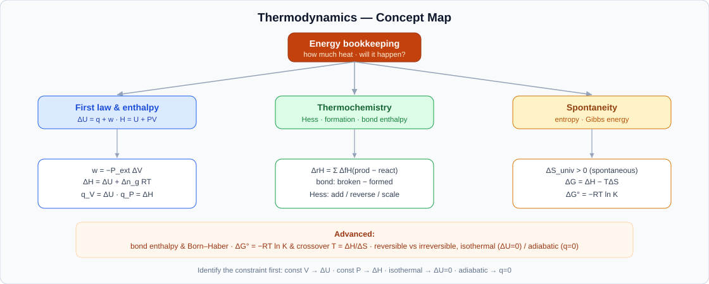
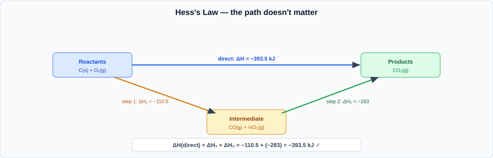

# Thermodynamics — Concepts

> **Class 11 · Chemistry · Chapter 5** — Chemical Thermodynamics (first law, enthalpy, thermochemistry, entropy, Gibbs energy)
> **Branch:** Physical Chemistry
> **Prerequisites:** [Mole concept](../01-mole-concept/01-concepts.md), ideal-gas idea, basic calculus/logarithms, sign conventions
> **JEE weightage:** Very High — first-law numericals, Hess's law, bond enthalpy and ΔG spontaneity appear every year in Main, and the ΔG°–K link feeds equilibrium and electrochemistry in Advanced.

<!-- RENDERING: inside math use \cdot (not ·), \Delta for change, \to for arrows, degree sign as ^\circ. Concept map is an SVG. -->

---

## 📑 Index

1. [System, surroundings and state functions](#1-system)
2. [Internal energy, work and the first law](#2-first-law)
3. [Enthalpy and heat capacities](#3-enthalpy)
4. [Thermochemistry: enthalpies of reaction](#4-thermochemistry)
5. [Hess's law](#5-hess)
6. [Entropy and the second law](#6-entropy)
7. [Gibbs energy and spontaneity](#7-gibbs)

**Advanced (JEE Main & Advanced depth):**

8. [Bond enthalpy, Kirchhoff and thermochemical cycles](#8-bond-enthalpy)
9. [ΔG°, the equilibrium constant and the spontaneity switch](#9-dg-k)
10. [Reversible vs irreversible work; isothermal and adiabatic expansion](#10-work)

Related: [Solved Numericals](./02-solved-numericals.md) · [Practice Range](./03-practice.md) · [Deep Dive](./04-deep-dive.md) · [Formula Recap](./05-formula-recap.md)

---

## 🗺️ Concept map

---

## 1. System, surroundings and state functions

- **System:** the part of the universe under study. **Surroundings:** everything else. **Boundary:** separates them.
- **Types:** **open** (exchanges matter + energy), **closed** (energy only), **isolated** (neither).

| Term | Meaning |
|---|---|
| **State function** | depends only on state, not path ($U, H, S, G, T, P, V$) |
| **Path function** | depends on how the change is made ($q$ heat, $w$ work) |
| **Extensive** | depends on amount ($U, H, V, n$, mass) |
| **Intensive** | independent of amount ($T, P$, density, molar quantities) |

> [!IMPORTANT]
> **State functions** ($\Delta U, \Delta H$) depend only on initial and final states — the path cancels,
> which is exactly what lets Hess's law work. **Heat $q$ and work $w$ are path functions** — their values
> depend on how the process is carried out, even between the same two states.

---

## 2. Internal energy, work and the first law

**Internal energy $U$** is the total energy of a system. The **first law** (conservation of energy):
$$\boxed{\Delta U = q + w}$$

**Sign convention (IUPAC):** heat absorbed by the system and work done **on** the system are **positive**.

For pressure–volume work (gas expanding against external pressure $P_{\text{ext}}$):
$$w = -P_{\text{ext}}\,\Delta V$$

> [!WARNING]
> Watch the sign convention — in the modern (IUPAC) convention, $w = -P_{\text{ext}}\Delta V$: a gas
> **expanding** ($\Delta V > 0$) does work *on* the surroundings, so $w$ is **negative**. (Older texts write
> $\Delta U = q - w$ with $w$ = work done *by* the system; be consistent with whichever your book uses.)

---

## 3. Enthalpy and heat capacities

Most reactions happen at **constant pressure**, where the heat exchanged is the **enthalpy change**:
$$\boxed{H = U + PV}, \qquad \Delta H = \Delta U + \Delta(PV)$$

For ideal gases, $\Delta(PV) = \Delta n_g RT$, so:
$$\boxed{\Delta H = \Delta U + \Delta n_g RT}$$
where $\Delta n_g$ = (moles of gaseous products − gaseous reactants).

| Condition | Heat exchanged |
|---|---|
| Constant volume | $q_V = \Delta U$ |
| Constant pressure | $q_P = \Delta H$ |

**Heat capacities:** $C_P - C_V = R$ (ideal gas, per mole); $q = nC\,\Delta T$.

> [!NOTE]
> $\Delta H$ and $\Delta U$ are nearly equal for reactions with no change in gas moles ($\Delta n_g = 0$) or
> only solids/liquids. When gas moles change, the $\Delta n_g RT$ term matters — a very common exam point.
> **Exothermic:** $\Delta H < 0$ (heat released); **endothermic:** $\Delta H > 0$.

---

## 4. Thermochemistry: enthalpies of reaction

Standard enthalpy changes (at $298\ \mathrm{K}$, $1\ \mathrm{bar}$, denoted $\Delta H^\circ$):

| Type | Definition |
|---|---|
| **Formation** $\Delta_f H^\circ$ | 1 mole of compound from elements in standard states |
| **Combustion** $\Delta_c H^\circ$ | 1 mole burned completely in O₂ (always exothermic) |
| **Neutralisation** | acid + base → 1 mole water ($\approx -57.1\ \mathrm{kJ}$ for strong acid + strong base) |
| **Sublimation / fusion / vaporisation** | phase changes |

The enthalpy of a reaction from formation enthalpies:
$$\Delta_r H^\circ = \sum \Delta_f H^\circ(\text{products}) - \sum \Delta_f H^\circ(\text{reactants})$$

> [!IMPORTANT]
> By definition, $\Delta_f H^\circ$ of an **element in its standard state is zero** (e.g. O₂(g), C(graphite),
> H₂(g)). The "products minus reactants" rule with formation enthalpies is the workhorse for computing any
> reaction enthalpy.

---

## 5. Hess's law

> **Hess's law:** the total enthalpy change of a reaction is the same whether it occurs in one step or
> several — because $H$ is a state function.

So you can **add, reverse and scale** thermochemical equations (reversing flips the sign of $\Delta H$;
scaling multiplies it) to build a target reaction whose $\Delta H$ you want.

> [!TIP]
> Treat thermochemical equations like algebra: line up the given reactions so that unwanted species cancel,
> reversing (flip sign) and multiplying (scale $\Delta H$) as needed, then add. The sum's $\Delta H$ is your
> answer — this is how enthalpies that can't be measured directly are found.

---

## 6. Entropy and the second law

**Entropy $S$** measures disorder/randomness (a state function). The **second law**: the entropy of the
**universe** increases in any spontaneous process:
$$\Delta S_{\text{universe}} = \Delta S_{\text{system}} + \Delta S_{\text{surroundings}} > 0 \ (\text{spontaneous})$$

- Entropy increases: solid → liquid → gas, dissolving, mixing, more moles of gas.
- $\Delta S_{\text{surr}} = -\dfrac{\Delta H_{\text{sys}}}{T}$ (at constant $T, P$).

> [!NOTE]
> A process can be spontaneous even if the **system's** entropy decreases, provided the surroundings gain
> more (e.g. freezing water below 0 °C). The real criterion is always $\Delta S_{\text{universe}} > 0$ —
> which Gibbs energy repackages into a system-only test (Section 7).

---

## 7. Gibbs energy and spontaneity

**Gibbs free energy** combines enthalpy and entropy into a single, system-only spontaneity criterion:
$$\boxed{\Delta G = \Delta H - T\Delta S}$$

| $\Delta G$ | Process |
|---|---|
| $< 0$ | spontaneous (feasible) |
| $= 0$ | at equilibrium |
| $> 0$ | non-spontaneous |

> [!IMPORTANT]
> Spontaneity depends on all three of $\Delta H$, $\Delta S$ and $T$:
> - $\Delta H < 0, \Delta S > 0$: spontaneous at **all** temperatures.
> - $\Delta H > 0, \Delta S < 0$: non-spontaneous at **all** temperatures.
> - Mixed signs: temperature decides — there is a crossover $T = \Delta H/\Delta S$ where $\Delta G$ changes sign.

---

<!-- ===== ADVANCED CLUSTER (required on every chapter) ===== -->

## 8. Bond enthalpy, Kirchhoff and thermochemical cycles

**Bond enthalpy** is the energy to break one mole of a bond in the gas phase. For a gaseous reaction:
$$\Delta_r H = \sum (\text{bond enthalpies of bonds broken}) - \sum (\text{bond enthalpies of bonds formed})$$

**Born–Haber cycle:** a Hess's-law cycle for ionic-compound formation (sublimation + ionisation + dissociation
+ electron gain + lattice enthalpy). **Kirchhoff's equation** gives the temperature dependence of $\Delta H$:
$$\Delta H_{T_2} = \Delta H_{T_1} + \Delta C_P\,(T_2 - T_1)$$

> [!IMPORTANT]
> Bond-enthalpy calculations are "broken minus formed" (note the order is reversed from the formation-enthalpy
> rule). The Born–Haber cycle is just Hess's law applied to a loop, letting you solve for a quantity that
> can't be measured directly (usually lattice or electron-gain enthalpy).

---

## 9. ΔG°, the equilibrium constant and the spontaneity switch

Standard Gibbs energy links thermodynamics to **equilibrium**:
$$\boxed{\Delta G^\circ = -RT\ln K}$$

- $\Delta G^\circ < 0 \Rightarrow K > 1$ (products favoured); $\Delta G^\circ > 0 \Rightarrow K < 1$.
- Under non-standard conditions: $\Delta G = \Delta G^\circ + RT\ln Q$.

**Temperature of the spontaneity switch** (where $\Delta G = 0$):
$$T = \frac{\Delta H}{\Delta S}$$
Above/below this $T$, a reaction with mixed $\Delta H, \Delta S$ signs flips between spontaneous and not.

> [!TIP]
> $\Delta G^\circ = -RT\ln K$ is the bridge from this chapter to equilibrium and electrochemistry
> ($\Delta G^\circ = -nFE^\circ$). A negative $\Delta G^\circ$ means a large $K$ (reaction goes forward); the
> crossover temperature $\Delta H/\Delta S$ answers "above what temperature does this become feasible?"

---

## 10. Reversible vs irreversible work; isothermal and adiabatic expansion

Work depends on the path. For an **ideal gas** expanding:

| Process | Work done by gas |
|---|---|
| Irreversible (against constant $P_{\text{ext}}$) | $w = -P_{\text{ext}}\,\Delta V$ |
| Reversible isothermal | $w = -nRT\ln\dfrac{V_2}{V_1} = -2.303\,nRT\log\dfrac{V_2}{V_1}$ |
| Reversible adiabatic | $q = 0$, so $\Delta U = w = nC_V\Delta T$ |

- **Isothermal** (constant $T$): for an ideal gas $\Delta U = 0$, so $q = -w$.
- **Adiabatic** (no heat exchange): $q = 0$, so $\Delta U = w$; temperature changes; $PV^\gamma = $ const.

> [!IMPORTANT]
> **Reversible work is the maximum** work a system can do — the reversible isothermal path extracts more work
> than any irreversible one between the same states. In an **isothermal** ideal-gas process $\Delta U = 0$
> (so $q = -w$); in an **adiabatic** one $q = 0$ (so $\Delta U = w$). Knowing which quantity is zero is half
> the battle in these problems.

---

## ✅ One-line summary

> The **first law** $\Delta U = q + w$ (with $w = -P_{\text{ext}}\Delta V$) conserves energy; at constant
> pressure the heat is the **enthalpy** $\Delta H = \Delta U + \Delta n_g RT$. Reaction enthalpies come from
> formation enthalpies, **Hess's law** and bond enthalpies. Spontaneity is set by
> $\Delta S_{\text{universe}} > 0$, repackaged as $\boxed{\Delta G = \Delta H - T\Delta S}$ (negative =
> spontaneous), and $\Delta G^\circ = -RT\ln K$ links it all to equilibrium.

**Next:** [Solved Numericals →](./02-solved-numericals.md)
