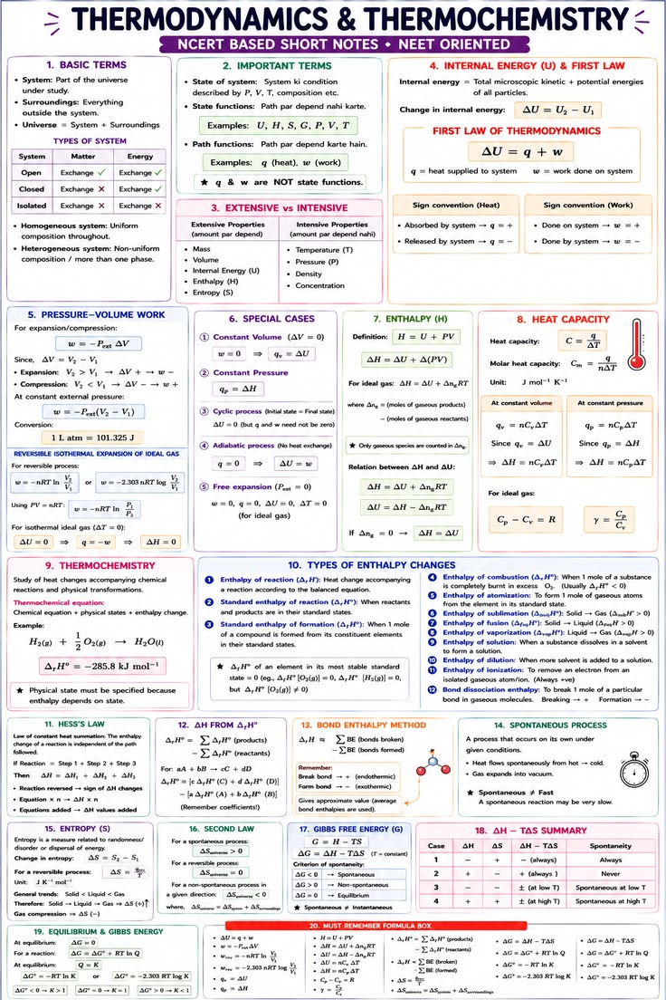
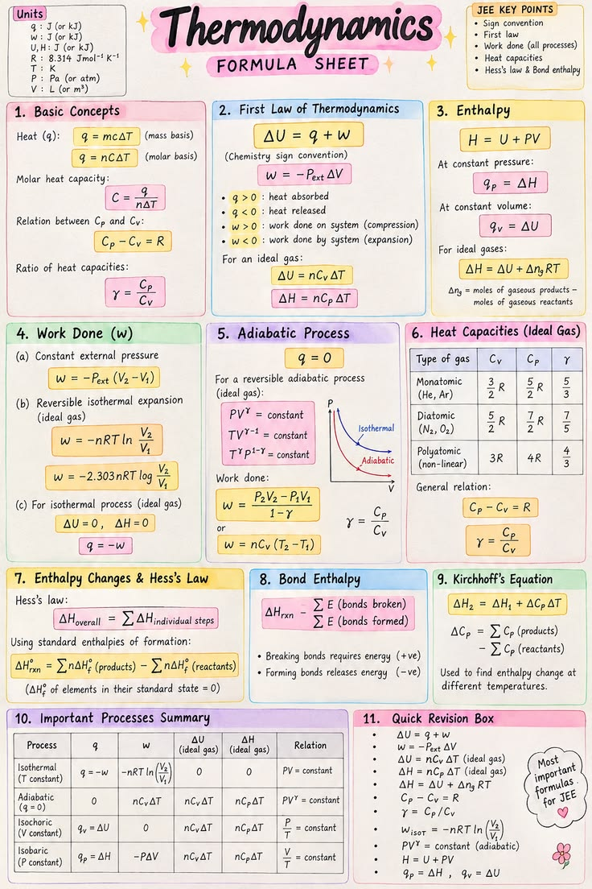

# Thermodynamics — Quick Formula Recap

> One-page revision of the first law, enthalpy, thermochemistry, entropy and Gibbs energy. If anything is
> unfamiliar, jump back to [Concepts](./01-concepts.md) or the [Deep Dive](./04-deep-dive.md).

<!-- RENDERING: inside math use \cdot (not ·), \Delta, \to, ^\circ. -->

---

## 📑 Index

- [First law & work](#first-law)
- [Enthalpy & heat capacity](#enthalpy)
- [Thermochemistry](#thermochemistry)
- [Entropy](#entropy)
- [Gibbs energy & spontaneity](#gibbs)
- [Reversible/irreversible work](#work)
- [Constants](#constants)

---

## First law & work

$$\Delta U = q + w, \qquad w = -P_{\text{ext}}\,\Delta V$$

- $q_V = \Delta U$ (constant V); $q_P = \Delta H$ (constant P).
- IUPAC: heat in and work on the system are positive.

---

## Enthalpy & heat capacity

$$H = U + PV, \qquad \Delta H = \Delta U + \Delta n_g RT$$
$$q = nC\,\Delta T, \qquad C_P - C_V = R$$

- Exothermic: $\Delta H < 0$; endothermic: $\Delta H > 0$. Count only **gas** moles in $\Delta n_g$.

---

## Thermochemistry

$$\Delta_r H = \sum\Delta_f H(\text{prod}) - \sum\Delta_f H(\text{react})$$
$$\Delta_r H = \sum BE(\text{broken}) - \sum BE(\text{formed}) \ (\text{gas phase})$$

- **Hess's law:** add/reverse/scale equations (reverse → flip sign; scale → multiply $\Delta H$).
- Element in standard state → $\Delta_f H^\circ = 0$.
- Strong acid + strong base neutralisation $\approx -57.1\ \mathrm{kJ/mol}$ water.
- Kirchhoff: $\Delta H_{T_2} = \Delta H_{T_1} + \Delta C_P(T_2 - T_1)$.

---

## Entropy

$$\Delta S_{\text{univ}} = \Delta S_{\text{sys}} + \Delta S_{\text{surr}} > 0 \ (\text{spontaneous})$$
$$\Delta S_{\text{surr}} = -\frac{\Delta H_{\text{sys}}}{T}, \qquad \Delta S_{\text{transition}} = \frac{\Delta H}{T}$$

- Entropy: gas > liquid > solid; rises on mixing, dissolving, more gas moles.

---

## Gibbs energy & spontaneity

$$\boxed{\Delta G = \Delta H - T\Delta S}, \qquad \Delta G^\circ = -RT\ln K = -2.303\,RT\log K$$
$$\Delta G = \Delta G^\circ + RT\ln Q$$

| $\Delta H$ | $\Delta S$ | Spontaneous |
|---|---|---|
| − | + | all T |
| + | − | never |
| − | − | below $T=\Delta H/\Delta S$ |
| + | + | above $T=\Delta H/\Delta S$ |

- $\Delta G < 0$ spontaneous, $=0$ equilibrium, $>0$ non-spontaneous.

---

## Reversible/irreversible work (ideal gas)

| Process | Result |
|---|---|
| Irreversible (const $P_{\text{ext}}$) | $w = -P_{\text{ext}}\Delta V$ |
| Reversible isothermal | $w = -2.303\,nRT\log(V_2/V_1)$ |
| Isothermal | $\Delta U = 0 \Rightarrow q = -w$ |
| Adiabatic | $q = 0 \Rightarrow \Delta U = w = nC_V\Delta T$ |

Reversible work is the **maximum**.

---

## Constants

| Quantity | Value |
|---|---|
| $R$ | $8.314\ \mathrm{J\,K^{-1}mol^{-1}} = 0.0821\ \mathrm{L\,atm\,K^{-1}mol^{-1}}$ |
| $1\ \mathrm{L\,atm}$ | $101.3\ \mathrm{J}$ |
| $2.303R$ | $19.15\ \mathrm{J\,K^{-1}mol^{-1}}$ |
| Standard | $298\ \mathrm{K}$, $1\ \mathrm{bar}$ |

> [!TIP]
> If stuck: identify the constraint (const V → $\Delta U$; const P → $\Delta H$; isothermal → $\Delta U=0$;
> adiabatic → $q=0$); for spontaneity compute $\Delta G = \Delta H - T\Delta S$; for $K$ use $\Delta G^\circ = -2.303RT\log K$.

---

## 📸 Handwritten Notes (originals)

Your own formula sheets for this chapter, filed under [`notes/scans/`](./notes/scans/), plus the full chapter notes PDF.

📄 Full chapter notes (from Google Drive): [`class_11_chem_ch05_thermodynamics.pdf`](./notes/scans/class_11_chem_ch05_thermodynamics.pdf)

---

**Back to:** [Concepts](./01-concepts.md) · [Solved Numericals](./02-solved-numericals.md) · [Practice](./03-practice.md) · [Deep Dive](./04-deep-dive.md)
