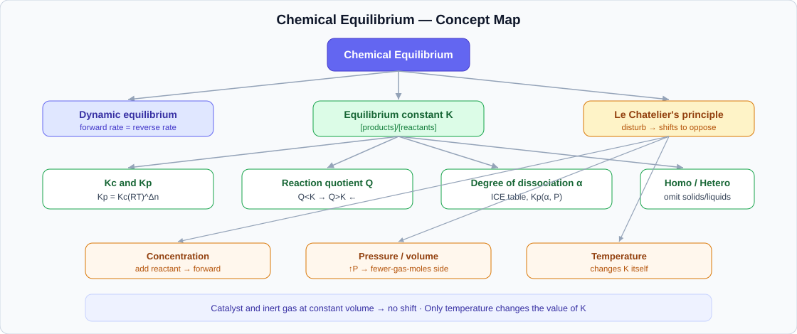
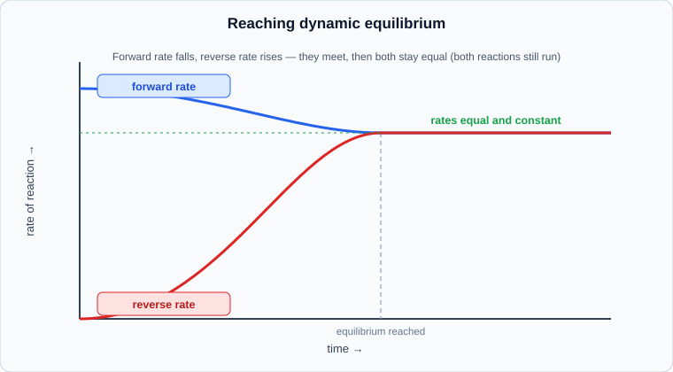
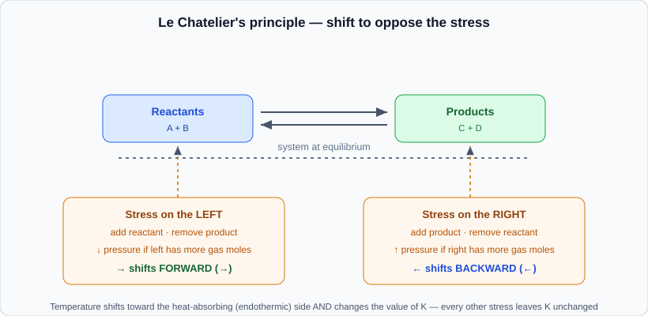

# Chemical Equilibrium — Concepts

> **Class 11 · Chemistry · Chapter 6** — Equilibrium (chemical-equilibrium half)
> **Branch:** Physical Chemistry
> **Prerequisites:** mole concept, writing & balancing equations, basic logarithms, ideal-gas idea
> **JEE weightage:** High — $K_c$/$K_p$ numericals and Le Chatelier reasoning appear every year, and this chapter is the foundation for ionic equilibrium, electrochemistry and thermodynamics.

<!-- RENDERING: inside math use \cdot (not ·), \rightleftharpoons for equilibrium, \Delta n. Concept map is an SVG. -->

---

## 📑 Index

1. [Reversible reactions and dynamic equilibrium](#1-reversible-reactions-and-dynamic-equilibrium)
2. [Law of mass action and the equilibrium constant Kc](#2-law-of-mass-action-and-the-equilibrium-constant-kc)
3. [Kp and the relation between Kp and Kc](#3-kp-and-the-relation-between-kp-and-kc)
4. [Properties of the equilibrium constant](#4-properties-of-the-equilibrium-constant)
5. [Reaction quotient Q — which way will it go?](#5-reaction-quotient-q--which-way-will-it-go)
6. [Degree of dissociation](#6-degree-of-dissociation)
7. [Le Chatelier's principle](#7-le-chateliers-principle)
8. [Homogeneous vs heterogeneous equilibria](#8-homogeneous-vs-heterogeneous-equilibria)

Related: [Solved Numericals](./02-solved-numericals.md) · [Practice Range](./03-practice.md) · [Deep Dive](./04-deep-dive.md) · [Formula Recap](./05-formula-recap.md)

---

## 🗺️ Concept map

---

## 1. Reversible reactions and dynamic equilibrium

Some reactions go only one way (irreversible). Many, in a closed container, go **both ways** — products re-form reactants. We write these with a double half-arrow:
$$\text{N}_2 + 3\text{H}_2 \rightleftharpoons 2\text{NH}_3$$

At the start, the **forward** rate is high (lots of reactants) and the **reverse** rate is zero. As reactants convert to products, the forward rate falls and the reverse rate rises. Eventually the two rates become **equal** — this is **equilibrium**.

> [!IMPORTANT]
> Equilibrium is **dynamic, not static.** Both reactions are still happening — they just happen at the *same rate*, so the amounts of everything stay constant. Nothing has stopped; the forward and reverse traffic are simply balanced.

**Characteristics of equilibrium:**
- Reached only in a **closed system** (nothing added or escapes).
- Forward rate $=$ reverse rate; concentrations become **constant** (not equal).
- Can be approached from **either side** — same final state.
- A **catalyst** speeds both directions equally, so it reaches equilibrium faster but does **not** change the equilibrium position.

---

## 2. Law of mass action and the equilibrium constant Kc

The **law of mass action** says the rate of a reaction is proportional to the product of the active masses (concentrations) of the reactants. Applying it to both directions and setting the rates equal gives the **equilibrium constant**.

For a general reaction:
$$aA + bB \rightleftharpoons cC + dD$$
$$\boxed{K_c = \frac{[C]^c\,[D]^d}{[A]^a\,[B]^b}}$$

- Square brackets are **equilibrium molar concentrations** (mol/L).
- Each concentration is raised to the power of its **stoichiometric coefficient**.
- Products on top, reactants on the bottom.

A **large $K_c$** ($\gg 1$) means products dominate at equilibrium (reaction nearly complete); a **small $K_c$** ($\ll 1$) means reactants dominate (reaction barely proceeds).

> [!NOTE]
> The units of $K_c$ depend on $\Delta n$ (the change in moles of gas/solute): $K_c$ has units $(\text{mol/L})^{\Delta n}$. If moles are unchanged ($\Delta n = 0$), $K_c$ is dimensionless.

---

## 3. Kp and the relation between Kp and Kc

For **gaseous** equilibria it is often easier to use **partial pressures** instead of concentrations:
$$K_p = \frac{(p_C)^c\,(p_D)^d}{(p_A)^a\,(p_B)^b}$$

Using the ideal gas law $pV = nRT$ (so $p = \frac{n}{V}RT = C\,RT$), $K_p$ and $K_c$ are linked by:
$$\boxed{K_p = K_c\,(RT)^{\Delta n}}, \qquad \Delta n = (\text{moles of gaseous products}) - (\text{moles of gaseous reactants})$$

- If $\Delta n = 0$: $K_p = K_c$ (e.g. $\text{H}_2 + \text{I}_2 \rightleftharpoons 2\text{HI}$).
- If $\Delta n > 0$: $K_p > K_c$.
- If $\Delta n < 0$: $K_p < K_c$.

> [!WARNING]
> **Only gaseous species count in $\Delta n$.** Pure solids and pure liquids are excluded (Section 8). Use $R = 0.0821\ \text{L atm K}^{-1}\text{mol}^{-1}$ when pressures are in atm, or $R = 0.0831\ \text{L bar K}^{-1}\text{mol}^{-1}$ for bar — match $R$ to the pressure unit.

---

## 4. Properties of the equilibrium constant

The equilibrium constant behaves in predictable ways when you manipulate the equation — these are routinely tested:

| Operation on the reaction | Effect on $K$ |
|---|---|
| **Reverse** the reaction | $K' = \dfrac{1}{K}$ |
| **Multiply** all coefficients by $n$ | $K' = K^n$ |
| **Divide** all coefficients by $n$ | $K' = K^{1/n}$ |
| **Add** two reactions | $K = K_1 \times K_2$ |

- $K$ depends **only on temperature** — not on initial concentrations, pressure, volume, or a catalyst.
- Changing $T$ changes $K$: for an **exothermic** reaction $K$ **decreases** as $T$ rises; for **endothermic**, $K$ **increases** with $T$.

> [!TIP]
> If a question gives $K$ for one way and asks for the reverse, or for a doubled/halved equation, don't recompute from scratch — just apply the table ($1/K$, $K^n$, $K^{1/n}$).

---

## 5. Reaction quotient Q — which way will it go?

The **reaction quotient $Q$** has the *same form* as $K$ but uses the **current** (not necessarily equilibrium) concentrations. Comparing $Q$ to $K$ tells you the direction the reaction must shift to reach equilibrium:

$$\boxed{\begin{aligned} Q < K &\;\Rightarrow\; \text{too few products} \to \text{shifts forward (→)} \\ Q = K &\;\Rightarrow\; \text{at equilibrium} \\ Q > K &\;\Rightarrow\; \text{too many products} \to \text{shifts backward (←)} \end{aligned}}$$

> [!TIP]
> Think of $Q$ as a "snapshot" and $K$ as the "target." The system always moves to make $Q$ approach $K$. This single comparison predicts the direction of *any* reaction mixture without extra calculation.

---

## 6. Degree of dissociation

For reactions where a species breaks apart (dissociates), the **degree of dissociation $\alpha$** is the fraction of the original that has dissociated at equilibrium ($0 \leq \alpha \leq 1$).

**Example — $\text{PCl}_5 \rightleftharpoons \text{PCl}_3 + \text{Cl}_2$**, starting with 1 mole in volume $V$:

| | $\text{PCl}_5$ | $\text{PCl}_3$ | $\text{Cl}_2$ |
|---|---|---|---|
| Initial | 1 | 0 | 0 |
| At eqm | $1-\alpha$ | $\alpha$ | $\alpha$ |

Total moles at equilibrium $= 1+\alpha$. In terms of total pressure $P$:
$$K_p = \frac{\alpha^2}{1-\alpha^2}\,P$$

For a reaction of type $A \rightleftharpoons nB$, the total moles rise, so **increasing pressure pushes dissociation back** (fewer moles side is favoured) — a Le Chatelier result (Section 7).

> [!NOTE]
> Set up these problems with an **ICE table** (Initial, Change, Equilibrium) in moles, convert to concentrations or partial pressures, then substitute into $K_c$ or $K_p$. The ICE table is the single most reliable tool for every equilibrium numerical.

---

## 7. Le Chatelier's principle

> **If a system at equilibrium is disturbed, it shifts in the direction that partially undoes the disturbance.**

This one principle predicts the qualitative effect of every change:

| Change (stress) | Equilibrium shifts… |
|---|---|
| **Add reactant** (↑ its conc.) | forward (to consume it) |
| **Add product** | backward |
| **Remove product** | forward |
| **Increase pressure** (↓ volume) | toward the side with **fewer gas moles** |
| **Decrease pressure** | toward the side with **more gas moles** |
| **Increase temperature** | in the **endothermic** direction (absorbs heat) |
| **Decrease temperature** | in the **exothermic** direction |
| **Add a catalyst** | **no shift** (reaches equilibrium faster only) |
| **Add inert gas at constant volume** | **no shift** (partial pressures unchanged) |
| **Add inert gas at constant pressure** | toward the side with **more gas moles** |

> [!IMPORTANT]
> Two classic traps: a **catalyst never shifts** the position of equilibrium (it changes neither $K$ nor the amounts, only the speed); and **adding inert gas at constant volume does nothing** (it raises total pressure but leaves each species' partial pressure — and hence $Q$ — unchanged). Only *constant-pressure* inert-gas addition causes a shift.

---

## 8. Homogeneous vs heterogeneous equilibria

- **Homogeneous:** all species in the same phase (e.g. all gases, or all in solution).
- **Heterogeneous:** more than one phase (e.g. a solid reacting with a gas).

In a heterogeneous equilibrium, **pure solids and pure liquids are left out** of the $K$ expression, because their "concentration" (density/molar mass) is constant.

**Example — $\text{CaCO}_3(s) \rightleftharpoons \text{CaO}(s) + \text{CO}_2(g)$:**
$$K_c = [\text{CO}_2], \qquad K_p = p_{\text{CO}_2}$$

Only the gas appears. This is why limestone decomposition has an equilibrium "decomposition pressure" that depends only on temperature.

> [!WARNING]
> Never write $[\text{CaCO}_3]$ or $[\text{CaO}]$ in the expression. Omitting pure solids/liquids is the most common error in heterogeneous-equilibrium questions — and it also means they don't count in $\Delta n$ for $K_p = K_c(RT)^{\Delta n}$.

---

## ✅ One-line summary

> At equilibrium the forward and reverse rates are equal (dynamic, not static). The ratio
> $K_c = \dfrac{[\text{products}]}{[\text{reactants}]}$ (each to its coefficient) is fixed at a given
> temperature; $K_p = K_c(RT)^{\Delta n}$ for gases; comparing $Q$ to $K$ predicts the direction; and
> Le Chatelier's principle tells you how the position moves when you disturb it.

**Next:** [Solved Numericals →](./02-solved-numericals.md)
