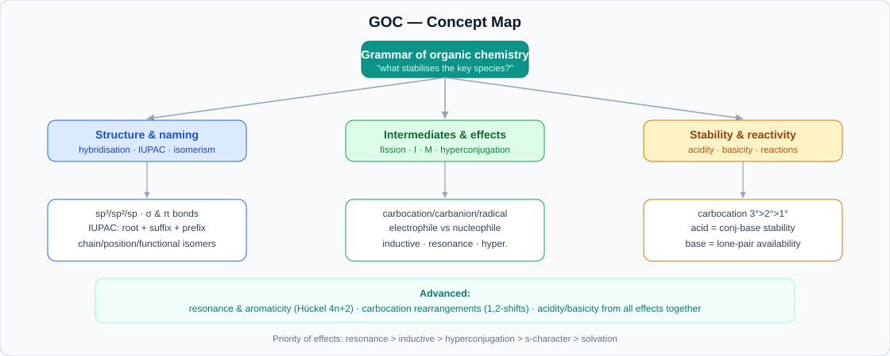
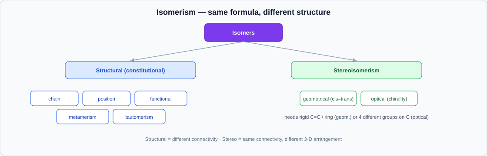
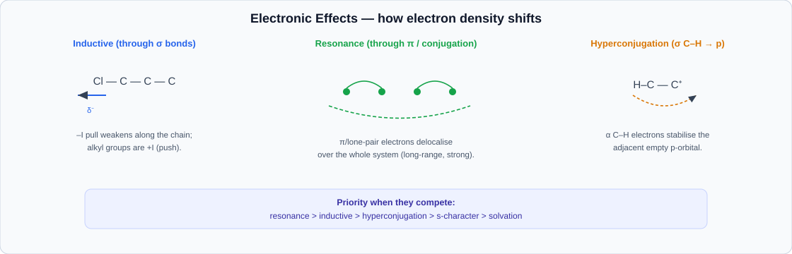

# Organic Chemistry — Basic Principles (GOC) — Concepts

> **Class 11 · Chemistry · Chapter 8** — Organic Chemistry: Some Basic Principles and Techniques
> **Branch:** Organic Chemistry
> **Prerequisites:** [Structure of Atom](../02-structure-of-atom/01-concepts.md) (hybridisation, electronegativity), chemical bonding (covalent bonds, shapes), [Classification & Periodicity](../03-classification-periodicity/01-concepts.md)
> **JEE weightage:** Very High — GOC is the foundation of **all** organic chemistry. IUPAC naming, electronic effects, intermediate stability and acid/base reasoning are asked every year and underpin every reaction mechanism in Classes 11–12.

<!-- RENDERING: inside math use \cdot (not ·), \to for arrows, \delta for partial charge, \text{} for groups/formulas, curly arrows described in words. Structures are SVGs. -->

---

## 📑 Index

1. [Classification, hybridisation and shapes](#1-classification)
2. [IUPAC nomenclature](#2-iupac)
3. [Isomerism](#3-isomerism)
4. [Bond fission and reaction intermediates](#4-fission)
5. [Electronic effects: inductive, resonance, hyperconjugation](#5-electronic-effects)
6. [Types of organic reactions and reagents](#6-reactions)
7. [Stability of intermediates and acid–base strength](#7-stability)

**Advanced (JEE Main & Advanced depth):**

8. [Resonance, aromaticity and resonance energy](#8-resonance)
9. [Carbocation stability, hyperconjugation counting and rearrangements](#9-carbocation)
10. [Acidity and basicity, reasoned from all effects together](#10-acidity)

Related: [Solved Problems](./02-solved-numericals.md) · [Practice Range](./03-practice.md) · [Deep Dive](./04-deep-dive.md) · [Formula Recap](./05-formula-recap.md)

---

## 🗺️ Concept map

---

## 1. Classification, hybridisation and shapes

Organic compounds are carbon compounds. Carbon's versatility comes from **catenation** (C–C chains) and
**tetravalency** with three hybridisation states:

| Hybridisation | Shape | Bond angle | σ/π | Example |
|---|---|---|---|---|
| $sp^3$ | tetrahedral | $109.5°$ | 4σ | methane, alkanes |
| $sp^2$ | trigonal planar | $120°$ | 3σ + 1π | ethene, benzene |
| $sp$ | linear | $180°$ | 2σ + 2π | ethyne |

- A **σ bond** is a head-on overlap (strong, free rotation); a **π bond** is a sideways overlap (weaker, no rotation, source of unsaturation).
- Compounds are classified as **acyclic (open-chain)** or **cyclic**; and by **functional group** (the reactive site: –OH, –CHO, –COOH, etc.).

> [!NOTE]
> **% s-character** rises $sp^3 (25\%) < sp^2 (33\%) < sp (50\%)$. More s-character → electrons held closer
> to the nucleus → shorter/stronger bonds, higher electronegativity of the carbon, and greater acidity of a
> C–H bond (ethyne's terminal H is weakly acidic for this reason).

---

## 2. IUPAC nomenclature

A systematic name has: **(substituent prefixes) + (longest-chain root) + (suffix for the principal functional group)**.

**Steps:**
1. Find the **longest continuous chain** containing the principal functional group → root (meth, eth, prop, but, pent…).
2. Number from the end giving the **principal functional group the lowest locant** (then lowest set of locants overall).
3. Name substituents as prefixes (alphabetical order), with locants.
4. Add the suffix for the functional group.

**Priority of functional groups (suffix order, highest first):**
$$\text{–COOH} > \text{–SO}_3\text{H} > \text{ester} > \text{amide} > \text{–CN} > \text{–CHO} > \text{>C=O} > \text{–OH} > \text{–NH}_2$$

> [!IMPORTANT]
> The **principal functional group** (highest priority present) gets the suffix and the lowest locant;
> everything else becomes a prefix. Double/triple bonds get locants too. Alphabetical ordering of prefixes
> ignores multiplying prefixes (di, tri) — "ethyl" before "dimethyl" compares e vs m.

---

## 3. Isomerism

**Isomers** have the same molecular formula but differ in structure or arrangement.

**Structural (constitutional) isomerism:**
- **Chain** (different carbon skeleton), **position** (functional group at a different carbon), **functional** (different functional group, e.g. alcohol vs ether), **metamerism** (different alkyl groups around a central atom), **tautomerism** (keto–enol interconversion).

**Stereoisomerism** (same connectivity, different spatial arrangement):
- **Geometrical (cis–trans)**: restricted rotation about a C=C (needs two different groups on each doubly-bonded carbon).
- **Optical**: non-superimposable mirror images (chirality), from a carbon with four different groups.

> [!TIP]
> To spot **functional isomerism**, compute the degree of unsaturation and look for different groups fitting
> the same formula ($\text{C}_2\text{H}_6\text{O}$ = ethanol or dimethyl ether). **Geometrical isomerism**
> needs a rigid double bond (or ring) *and* two different substituents on each end.

---

## 4. Bond fission and reaction intermediates

A covalent bond breaks in two ways:
- **Homolytic fission:** each atom keeps one electron → **free radicals** (shown with single-barb "fish-hook" arrows). Favoured by non-polar bonds, heat/light.
- **Heterolytic fission:** one atom takes both electrons → **ions** (carbocation + anion, or carbanion + cation).

| Intermediate | Charge on C | Hybridisation | Geometry | Electron count at C |
|---|---|---|---|---|
| **Carbocation** | $+$ | $sp^2$ | trigonal planar | 6 (electron-deficient) |
| **Carbanion** | $-$ | $sp^3$ | pyramidal | 8 (lone pair) |
| **Free radical** | neutral | $sp^2$ (≈planar) | planar | 7 (one unpaired) |
| **Carbene** | neutral | $sp^2$ | bent | 6 |

> [!IMPORTANT]
> **Electrophiles** are electron-pair *acceptors* (electron-loving: $\text{H}^+$, $\text{NO}_2^+$,
> carbocations); **nucleophiles** are electron-pair *donors* (nucleus-loving: $\text{OH}^-$,
> $\text{CN}^-$, $\text{NH}_3$, water). A curly (double-barb) arrow always shows movement of an **electron
> pair** from the nucleophile to the electrophile.

---

## 5. Electronic effects: inductive, resonance, hyperconjugation

These effects redistribute electron density and explain almost every stability/reactivity trend.

- **Inductive effect (I):** permanent polarisation through σ bonds, falling off with distance. **–I** groups withdraw electrons ($\text{–NO}_2$, $\text{–CN}$, halogens, $\text{–COOH}$); **+I** groups donate (alkyl groups). Acts through bonds, decreasing along the chain.
- **Resonance / mesomeric effect (M):** delocalisation of π/lone-pair electrons over a conjugated system. **–M** (withdraw: $\text{–NO}_2$, $\text{–C=O}$, $\text{–CN}$); **+M** (donate: $\text{–OH}$, $\text{–NH}_2$, $\text{–OR}$, halogens). Stronger than inductive and not distance-limited (needs conjugation).
- **Hyperconjugation:** delocalisation of σ(C–H) electrons into an adjacent empty p-orbital or π system ("no-bond resonance"). More **α-hydrogens** → more hyperconjugation → more stability.
- **Electromeric effect (E):** a temporary, complete π-electron shift in the presence of an attacking reagent.

> [!WARNING]
> **Resonance generally outweighs inductive** when both operate (resonance is not distance-limited). The
> classic case: in phenol and aniline, the +M (lone-pair donation into the ring) competes with the –I of the
> electronegative O/N — resonance wins for ring activation, but acidity/basicity needs you to weigh them
> carefully (Section 10).

---

## 6. Types of organic reactions and reagents

| Reaction type | What happens |
|---|---|
| **Substitution** | one atom/group replaced by another (e.g. halogenation of alkanes) |
| **Addition** | two groups add across a multiple bond (alkenes, alkynes) |
| **Elimination** | a small molecule removed to form a multiple bond (e.g. dehydrohalogenation) |
| **Rearrangement** | atoms reorganise within a molecule (e.g. carbocation shifts) |

Reagents are **electrophilic** (seek electrons) or **nucleophilic** (donate electrons); mechanisms are named
accordingly ($S_N$, $S_E$, $A_E$, $A_N$, $E1/E2$).

> [!NOTE]
> Markovnikov's rule (addition of HX to an unsymmetrical alkene): H adds to the carbon with **more** H's, so
> the more stable (more substituted) carbocation forms. Anti-Markovnikov (peroxide/radical) reverses this.
> These follow directly from **carbocation/radical stability** (Section 9).

---

## 7. Stability of intermediates and acid–base strength

**Carbocation stability** (most to least): $3° > 2° > 1° > \text{methyl}$ — more alkyl groups (+I and
hyperconjugation) stabilise the positive charge; **resonance** (allyl, benzyl) stabilises even more.

**Carbanion/free-radical stability:** carbanions are *opposite* for inductive (electron-withdrawing groups
stabilise them); radical stability parallels carbocations ($3° > 2° > 1°$).

**Acidity & basicity** (preview of Section 10): a species is a **stronger acid** if its conjugate base is
more stable (by –I, resonance, or more s-character). Carboxylic acids > phenols > water > alcohols > alkynes.

> [!TIP]
> One unifying rule: **anything that stabilises the product (intermediate, conjugate base, or conjugate
> acid) drives the equilibrium/reactivity that way.** Stabilise a carbocation → faster reaction via it;
> stabilise a conjugate base → stronger acid. Electronic effects are just the tools that do the stabilising.

---

<!-- ===== ADVANCED CLUSTER (required on every chapter) ===== -->

## 8. Resonance, aromaticity and resonance energy

**Resonance** describes a real molecule as a hybrid of contributing structures (not rapidly interconverting
forms). Rules for a **major** contributor: more covalent bonds, every atom with an octet, minimal/most
favourably-placed formal charges, negative charge on the more electronegative atom.

**Aromaticity (Hückel's rule):** a cyclic, planar, fully conjugated system with $(4n+2)$ π electrons is
**aromatic** and unusually stable (benzene: 6 π electrons, $n=1$). $(4n)$ π electrons → **antiaromatic**
(destabilised); non-planar/non-conjugated → **non-aromatic**.

**Resonance energy** is the extra stability of the real hybrid over the best single structure (benzene ≈
$150\ \mathrm{kJ/mol}$).

> [!IMPORTANT]
> Test aromaticity in order: **cyclic → planar → fully conjugated (every ring atom has a p-orbital) →
> count π electrons → $4n+2$?** Lone pairs in the ring p-system count (e.g. pyrrole's N lone pair makes 6 π
> electrons). This single checklist handles every "is it aromatic?" question.

---

## 9. Carbocation stability, hyperconjugation counting and rearrangements

**Order of carbocation stability:**
$$\text{benzyl} \approx \text{allyl} > 3° > 2° > 1° > \text{methyl} > \text{vinyl}$$
Resonance (benzyl/allyl) beats hyperconjugation/inductive (3°).

**Hyperconjugation counting:** stability increases with the number of **α C–H bonds**. A *tert*-butyl cation
has 9 α-hydrogens (very stable); ethyl cation has 3.

**Rearrangements:** a less stable carbocation rearranges to a more stable one via a **1,2-hydride or
1,2-methyl shift** — a signature of carbocation mechanisms (and a trap when predicting products).

> [!WARNING]
> Whenever a reaction goes through a carbocation (e.g. HX addition, $S_N1$, dehydration), **check for a
> possible 1,2-shift** to a more stable cation — the major product often comes from the *rearranged* cation,
> not the one you first draw. This is a favourite JEE "unexpected product" question.

---

## 10. Acidity and basicity, reasoned from all effects together

**Acidity** = stability of the conjugate base (after losing H⁺):
- **Carboxylic acids** are strong (the carboxylate is resonance-stabilised over two equivalent O's).
- **Electron-withdrawing groups (–I)** increase acidity (trichloroacetic acid ≫ acetic acid).
- **Phenol > water > alcohol** (phenoxide is resonance-stabilised; alkyl +I destabilises alkoxide).

**Basicity** = availability of a lone pair / stability of the conjugate acid:
- **Aliphatic amines** are more basic than ammonia (+I of alkyl); **aniline is weaker** (the N lone pair is delocalised into the ring, so less available).
- In water, the order of amine basicity is complicated by solvation: often $2° > 1° > 3°$ for the lower members.

> [!IMPORTANT]
> Weigh the effects in order: **resonance (if present) usually dominates, then inductive, then
> hybridisation/s-character, then solvation.** For acids, ask "how stable is the conjugate base?"; for bases,
> "how available is the lone pair?". Every GOC acidity/basicity ranking reduces to these two questions.

---

## ✅ One-line summary

> Organic behaviour follows from **carbon's hybridisation** (sp³/sp²/sp), systematic **IUPAC naming**, and
> **isomerism**. Bonds break homolytically (radicals) or heterolytically (carbocation/carbanion); reactivity
> is governed by **electronic effects** (inductive, resonance, hyperconjugation) that stabilise intermediates
> and conjugate bases. Carbocation stability ($3° >2°>1°$, resonance best), aromaticity ($4n+2$), and
> acid/base strength all reduce to **"what stabilises the key species?"**

**Next:** [Solved Problems →](./02-solved-numericals.md)
