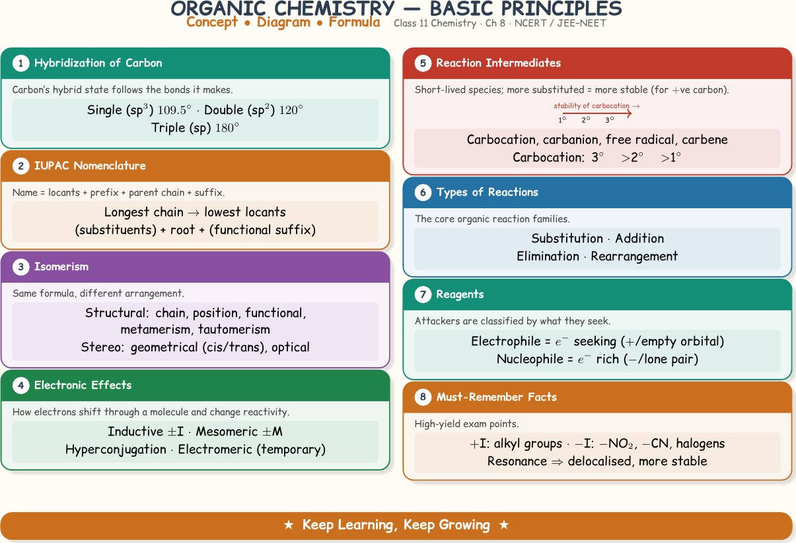

# Organic Chemistry (GOC) — Quick Recap

> One-page revision of the rules, trends and orders that run all of organic chemistry. If anything is
> unfamiliar, jump back to [Concepts](./01-concepts.md) or the [Deep Dive](./04-deep-dive.md).

<!-- RENDERING: inside math use \cdot (not ·), \to, \delta, \text{} for groups. -->

---

## 📑 Index

- [Hybridisation & bonds](#hybridisation)
- [IUPAC essentials](#iupac)
- [Isomerism](#isomerism)
- [Intermediates](#intermediates)
- [Electronic effects](#effects)
- [Stability & acid–base orders](#orders)
- [Aromaticity](#aromaticity)

---

## Hybridisation & bonds

| Hybridisation | Shape | Angle | s-character |
|---|---|---|---|
| $sp^3$ | tetrahedral | $109.5°$ | 25% |
| $sp^2$ | trigonal planar | $120°$ | 33% |
| $sp$ | linear | $180°$ | 50% |

- σ bond: head-on, free rotation. π bond: sideways, no rotation.
- Degree of unsaturation $= \dfrac{2C + 2 + N - H - X}{2}$.

---

## IUPAC essentials

- Name = **prefixes (substituents) + root (longest chain) + suffix (principal group)**.
- Number for the **lowest locant** to the principal functional group.
- Priority: –COOH > –SO₃H > ester > amide > –CN > –CHO > >C=O > –OH > –NH₂.

---

## Isomerism

- **Structural:** chain, position, functional, metamerism, tautomerism.
- **Stereo:** geometrical (cis–trans, needs rigid C=C + two different groups each end); optical (chirality, 4 different groups on C).

---

## Intermediates

| Species | Charge | Hybridisation | e⁻ at C |
|---|---|---|---|
| Carbocation | + | $sp^2$, planar | 6 |
| Carbanion | − | $sp^3$, pyramidal | 8 |
| Free radical | 0 | ≈planar | 7 |
| Carbene | 0 | $sp^2$, bent | 6 |

- **Electrophile** = electron-pair acceptor; **nucleophile** = electron-pair donor.
- Homolytic → radicals; heterolytic → ions.

---

## Electronic effects

| Effect | Donate (+) | Withdraw (−) |
|---|---|---|
| Inductive (σ, short-range) | alkyl | –NO₂, –CN, –X, –COOH |
| Resonance (π, long-range) | –OH, –NH₂, –OR, –X | –NO₂, –C=O, –CN |
| Hyperconjugation | more α-H → more stable | — |

Priority: **resonance > inductive > hyperconjugation > s-character > solvation.**

---

## Stability & acid–base orders

- **Carbocation:** benzyl ≈ allyl > 3° > 2° > 1° > methyl > vinyl.
- **Radical:** 3° > 2° > 1° > methyl.
- **Acidity:** carboxylic acid > phenol > water > alcohol > alkyne (sp) > alkene > alkane.
- **–I groups raise acidity:** Cl₃CCOOH > Cl₂CHCOOH > ClCH₂COOH > CH₃COOH.
- **Amine basicity:** gas phase 3°>2°>1°>NH₃ (+I); water order scrambled by solvation. Aniline < NH₃.
- **Carbocations rearrange** (1,2-H / 1,2-CH₃ shift) toward greater stability.

---

## Aromaticity (Hückel)

Cyclic + planar + fully conjugated + $(4n+2)$ π electrons → **aromatic**; $(4n)$ → antiaromatic; else non-aromatic.

- Count ring lone pairs that enter the p-system (pyrrole, furan → 6 π).
- Cyclopentadienyl anion, tropylium cation → aromatic (6 π).

> [!TIP]
> If stuck: translate to **"what stabilises the key species?"** For acids → conjugate-base stability; for
> bases → lone-pair availability; for reactions → the more stable carbocation/radical.

---

## 📸 Formula sheet & notes (from Google Drive)

Reference sheets for this chapter, filed under [`notes/scans/`](./notes/scans/).

📄 Full chapter notes (from Google Drive): [`class_11_chem_ch08_organic-chemistry-basic-principles.pdf`](./notes/scans/class_11_chem_ch08_organic-chemistry-basic-principles.pdf)
📄 Formula sheet PDF (vector original): [`class_11_chem_ch08_formula-sheet.pdf`](./notes/scans/class_11_chem_ch08_formula-sheet.pdf)

---

**Back to:** [Concepts](./01-concepts.md) · [Solved Problems](./02-solved-numericals.md) · [Practice](./03-practice.md) · [Deep Dive](./04-deep-dive.md)
