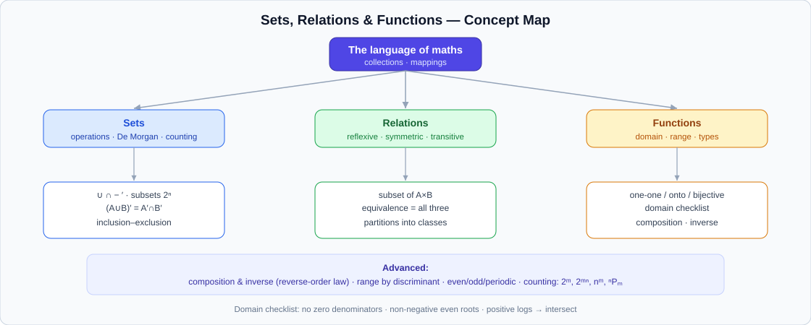
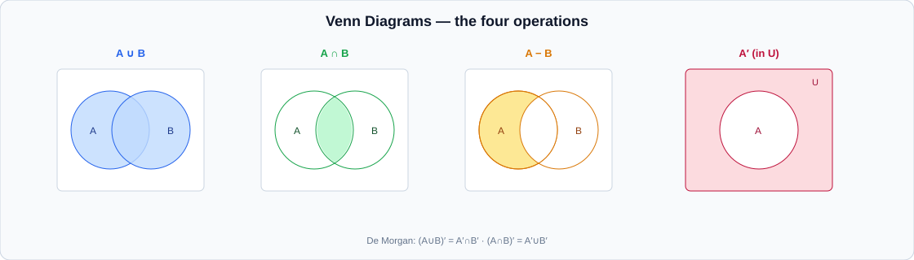
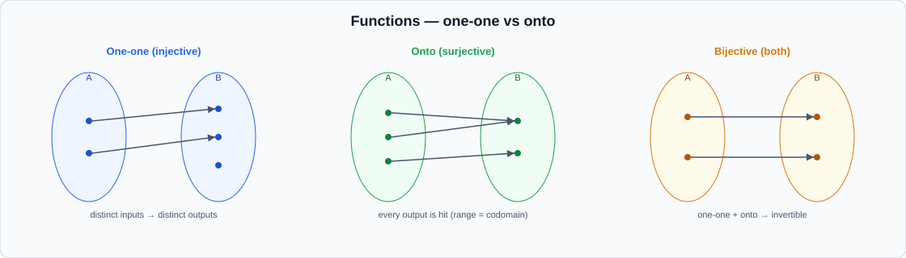

# Sets, Relations & Functions — Concepts

> **Class 11 · Mathematics · Chapter 1** — Sets, Relations and Functions
> **Prerequisites:** basic algebra, number systems, interval notation
> **JEE weightage:** High — the language of sets, relations and functions underpins **every** later topic (domains in calculus, equivalence in modular arithmetic, mappings everywhere). Domain/range and function-type questions appear in Main every year.

<!-- RENDERING: inside math use \cdot (not ·), \to (not →), \geq/\leq, \in, \subseteq, \cup, \cap. Concept map is an SVG. -->

---

## 📑 Index

1. [Sets: definition, representation and types](#1-sets)
2. [Operations on sets and Venn diagrams](#2-operations)
3. [Cardinality and inclusion–exclusion](#3-cardinality)
4. [Ordered pairs, Cartesian product and relations](#4-relations)
5. [Types of relations and equivalence](#5-types-relations)
6. [Functions: domain, codomain and range](#6-functions)
7. [Types of functions](#7-types-functions)

**Advanced (JEE Main & Advanced depth):**

8. [Composition and inverse of functions](#8-composition)
9. [Finding domain and range; even, odd and periodic functions](#9-domain-range)
10. [Equivalence relations, partitions and counting](#10-counting)

Related: [Solved Numericals](./02-solved-numericals.md) · [Practice Range](./03-practice.md) · [Deep Dive](./04-deep-dive.md) · [Formula Recap](./05-formula-recap.md)

---

## 🗺️ Concept map

---

## 1. Sets: definition, representation and types

A **set** is a well-defined collection of distinct objects (its **elements**). Membership: $x \in A$ or $x \notin A$.

**Representation:**
- **Roster (tabular):** $A = \{1, 2, 3, 4\}$.
- **Set-builder:** $A = \{x : x \in \mathbb{N},\ x \le 4\}$.

**Types of sets:**

| Type | Meaning |
|---|---|
| Empty (null) $\varnothing$ | no elements |
| Finite / infinite | countably many / unlimited elements |
| Singleton | exactly one element |
| Equal | same elements ($A = B$) |
| Subset $A \subseteq B$ | every element of $A$ is in $B$ |
| Proper subset $A \subset B$ | $A \subseteq B$ but $A \ne B$ |
| Universal $U$ | the reference set containing all elements |
| Power set $P(A)$ | the set of all subsets of $A$ |

> [!IMPORTANT]
> A set with $n$ elements has $2^n$ **subsets** (its power set has $2^n$ elements), of which $2^n - 1$ are
> **proper** subsets and $2^n - 1$ are non-empty. The empty set $\varnothing$ is a subset of **every** set.
> These counting facts are tested directly.

---

## 2. Operations on sets and Venn diagrams

| Operation | Definition |
|---|---|
| Union $A \cup B$ | elements in $A$ **or** $B$ |
| Intersection $A \cap B$ | elements in $A$ **and** $B$ |
| Difference $A - B$ | in $A$ but not $B$ |
| Complement $A'$ | $U - A$ |
| Symmetric difference $A \triangle B$ | $(A-B) \cup (B-A)$ |

**Key laws:**
- Commutative, associative, distributive ($A \cap (B \cup C) = (A\cap B)\cup(A\cap C)$).
- **De Morgan's laws:** $(A \cup B)' = A' \cap B'$ and $(A \cap B)' = A' \cup B'$.

> [!TIP]
> Draw a **Venn diagram** for any set-identity or word problem — it converts abstract algebra of sets into
> regions you can shade and count. De Morgan's laws ("complement turns ∪ into ∩ and vice versa") are the
> most-used identities.

---

## 3. Cardinality and inclusion–exclusion

$n(A)$ is the number of elements in a finite set $A$. The **inclusion–exclusion principle**:
$$n(A \cup B) = n(A) + n(B) - n(A \cap B)$$
$$n(A \cup B \cup C) = n(A)+n(B)+n(C) - n(A\cap B) - n(B\cap C) - n(C\cap A) + n(A\cap B\cap C)$$

> [!TIP]
> Almost every "survey" word problem (how many study both/neither/exactly one) is inclusion–exclusion.
> "**Neither**" means outside the union: $n(\text{neither}) = n(U) - n(A\cup B)$. Draw the Venn diagram and
> fill from the innermost overlap outward.

---

## 4. Ordered pairs, Cartesian product and relations

- An **ordered pair** $(a, b)$ cares about order: $(a,b) \ne (b,a)$ unless $a = b$.
- The **Cartesian product** $A \times B = \{(a,b) : a \in A,\ b \in B\}$; $n(A \times B) = n(A)\cdot n(B)$.
- A **relation** $R$ from $A$ to $B$ is any **subset** of $A \times B$. We write $aRb$ if $(a,b) \in R$.
  - **Domain** of $R$ = set of first elements; **range** = set of second elements.

> [!NOTE]
> Since a relation is any subset of $A \times B$ (which has $n(A)\,n(B)$ elements), the number of possible
> relations from $A$ to $B$ is $2^{\,n(A)\,n(B)}$. A relation **on** a set $A$ is a subset of $A \times A$.

---

## 5. Types of relations and equivalence

A relation $R$ on a set $A$ can be:

| Property | Condition |
|---|---|
| **Reflexive** | $aRa$ for all $a \in A$ |
| **Symmetric** | $aRb \Rightarrow bRa$ |
| **Transitive** | $aRb$ and $bRc \Rightarrow aRc$ |

- An **equivalence relation** is reflexive, symmetric **and** transitive (e.g. "congruent modulo $n$", "parallel to", "equal to").
- Other types: identity, universal, empty.

> [!IMPORTANT]
> To test a relation, check all three properties explicitly with the definition. An equivalence relation
> **partitions** the set into disjoint **equivalence classes** (Section 10) — a deep idea used in number
> theory and geometry. "Is perpendicular to" is symmetric but **not** reflexive or transitive — a classic trap.

---

## 6. Functions: domain, codomain and range

A **function** $f: A \to B$ is a special relation that assigns to **each** element of $A$ **exactly one**
element of $B$.

- **Domain** $= A$ (every input is used, each once).
- **Codomain** $= B$ (the target set).
- **Range** $= \{f(x) : x \in A\} \subseteq B$ (the actual outputs).

> [!WARNING]
> The defining rule: **every input has exactly one output.** A relation that maps some $x$ to two different
> values is **not** a function (the "vertical line test" on a graph: a vertical line meets the graph at most
> once). Range is a subset of the codomain — they're equal only for an **onto** function.

---

## 7. Types of functions

| Type | Condition |
|---|---|
| **One-one (injective)** | different inputs → different outputs ($f(x_1)=f(x_2) \Rightarrow x_1 = x_2$) |
| **Onto (surjective)** | range = codomain (every $b \in B$ is hit) |
| **Bijective** | both one-one and onto (invertible) |
| **Many-one** | some outputs come from several inputs |
| **Into** | range is a proper subset of the codomain |

**Standard functions:** identity, constant, modulus $|x|$, greatest integer $\lfloor x\rfloor$, signum, polynomial, rational, exponential, logarithmic.

> [!TIP]
> Test **one-one** by $f(x_1)=f(x_2)\Rightarrow x_1=x_2$ (or: a strictly increasing/decreasing function is
> one-one; use the derivative later). Test **onto** by solving $y = f(x)$ for $x$ and checking every
> codomain value is reachable. **Bijective ⇔ invertible.**

---

<!-- ===== ADVANCED CLUSTER (required on every chapter) ===== -->

## 8. Composition and inverse of functions

**Composition:** $(g \circ f)(x) = g(f(x))$ — apply $f$ first, then $g$. It is **associative** but **not
commutative** in general ($g\circ f \ne f \circ g$).

**Inverse:** a function $f: A \to B$ has an inverse $f^{-1}: B \to A$ **iff it is bijective**, and then
$f^{-1}(f(x)) = x$, $f(f^{-1}(y)) = y$. To find $f^{-1}$: set $y = f(x)$, solve for $x$ in terms of $y$, swap.

$$(g \circ f)^{-1} = f^{-1} \circ g^{-1} \qquad (\text{reverse order})$$

> [!IMPORTANT]
> Only a **bijection** is invertible. The graph of $f^{-1}$ is the reflection of $f$ in the line $y = x$.
> The "reverse-order" law $(g\circ f)^{-1} = f^{-1}\circ g^{-1}$ (socks-and-shoes: last on, first off) is a
> favourite exam identity.

---

## 9. Finding domain and range; even, odd and periodic functions

**Domain** = all real $x$ for which $f(x)$ is defined. Watch the usual restrictions:
- Denominators $\ne 0$; even roots need a non-negative radicand ($\sqrt{\ }$ requires $\ge 0$); $\log$ needs a positive argument; $\lfloor\ \rfloor$ and modulus are defined everywhere.

**Range:** express $x$ in terms of $y$ and find the $y$-values that give real $x$ in the domain (or use the graph / calculus later).

**Symmetry & periodicity:**
- **Even:** $f(-x) = f(x)$ (symmetric about the $y$-axis, e.g. $x^2$, $\cos x$).
- **Odd:** $f(-x) = -f(x)$ (symmetric about the origin, e.g. $x^3$, $\sin x$).
- **Periodic:** $f(x + T) = f(x)$ for the smallest $T > 0$ (e.g. $\sin x$ has period $2\pi$).

> [!TIP]
> Domain is a **checklist**: no zero denominators, non-negative even-roots, positive logs. For range, the
> "solve for $x$" method works for rational functions ($y = \frac{ax+b}{cx+d}$), and even/odd/periodic
> symmetry often shortcuts both domain and range.

---

## 10. Equivalence relations, partitions and counting

An **equivalence relation** on $A$ splits $A$ into disjoint **equivalence classes** whose union is $A$ (a
**partition**). Every partition corresponds to exactly one equivalence relation, and vice versa.

**Counting results** (for $n(A) = m$, $n(B) = n$):

| Quantity | Count |
|---|---|
| Subsets of $A$ | $2^m$ |
| Relations from $A$ to $B$ | $2^{mn}$ |
| Functions $A \to B$ | $n^m$ |
| One-one functions $A \to B$ ($n \ge m$) | $n(n-1)\cdots(n-m+1) = {}^nP_m$ |
| Onto functions (general) | by inclusion–exclusion |

> [!IMPORTANT]
> The function counts are high-yield: **$n^m$ total functions** (each of $m$ inputs has $n$ choices), and
> **${}^nP_m$ injective functions** (choose distinct images in order). Equivalence classes **partition** the
> set — this links relations to counting and to modular arithmetic.

---

## ✅ One-line summary

> A **set** is a collection; operations ($\cup, \cap, -, '$) obey De Morgan's laws, and counting uses
> inclusion–exclusion. A **relation** is a subset of $A\times B$; the reflexive + symmetric + transitive
> ones are **equivalence relations** (they partition the set). A **function** maps each input to exactly one
> output; it is **one-one / onto / bijective**, invertible iff bijective, and its **domain** is a checklist
> (no zero denominators, non-negative even roots, positive logs). Key counts: $2^m$ subsets, $n^m$ functions,
> ${}^nP_m$ injections.

**Next:** [Solved Numericals →](./02-solved-numericals.md)
