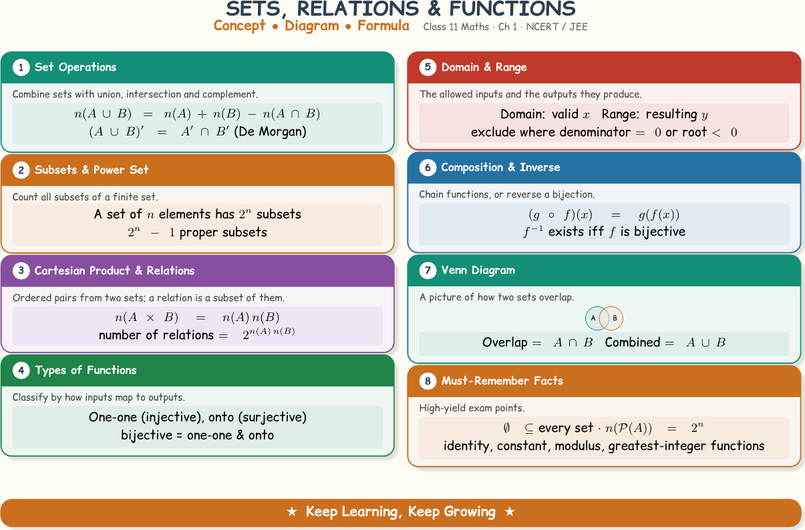

# Sets, Relations & Functions — Quick Formula Recap

> One-page revision of set algebra, relations, functions and the counting formulas. If anything is
> unfamiliar, jump back to [Concepts](./01-concepts.md) or the [Deep Dive](./04-deep-dive.md).

<!-- RENDERING: inside math use \cdot (not ·), \to, \geq/\leq, \in, \cup, \cap. -->

---

## 📑 Index

- [Sets & operations](#sets)
- [Cardinality](#cardinality)
- [Relations](#relations)
- [Functions](#functions)
- [Domain checklist](#domain)
- [Counting formulas](#counting)

---

## Sets & operations

- Subsets of an $n$-set: $2^n$; proper subsets: $2^n - 1$.
- $A\cup B$, $A\cap B$, $A-B$, $A' = U - A$, $A\triangle B = (A-B)\cup(B-A)$.
- **De Morgan:** $(A\cup B)' = A'\cap B'$, $(A\cap B)' = A'\cup B'$.

---

## Cardinality (inclusion–exclusion)

$$n(A\cup B) = n(A)+n(B)-n(A\cap B)$$
$$n(A\cup B\cup C) = \sum n - \sum n(\text{pairs}) + n(A\cap B\cap C)$$

- Neither $= n(U) - n(\text{union})$.

---

## Relations

- $A\times B$: $n(A\times B) = n(A)\,n(B)$; a relation is any subset.
- **Reflexive** ($aRa$), **symmetric** ($aRb\Rightarrow bRa$), **transitive** ($aRb,bRc\Rightarrow aRc$).
- **Equivalence** = all three → partitions the set into classes.

---

## Functions

- $f:A\to B$: each input → exactly one output. Range $\subseteq$ codomain.
- **One-one:** $f(x_1)=f(x_2)\Rightarrow x_1=x_2$. **Onto:** range = codomain. **Bijective** = both.
- **Composition:** $(g\circ f)(x)=g(f(x))$ (not commutative). **Inverse** exists iff bijective; $(g\circ f)^{-1}=f^{-1}\circ g^{-1}$.
- **Even:** $f(-x)=f(x)$; **odd:** $f(-x)=-f(x)$; **periodic:** $f(x+T)=f(x)$.

---

## Domain checklist

| Feature | Restriction |
|---|---|
| $\dfrac{1}{g(x)}$ | $g(x)\ne 0$ |
| $\sqrt{g(x)}$ | $g(x)\ge 0$ |
| $\dfrac{1}{\sqrt{g(x)}}$ | $g(x)>0$ |
| $\log g(x)$ | $g(x)>0$ |
| $\arcsin/\arccos$ | argument in $[-1,1]$ |

Range: solve $y=f(x)$ for $x$ (discriminant $\ge 0$ for rational), or use a known range/graph.

---

## Counting formulas ($n(A)=m$, $n(B)=n$)

| Count | Formula |
|---|---|
| Subsets of $A$ | $2^m$ |
| Relations $A\to B$ | $2^{mn}$ |
| Functions $A\to B$ | $n^m$ |
| Injective ($n\ge m$) | ${}^nP_m = \dfrac{n!}{(n-m)!}$ |
| Bijections of $m$-set | $m!$ |
| Reflexive relations | $2^{\,m^2-m}$ |

Onto functions: via inclusion–exclusion. Period of a sum = LCM of periods.

> [!TIP]
> If stuck: for counting use the base four ($2^m$, $2^{mn}$, $n^m$, ${}^nP_m$); for domain run the
> checklist and intersect; for range use the discriminant method.

---

## 📸 Formula sheet (from Google Drive)

Reference sheet for this chapter, filed under [`notes/scans/`](./notes/scans/).

📄 Formula sheet PDF (vector original): [`class_11_math_ch01_formula-sheet.pdf`](./notes/scans/class_11_math_ch01_formula-sheet.pdf)

> _Chapter notes PDF not in Drive yet (the Class 11 Maths Notes folders are currently empty except Statistics). Drop a scan into `notes/scans/` and ask Claude to clean it up._

---

**Back to:** [Concepts](./01-concepts.md) · [Solved Numericals](./02-solved-numericals.md) · [Practice](./03-practice.md) · [Deep Dive](./04-deep-dive.md)
