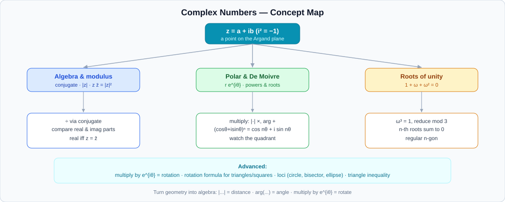
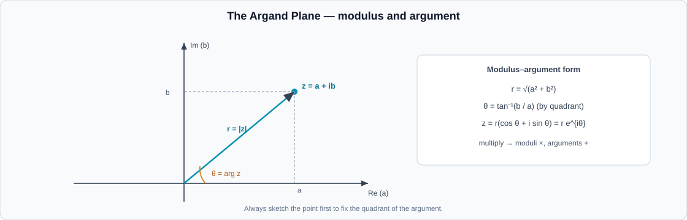

# Complex Numbers — Concepts

> **Class 11 · Mathematics · Chapter 2** — Complex Numbers (the *Complex Numbers* half of "Complex Numbers & Quadratic Equations")
> **Prerequisites:** real-number algebra, [Quadratic Equations](../02-quadratic-equations/01-concepts.md), basic trigonometry (for polar form), coordinate geometry
> **JEE weightage:** High — modulus/argument, De Moivre's theorem, cube roots of unity and the geometry of complex numbers appear every year in Main and feed into vectors, conics and trigonometry in Advanced.

<!-- RENDERING: inside math use \cdot (not ·), \to (not →), i for the imaginary unit, \bar z for conjugate, |z| for modulus, \arg z. Concept map is an SVG. -->

---

## 📑 Index

1. [The imaginary unit and complex numbers](#1-imaginary-unit)
2. [Algebra of complex numbers](#2-algebra)
3. [Conjugate and modulus](#3-conjugate-modulus)
4. [Argand plane and polar form](#4-polar)
5. [De Moivre's theorem](#5-de-moivre)
6. [Cube roots of unity](#6-cube-roots)
7. [Complex roots of quadratics](#7-quadratic-roots)

**Advanced (JEE Main & Advanced depth):**

8. [nth roots of unity and their properties](#8-nth-roots)
9. [Geometry of complex numbers: rotation and loci](#9-geometry)
10. [Modulus–argument identities and the triangle inequality](#10-identities)

Related: [Solved Numericals](./02-solved-numericals.md) · [Practice Range](./03-practice.md) · [Deep Dive](./04-deep-dive.md) · [Formula Recap](./05-formula-recap.md)

---

## 🗺️ Concept map

---

## 1. The imaginary unit and complex numbers

The equation $x^2 = -1$ has no real solution, so we define the **imaginary unit**:
$$i = \sqrt{-1}, \qquad i^2 = -1$$

A **complex number** is $z = a + ib$ where $a, b \in \mathbb{R}$:
- $a = \operatorname{Re}(z)$ (real part), $b = \operatorname{Im}(z)$ (imaginary part).
- **Purely real** if $b = 0$; **purely imaginary** if $a = 0$.

**Powers of $i$ cycle** with period 4:
$$i^1 = i,\quad i^2 = -1,\quad i^3 = -i,\quad i^4 = 1,\quad i^{4k+r} = i^r$$

> [!WARNING]
> The rule $\sqrt{a}\cdot\sqrt{b} = \sqrt{ab}$ **fails** for negative numbers: $\sqrt{-2}\cdot\sqrt{-3} \ne
> \sqrt{6}$. Always convert to $i$ first: $\sqrt{-2} = i\sqrt2$, $\sqrt{-3} = i\sqrt3$, so the product is
> $i^2\sqrt6 = -\sqrt6$. This is a classic trap.

---

## 2. Algebra of complex numbers

With $z_1 = a + ib$ and $z_2 = c + id$:

| Operation | Result |
|---|---|
| Addition | $(a+c) + i(b+d)$ |
| Subtraction | $(a-c) + i(b-d)$ |
| Multiplication | $(ac - bd) + i(ad + bc)$ |
| Division | multiply by the conjugate: $\dfrac{z_1}{z_2} = \dfrac{z_1 \bar{z_2}}{|z_2|^2}$ |

Two complex numbers are **equal** iff both real and imaginary parts match.

> [!TIP]
> To divide, **multiply numerator and denominator by the conjugate of the denominator** — this makes the
> denominator real ($z\bar z = |z|^2$). Equate real and imaginary parts to solve equations; "compare parts"
> is the workhorse technique of the whole chapter.

---

## 3. Conjugate and modulus

For $z = a + ib$:
- **Conjugate:** $\bar z = a - ib$ (reflect in the real axis).
- **Modulus:** $|z| = \sqrt{a^2 + b^2}$ (distance from the origin).

**Key properties:**
$$z\bar z = |z|^2, \quad \overline{z_1 z_2} = \bar z_1 \bar z_2, \quad \overline{z_1 + z_2} = \bar z_1 + \bar z_2$$
$$|z_1 z_2| = |z_1||z_2|, \quad \left|\frac{z_1}{z_2}\right| = \frac{|z_1|}{|z_2|}, \quad |\bar z| = |z|$$
$$\operatorname{Re}(z) = \frac{z + \bar z}{2}, \qquad \operatorname{Im}(z) = \frac{z - \bar z}{2i}$$

> [!IMPORTANT]
> $z\bar z = |z|^2$ is used constantly (it rationalises denominators and proves identities). A number is
> **real** iff $z = \bar z$, and **purely imaginary** iff $z = -\bar z$ (with $z \ne 0$) — handy tests.

---

## 4. Argand plane and polar form

A complex number $z = a + ib$ is the point $(a, b)$ on the **Argand plane**. In polar coordinates:
$$z = r(\cos\theta + i\sin\theta), \qquad r = |z| = \sqrt{a^2+b^2}, \quad \theta = \arg z = \tan^{-1}\!\frac{b}{a}$$

- **Argument** $\theta$ is the angle from the positive real axis (choose the correct quadrant!). The **principal argument** lies in $(-\pi, \pi]$.
- Shorthand: $z = r\,\text{cis}\,\theta = re^{i\theta}$ (Euler form).

**Multiplication/division in polar form** (moduli multiply/divide, arguments add/subtract):
$$z_1 z_2 = r_1 r_2\,[\cos(\theta_1+\theta_2) + i\sin(\theta_1+\theta_2)], \qquad \frac{z_1}{z_2} = \frac{r_1}{r_2}[\cos(\theta_1-\theta_2) + i\sin(\theta_1-\theta_2)]$$

> [!WARNING]
> When finding the argument, **use the quadrant of $(a, b)$**, not just $\tan^{-1}(b/a)$ — the calculator
> value needs adjusting by $\pm\pi$ in the 2nd/3rd quadrants. Multiplying by a complex number of modulus 1
> is a pure **rotation** (Section 9).

---

## 5. De Moivre's theorem

For any integer $n$:
$$\boxed{(\cos\theta + i\sin\theta)^n = \cos n\theta + i\sin n\theta}$$

Equivalently $(re^{i\theta})^n = r^n e^{in\theta}$ — raise the modulus to the power and multiply the argument.

> [!TIP]
> De Moivre's theorem turns powers and roots of complex numbers into simple angle arithmetic. It's the key
> to finding $n$-th roots (Section 8) and to deriving multiple-angle trig identities (expand
> $(\cos\theta + i\sin\theta)^n$ and compare real/imaginary parts).

---

## 6. Cube roots of unity

The three cube roots of 1 solve $z^3 = 1$:
$$1, \quad \omega = \frac{-1 + i\sqrt3}{2}, \quad \omega^2 = \frac{-1 - i\sqrt3}{2}$$

**Key properties:**
$$1 + \omega + \omega^2 = 0, \qquad \omega^3 = 1, \qquad \bar\omega = \omega^2$$

> [!IMPORTANT]
> The identity $1 + \omega + \omega^2 = 0$ (and $\omega^3 = 1$) is one of the most-used results in JEE
> algebra — it collapses sums, factorises $a^3 + b^3 + c^3 - 3abc = (a+b+c)(a+\omega b+\omega^2 c)(a+\omega^2 b+\omega c)$,
> and simplifies powers (reduce the exponent mod 3). The three roots form an **equilateral triangle** on the unit circle.

---

## 7. Complex roots of quadratics

A real quadratic $ax^2 + bx + c = 0$ with **negative discriminant** ($b^2 - 4ac < 0$) has two **complex
conjugate** roots:
$$x = \frac{-b \pm i\sqrt{4ac - b^2}}{2a}$$

- For a quadratic with **real coefficients**, complex roots always occur in **conjugate pairs**.
- Sum of roots $= -b/a$, product $= c/a$ (Vieta's relations hold over $\mathbb{C}$ too).

> [!NOTE]
> This closes the loop with [Quadratic Equations](../02-quadratic-equations/01-concepts.md): the "no real
> roots" case ($D < 0$) now has a full solution in $\mathbb{C}$. Over the complex numbers, **every**
> degree-$n$ polynomial has exactly $n$ roots (Fundamental Theorem of Algebra).

---

<!-- ===== ADVANCED CLUSTER (required on every chapter) ===== -->

## 8. nth roots of unity and their properties

The $n$-th roots of unity solve $z^n = 1$:
$$z_k = \cos\frac{2\pi k}{n} + i\sin\frac{2\pi k}{n} = e^{2\pi i k/n}, \qquad k = 0, 1, \dots, n-1$$

If $\alpha = e^{2\pi i/n}$ (the primitive root), the roots are $1, \alpha, \alpha^2, \dots, \alpha^{n-1}$.

**Properties:**
- They form a **regular $n$-gon** on the unit circle.
- **Sum $= 0$** (for $n \ge 2$): $1 + \alpha + \alpha^2 + \dots + \alpha^{n-1} = 0$.
- **Product $= (-1)^{n-1}$**.

> [!IMPORTANT]
> The general $n$-th roots of any complex number $z = re^{i\theta}$ are $r^{1/n}e^{i(\theta + 2\pi k)/n}$ for
> $k = 0,\dots,n-1$ — $n$ points equally spaced ($2\pi/n$ apart) on a circle of radius $r^{1/n}$. The
> "sum of all $n$-th roots of unity is zero" is a frequent shortcut in summation problems.

---

## 9. Geometry of complex numbers: rotation and loci

Complex numbers **are** points/vectors, so geometry becomes algebra:
- $|z_1 - z_2|$ = distance between the points.
- **Rotation theorem:** to rotate the point $z$ about the origin by angle $\theta$, multiply by $e^{i\theta}$. To rotate $z$ about a point $z_0$: $z' = z_0 + (z - z_0)e^{i\theta}$.

**Standard loci:**

| Equation | Locus |
|---|---|
| $\|z - z_0\| = r$ | circle, centre $z_0$, radius $r$ |
| $\|z - z_1\| = \|z - z_2\|$ | perpendicular bisector of $z_1 z_2$ |
| $\|z - z_1\| + \|z - z_2\| = k$ | ellipse (foci $z_1, z_2$) |
| $\arg\!\left(\dfrac{z - z_1}{z - z_2}\right) = \alpha$ | arc of a circle |

> [!TIP]
> The **rotation formula** $\dfrac{z_3 - z_2}{z_1 - z_2} = \dfrac{|z_3 - z_2|}{|z_1 - z_2|}e^{i\theta}$ (angle
> at vertex $z_2$) handles almost every "complex numbers as geometry" problem — equilateral triangles,
> squares, perpendicularity. Translating $|...|$ and $\arg(...)$ conditions into shapes is the core Advanced skill.

---

## 10. Modulus–argument identities and the triangle inequality

$$|z_1 + z_2|^2 = |z_1|^2 + |z_2|^2 + 2\operatorname{Re}(z_1 \bar z_2)$$
$$|z_1 + z_2|^2 + |z_1 - z_2|^2 = 2(|z_1|^2 + |z_2|^2) \quad(\text{parallelogram law})$$

**Triangle inequality:**
$$\big||z_1| - |z_2|\big| \le |z_1 + z_2| \le |z_1| + |z_2|$$

**Argument rules:** $\arg(z_1 z_2) = \arg z_1 + \arg z_2$, $\arg(z_1/z_2) = \arg z_1 - \arg z_2$ (modulo $2\pi$).

> [!IMPORTANT]
> Equality in $|z_1 + z_2| = |z_1| + |z_2|$ holds iff $z_1, z_2$ have the **same argument** (point the same
> way). The identity $|z_1 + z_2|^2 = |z_1|^2 + |z_2|^2 + 2\operatorname{Re}(z_1\bar z_2)$ is the complex
> analogue of the cosine rule and expands most "find the modulus" problems.

---

## ✅ One-line summary

> A complex number $z = a + ib$ ($i^2 = -1$) lives on the **Argand plane** with modulus $|z| = \sqrt{a^2+b^2}$
> and argument $\arg z$; its conjugate satisfies $z\bar z = |z|^2$. In **polar form** $z = re^{i\theta}$,
> multiplication multiplies moduli and adds arguments (**De Moivre:** $(re^{i\theta})^n = r^n e^{in\theta}$).
> **Cube roots of unity** give $1 + \omega + \omega^2 = 0$; the $n$-th roots of unity sum to zero and form a
> regular polygon; and multiplying by $e^{i\theta}$ is a **rotation** — turning geometry into algebra.

**Next:** [Solved Numericals →](./02-solved-numericals.md)
