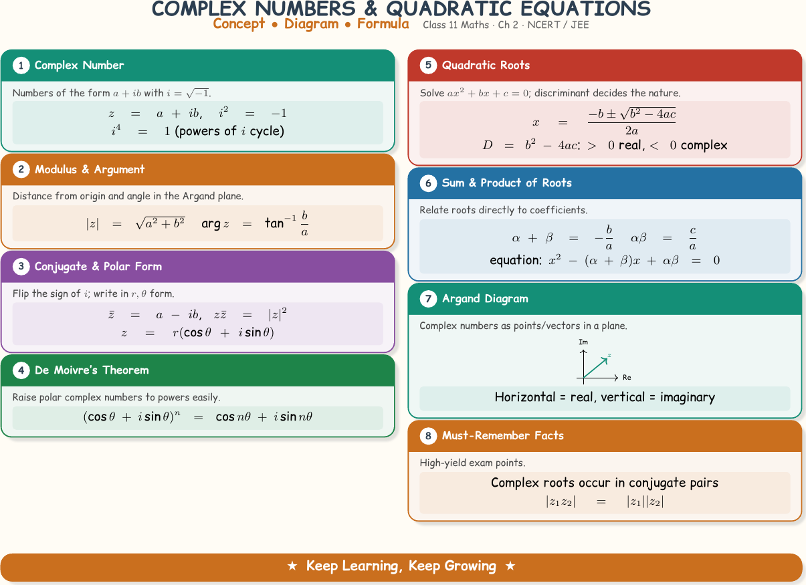

# Complex Numbers — Quick Formula Recap

> One-page revision of complex algebra, polar form, De Moivre and roots of unity. If anything is unfamiliar,
> jump back to [Concepts](./01-concepts.md) or the [Deep Dive](./04-deep-dive.md).

<!-- RENDERING: inside math use \cdot (not ·), \to, i, \bar z, |z|, \arg z, \omega. -->

---

## 📑 Index

- [Basics & algebra](#basics)
- [Conjugate & modulus](#conjugate)
- [Polar form](#polar)
- [De Moivre](#de-moivre)
- [Roots of unity](#roots)
- [Geometry](#geometry)

---

## Basics & algebra

- $i = \sqrt{-1}$, $i^2 = -1$; $i^{4k+r} = i^r$ (cycle $i, -1, -i, 1$).
- $z = a + ib$; equal iff real **and** imaginary parts match.
- $\sqrt{a}\sqrt{b} \ne \sqrt{ab}$ for negatives — convert to $i$ first.
- Division: $\dfrac{z_1}{z_2} = \dfrac{z_1\bar z_2}{|z_2|^2}$.

---

## Conjugate & modulus

$$\bar z = a - ib, \quad |z| = \sqrt{a^2+b^2}, \quad z\bar z = |z|^2$$
$$|z_1z_2| = |z_1||z_2|, \quad \left|\tfrac{z_1}{z_2}\right| = \tfrac{|z_1|}{|z_2|}, \quad \overline{z_1z_2} = \bar z_1\bar z_2$$
$$\operatorname{Re}(z) = \tfrac{z+\bar z}{2}, \quad \operatorname{Im}(z) = \tfrac{z-\bar z}{2i}$$

- Real iff $z = \bar z$; purely imaginary iff $z + \bar z = 0$.

---

## Polar form

$$z = r(\cos\theta + i\sin\theta) = re^{i\theta}, \quad r = |z|, \quad \theta = \arg z$$

- Multiply: moduli multiply, arguments add. Principal arg in $(-\pi, \pi]$. **Watch the quadrant.**

---

## De Moivre

$$(\cos\theta + i\sin\theta)^n = \cos n\theta + i\sin n\theta, \qquad (re^{i\theta})^n = r^n e^{in\theta}$$

- $z + \tfrac1z = 2\cos\theta \Rightarrow z^n + \tfrac1{z^n} = 2\cos n\theta$.
- $\cos3\theta = 4\cos^3\theta - 3\cos\theta$; $\sin3\theta = 3\sin\theta - 4\sin^3\theta$.

---

## Roots of unity

- **Cube roots:** $1, \omega, \omega^2$; $1+\omega+\omega^2 = 0$, $\omega^3 = 1$, $\bar\omega = \omega^2$. Reduce powers mod 3.
- **$n$-th roots of unity:** $e^{2\pi i k/n}$, $k = 0,\dots,n-1$; sum $= 0$, product $= (-1)^{n-1}$; regular $n$-gon.
- **$n$-th roots of $z = re^{i\theta}$:** $r^{1/n}e^{i(\theta+2\pi k)/n}$.
- Square roots of $a+ib$: solve $x^2-y^2=a$, $2xy=b$, $x^2+y^2=\sqrt{a^2+b^2}$.

---

## Geometry

- Rotation about origin: $z \mapsto ze^{i\theta}$; about $z_0$: $z_0 + (z-z_0)e^{i\theta}$.
- $|z_1+z_2|^2 = |z_1|^2+|z_2|^2+2\operatorname{Re}(z_1\bar z_2)$; parallelogram law.
- Triangle inequality: $\big||z_1|-|z_2|\big| \le |z_1+z_2| \le |z_1|+|z_2|$.

| Condition | Locus |
|---|---|
| $\|z-z_0\|=r$ | circle |
| $\|z-z_1\|=\|z-z_2\|$ | perpendicular bisector |
| $\|z-z_1\|+\|z-z_2\|=k$ | ellipse |

> [!TIP]
> If stuck: use **compare-parts** and the **conjugate trick** for algebra; switch to **polar** for powers
> and roots; translate $|...|$/$\arg(...)$ into distance/angle for geometry.

---

## 📸 Formula sheet (from Google Drive)

Reference sheet for this chapter (it pairs Complex Numbers with Quadratic Equations), filed under [`notes/scans/`](./notes/scans/).

📄 Formula sheet PDF (vector original): [`class_11_math_ch02_formula-sheet.pdf`](./notes/scans/class_11_math_ch02_formula-sheet.pdf)

> _Chapter notes PDF not in Drive yet (the Class 11 Maths Notes folders are currently empty except Statistics). Drop a scan into `notes/scans/` and ask Claude to clean it up._

---

**Back to:** [Concepts](./01-concepts.md) · [Solved Numericals](./02-solved-numericals.md) · [Practice](./03-practice.md) · [Deep Dive](./04-deep-dive.md)
