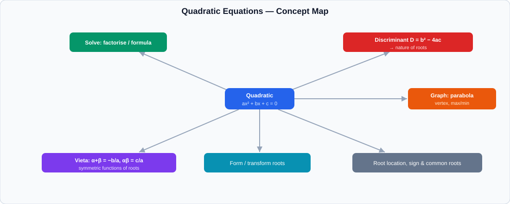
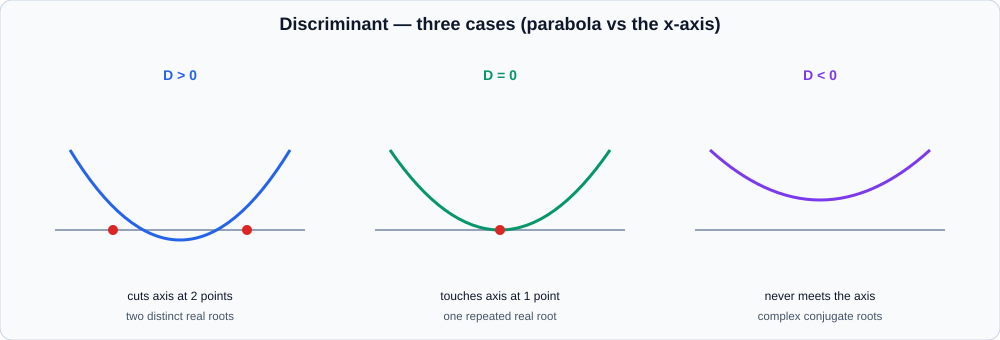
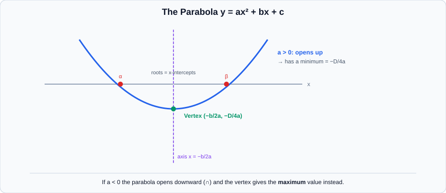

# Quadratic Equations — Concepts

> **Class 11 · Mathematics · Chapter: Complex Numbers & Quadratic Equations**
> **Prerequisites:** algebra of polynomials, factorisation, basic coordinate geometry, surds
> **JEE weightage:** High — quadratics appear directly and as a *tool* inside almost every other chapter (calculus, conics, trigonometry). The idea of the discriminant and sum/product of roots is used everywhere.

<!-- RENDERING: inside math use \cdot (not ·), \to (not →), \geq/\leq. Concept map is an SVG. -->

---

## 📑 Index

1. [What is a quadratic equation](#1-what-is-a-quadratic-equation)
2. [Three ways to solve](#2-three-ways-to-solve)
3. [The discriminant and the nature of roots](#3-the-discriminant-and-the-nature-of-roots)
4. [Sum and product of roots (Vieta's relations)](#4-sum-and-product-of-roots-vietas-relations)
5. [Forming a quadratic and transforming its roots](#5-forming-a-quadratic-and-transforming-its-roots)
6. [The graph: the parabola](#6-the-graph-the-parabola)
7. [Maximum and minimum value](#7-maximum-and-minimum-value)
8. [Common roots and special techniques](#8-common-roots-and-special-techniques)

Related: [Solved Numericals](./02-solved-numericals.md) · [Practice Range](./03-practice.md) · [Deep Dive](./04-deep-dive.md) · [Formula Recap](./05-formula-recap.md)

---

## 🗺️ Concept map

---

## 1. What is a quadratic equation

A **quadratic equation** is a polynomial equation of degree 2 — the highest power of the variable is 2. Its standard form is:
$$ax^2 + bx + c = 0, \qquad a \neq 0$$

- $a$, $b$, $c$ are real (or complex) constants; $a \neq 0$ is what makes it *quadratic* (if $a = 0$ it collapses to a linear equation).
- The values of $x$ that satisfy it are the **roots** (or **zeros**). A quadratic always has **exactly two roots** (counting a repeated root twice, and allowing complex roots).

> [!NOTE]
> "Two roots" is guaranteed only when you allow repeated and complex roots. Over the **real numbers** a quadratic may have two, one (repeated), or zero roots — and which case you are in is decided entirely by the **discriminant** (Section 3).

---

## 2. Three ways to solve

**(a) Factorisation** — split the middle term so the equation becomes a product of two linear factors. Fast when the numbers are friendly.
$$x^2 - 5x + 6 = 0 \;\Rightarrow\; (x-2)(x-3) = 0 \;\Rightarrow\; x = 2,\,3$$

**(b) Completing the square** — turn the left side into a perfect square plus a constant. This is *how* the quadratic formula is derived.
$$x^2 + bx = \left(x + \tfrac{b}{2}\right)^2 - \tfrac{b^2}{4}$$

**(c) The quadratic formula** — always works, for any $a, b, c$:
$$\boxed{x = \frac{-b \pm \sqrt{b^2 - 4ac}}{2a}}$$

The quantity under the root, $b^2 - 4ac$, is the **discriminant** — it alone decides what kind of roots you get.

> [!TIP]
> Try **factorisation first** (it's quickest), fall back to the **formula** when factors aren't obvious. Completing the square is mainly worth knowing because it produces the vertex form used for max/min (Section 7).

---

## 3. The discriminant and the nature of roots

$$\boxed{D = b^2 - 4ac}$$

The sign of $D$ tells you the nature of the roots **without solving** — a hugely useful shortcut.

| Discriminant | Nature of roots (real $a,b,c$) | Graph vs x-axis |
|---|---|---|
| $D > 0$ | two **distinct real** roots | cuts the x-axis at 2 points |
| $D = 0$ | one **repeated real** root ($x = -\tfrac{b}{2a}$) | *touches* the x-axis at 1 point |
| $D < 0$ | two **complex conjugate** roots (no real root) | never meets the x-axis |

**Further refinements (when $D \geq 0$ and $a,b,c$ are rational):**
- If $D$ is a **perfect square** → the roots are **rational**.
- If $D > 0$ but not a perfect square → the roots are **irrational**, and they come as **conjugate surds** $p \pm \sqrt{q}$.
- Complex roots of a *real* quadratic always come as **conjugate pairs** $p \pm iq$.

> [!IMPORTANT]
> Irrational and complex roots of a quadratic with rational/real coefficients **always come in conjugate pairs**. So if $2 + \sqrt3$ is a root, $2 - \sqrt3$ must be the other; if $3 - 2i$ is a root, $3 + 2i$ is the other. This instantly gives you the second root.

---

## 4. Sum and product of roots (Vieta's relations)

If $\alpha$ and $\beta$ are the roots of $ax^2 + bx + c = 0$, then:
$$\boxed{\alpha + \beta = -\frac{b}{a}, \qquad \alpha\beta = \frac{c}{a}}$$

These let you work with the roots **without finding them** — which is the whole game in JEE. From them you can build any symmetric expression:

$$\alpha^2 + \beta^2 = (\alpha+\beta)^2 - 2\alpha\beta$$
$$\alpha^2\beta^2 = (\alpha\beta)^2$$
$$\frac{1}{\alpha} + \frac{1}{\beta} = \frac{\alpha+\beta}{\alpha\beta}$$
$$(\alpha - \beta)^2 = (\alpha+\beta)^2 - 4\alpha\beta = \frac{D}{a^2} \quad\Rightarrow\quad |\alpha - \beta| = \frac{\sqrt{D}}{|a|}$$

> [!TIP]
> Any symmetric function of the roots (one unchanged when you swap $\alpha \leftrightarrow \beta$) can be written using just $\alpha+\beta$ and $\alpha\beta$. Recognising this saves you from ever solving the equation.

---

## 5. Forming a quadratic and transforming its roots

**To build a quadratic with roots $\alpha$ and $\beta$:**
$$\boxed{x^2 - (\alpha+\beta)x + \alpha\beta = 0} \qquad\text{i.e. } x^2 - (\text{sum})x + (\text{product}) = 0$$

**Transforming roots** — if the original has roots $\alpha,\beta$ (sum $S$, product $P$), the new equation whose roots are a function of them is built from the new sum and product:

| New roots | New sum | New product |
|---|---|---|
| $k\alpha,\ k\beta$ | $kS$ | $k^2P$ |
| $\alpha+k,\ \beta+k$ | $S + 2k$ | $P + kS + k^2$ |
| $\dfrac{1}{\alpha},\ \dfrac{1}{\beta}$ | $\dfrac{S}{P}$ | $\dfrac{1}{P}$ |
| $\alpha^2,\ \beta^2$ | $S^2 - 2P$ | $P^2$ |

Then write $x^2 - (\text{new sum})x + (\text{new product}) = 0$.

---

## 6. The graph: the parabola

The curve $y = ax^2 + bx + c$ is a **parabola**. Reading its shape answers most "nature/sign" questions at a glance.

- **Opening:** $a > 0$ → opens **upward** (U-shape, has a minimum); $a < 0$ → opens **downward** (∩-shape, has a maximum).
- **Axis of symmetry:** the vertical line $x = -\dfrac{b}{2a}$.
- **Vertex** (turning point): at $x = -\dfrac{b}{2a}$, $\;y = -\dfrac{D}{4a}$.
- **x-intercepts** are the real roots; the number of them matches the $D$ cases above.

**Sign of a quadratic** (very common in inequalities): with $a>0$ and real roots $\alpha<\beta$,
$$ax^2+bx+c \; \begin{cases} > 0 & x < \alpha \text{ or } x > \beta \quad(\text{outside the roots})\\ < 0 & \alpha < x < \beta \quad(\text{between the roots})\\ = 0 & x = \alpha,\ \beta \end{cases}$$

> [!NOTE]
> "Same sign as $a$ outside the roots, opposite sign between the roots." If $D < 0$, the quadratic **never changes sign** — it keeps the sign of $a$ for all real $x$. This one fact solves a large class of inequality and "always positive" problems.

---

## 7. Maximum and minimum value

Since a parabola has one turning point, $y = ax^2+bx+c$ has a single extreme value, reached at the vertex $x = -\dfrac{b}{2a}$:
$$\boxed{y_{\text{extreme}} = -\frac{D}{4a} = c - \frac{b^2}{4a}}$$

- If $a > 0$: this is the **minimum** value (parabola opens up).
- If $a < 0$: this is the **maximum** value (parabola opens down).

> [!TIP]
> For "find the greatest/least value of a quadratic expression" problems, don't use calculus — just complete the square or quote $-\dfrac{D}{4a}$ at $x=-\dfrac{b}{2a}$. It's faster and is what examiners expect at this level.

---

## 8. Common roots and special techniques

**One common root** between $a_1x^2+b_1x+c_1=0$ and $a_2x^2+b_2x+c_2=0$: the condition is
$$(a_1c_2 - a_2c_1)^2 = (b_1c_2 - b_2c_1)(a_1b_2 - a_2b_1)$$

**Both roots common:** the equations are proportional —
$$\frac{a_1}{a_2} = \frac{b_1}{b_2} = \frac{c_1}{c_2}$$

**Quadratic in disguise** — many equations become quadratic after a substitution:
- $x^4 - 5x^2 + 4 = 0$ → let $t = x^2$ → $t^2 - 5t + 4 = 0$.
- Equations in $\sqrt{x}$, $2^x$, $\sin x$, etc. often hide a quadratic; substitute the repeating block.

**If a quadratic has more than two roots, it is an identity** — i.e. $a=b=c=0$. (A degree-2 equation can't have 3 distinct roots unless every coefficient is zero.)

---

## ✅ One-line summary

> A quadratic $ax^2+bx+c=0$ is solved by the formula $x=\dfrac{-b\pm\sqrt{D}}{2a}$; the discriminant
> $D=b^2-4ac$ fixes the nature of the roots; Vieta's relations $\alpha+\beta=-b/a$, $\alpha\beta=c/a$
> let you work with the roots without finding them; and the parabola $y=ax^2+bx+c$ turns all of this
> into a picture — opening set by $a$, vertex at $-b/2a$, extreme value $-D/4a$.

**Next:** [Solved Numericals →](./02-solved-numericals.md)
