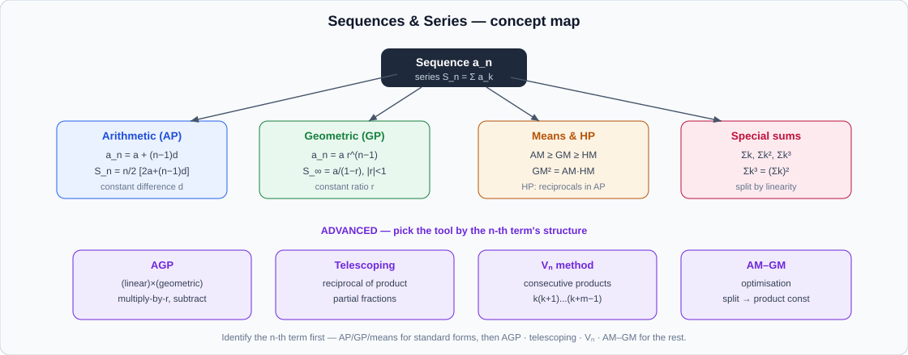

# Sequences & Series — Concepts

> **Class 11 · Mathematics · Chapter 3** — Sequences and Series (AP, GP, HP, means, special sums)
> **Prerequisites:** algebra, exponents and logarithms, basic summation notation
> **JEE weightage:** High — AP/GP $n$-th term and sum, the AM–GM inequality, and special-series summation appear every year in Main and feed into binomial, probability and calculus in Advanced.

<!-- RENDERING: inside math use \cdot (not ·), \to (not →), \sum, \frac, \geq/\leq. Concept map is an SVG. -->

---

## 📑 Index

1. [Sequences, series and the general term](#1-sequences)
2. [Arithmetic progression (AP)](#2-ap)
3. [Geometric progression (GP)](#3-gp)
4. [Arithmetic, geometric and harmonic means](#4-means)
5. [Harmonic progression (HP)](#5-hp)
6. [Special series: sums of powers](#6-special-series)
7. [The AM–GM–HM inequality](#7-inequality)

**Advanced (JEE Main & Advanced depth):**

8. [Arithmetic–geometric progression (AGP)](#8-agp)
9. [Method of differences and telescoping](#9-telescoping)
10. [Summation techniques (Vₙ method) and applications](#10-techniques)

Related: [Solved Numericals](./02-solved-numericals.md) · [Practice Range](./03-practice.md) · [Deep Dive](./04-deep-dive.md) · [Formula Recap](./05-formula-recap.md)

---

## 🗺️ Concept map

---

## 1. Sequences, series and the general term

- A **sequence** is an ordered list of numbers $a_1, a_2, a_3, \dots$; the **general (nth) term** $a_n$ is a
  formula for the $n$-th one.
- A **series** is the sum of a sequence's terms: $S_n = a_1 + a_2 + \dots + a_n = \sum_{k=1}^n a_k$.

A key link: the $n$-th term from the sum,
$$a_n = S_n - S_{n-1} \quad (n \ge 2), \qquad a_1 = S_1.$$

> [!TIP]
> If a problem gives the **sum** $S_n$ as a formula and asks for the $n$-th term, use $a_n = S_n - S_{n-1}$
> (and check $a_1 = S_1$ separately). This also tells you the type: if $S_n$ is quadratic in $n$, the
> sequence is an **AP**.

---

## 2. Arithmetic progression (AP)

An **AP** has a constant **common difference** $d = a_{n} - a_{n-1}$. With first term $a$:

$$a_n = a + (n-1)d, \qquad S_n = \frac{n}{2}\big[2a + (n-1)d\big] = \frac{n}{2}(a + \ell)$$

where $\ell = a_n$ is the last term.

**Properties:**
- Three numbers in AP: take them as $a - d,\ a,\ a + d$ (sum $= 3a$).
- The middle term of an odd-length AP is the average; any term is the AM of its neighbours: $a_n = \frac{a_{n-1} + a_{n+1}}{2}$.

> [!IMPORTANT]
> Choosing symmetric terms ($a-d, a, a+d$ for three; $a-3d, a-d, a+d, a+3d$ for four) makes the algebra
> collapse — the sum loses $d$. The sum $S_n$ of an AP is always a **quadratic in $n$ with no constant
> term**; recognising this identifies APs instantly.

---

## 3. Geometric progression (GP)

A **GP** has a constant **common ratio** $r = \dfrac{a_n}{a_{n-1}}$. With first term $a$:

$$a_n = a\,r^{n-1}, \qquad S_n = a\,\frac{r^n - 1}{r - 1} \ (r \ne 1)$$

**Infinite GP** (sum to infinity) converges only when $|r| < 1$:
$$\boxed{S_\infty = \frac{a}{1 - r} \quad (|r| < 1)}$$

**Properties:**
- Three numbers in GP: take $\dfrac{a}{r},\ a,\ ar$ (product $= a^3$).
- Any term is the GM of its neighbours: $a_n = \sqrt{a_{n-1}\,a_{n+1}}$.

> [!WARNING]
> The infinite-sum formula $\frac{a}{1-r}$ holds **only for $|r| < 1$** — otherwise the series diverges.
> For three GP terms use $\frac{a}{r}, a, ar$ (product collapses to $a^3$); for the sum, watch the $r = 1$
> case ($S_n = na$).

---

## 4. Arithmetic, geometric and harmonic means

For two positive numbers $a$ and $b$:

| Mean | Formula |
|---|---|
| Arithmetic (AM) | $\dfrac{a + b}{2}$ |
| Geometric (GM) | $\sqrt{ab}$ |
| Harmonic (HM) | $\dfrac{2ab}{a + b}$ |

**Key relation:** $\text{GM}^2 = \text{AM} \cdot \text{HM}$, and $\text{AM} \ge \text{GM} \ge \text{HM}$ (equality iff $a = b$).

- Inserting $n$ **arithmetic means** between $a$ and $b$ makes an AP of $n+2$ terms; similarly for GM/HM.

> [!IMPORTANT]
> $\text{GM} = \sqrt{\text{AM}\cdot\text{HM}}$ ties the three means together, and $\text{AM}\ge\text{GM}\ge\text{HM}$
> is a workhorse inequality (Section 7). These let you solve "find the numbers given two of their means" problems quickly.

---

## 5. Harmonic progression (HP)

A sequence is in **HP** if the reciprocals of its terms form an **AP**. So to work with an HP, **take
reciprocals and use AP formulas**, then invert at the end.

- $n$-th term of an HP: if $\frac{1}{a_n} = \frac{1}{a} + (n-1)D$ (the reciprocal AP), then $a_n$ is its reciprocal.

> [!TIP]
> There is **no simple direct sum formula** for an HP — the trick is always "reciprocate → it's an AP →
> use AP tools → reciprocate back." The HM of two numbers is the HP analogue of the AM/GM.

---

## 6. Special series: sums of powers

$$\sum_{k=1}^n k = \frac{n(n+1)}{2}, \qquad \sum_{k=1}^n k^2 = \frac{n(n+1)(2n+1)}{6}, \qquad \sum_{k=1}^n k^3 = \left[\frac{n(n+1)}{2}\right]^2$$

Note the neat fact $\sum k^3 = \left(\sum k\right)^2$.

> [!TIP]
> To sum a series like $\sum (k^2 + 3k)$, **split by linearity** and use the standard formulas:
> $\sum k^2 + 3\sum k$. Many "sum the series" questions reduce to finding the $n$-th term as a polynomial in
> $k$ and applying these three results.

---

## 7. The AM–GM–HM inequality

For positive reals, $\text{AM} \ge \text{GM} \ge \text{HM}$, with **equality iff all the numbers are equal**.
For $n$ positive numbers:
$$\frac{a_1 + a_2 + \dots + a_n}{n} \ge \sqrt[n]{a_1 a_2 \cdots a_n}$$

> [!IMPORTANT]
> AM–GM is a powerful optimisation tool: to **minimise a sum** with a fixed product (or **maximise a
> product** with a fixed sum), equality (all terms equal) gives the extremum. E.g. $x + \frac{1}{x} \ge 2$
> for $x > 0$ (minimum $2$ at $x = 1$). Spotting a fixed product/sum is the cue to apply it.

---

<!-- ===== ADVANCED CLUSTER (required on every chapter) ===== -->

## 8. Arithmetic–geometric progression (AGP)

An **AGP** has terms that are (an AP term) × (a GP term): e.g. $1 + 2x + 3x^2 + 4x^3 + \dots$. To sum
$S_n = \sum (a + (k-1)d)\,r^{k-1}$:

**Method:** write $S$, multiply by $r$ to get $rS$, subtract — the middle becomes a GP:
$$S_\infty = \frac{a}{1-r} + \frac{dr}{(1-r)^2} \quad (|r| < 1).$$

> [!IMPORTANT]
> The "**multiply by $r$ and subtract**" trick is the signature method for any AGP (and for series like
> $\sum k\,x^k$). After subtraction the awkward middle terms form a geometric series you can sum directly.
> For the infinite case it needs $|r| < 1$.

---

## 9. Method of differences and telescoping

If the $n$-th term can be written as a **difference** $a_k = f(k) - f(k+1)$, the sum **telescopes**:
$$\sum_{k=1}^n a_k = f(1) - f(n+1).$$

Classic example — partial fractions:
$$\frac{1}{k(k+1)} = \frac{1}{k} - \frac{1}{k+1} \Rightarrow \sum_{k=1}^n \frac{1}{k(k+1)} = 1 - \frac{1}{n+1}.$$

> [!TIP]
> When the $n$-th term is a **product of consecutive integers in a denominator** (or a factorial-type
> expression), try **partial fractions** to split it into a telescoping difference. Most intermediate terms
> cancel, leaving just the first and last.

---

## 10. Summation techniques (Vₙ method) and applications

For a series whose $n$-th term is a **product of terms in AP** like $T_k = k(k+1)(k+2)$, the **Vₙ (method of
differences) technique** finds a $V_k$ with $T_k = V_k - V_{k-1}$:
$$\sum_{k=1}^n k(k+1)(k+2) = \frac{n(n+1)(n+2)(n+3)}{4}.$$

**General approach to "sum the series":**
1. Find the $n$-th term $T_k$ (look for AP/GP/AGP/telescoping structure).
2. If $T_k$ is a polynomial, split into $\sum k, \sum k^2, \sum k^3$.
3. If it's a product/quotient, try telescoping or the Vₙ method.

> [!IMPORTANT]
> The reusable idea: **identify the $n$-th term's structure first**, then pick the matching tool —
> standard-power sums for polynomials, "multiply-by-$r$" for AGP, partial-fraction telescoping for
> reciprocal products, and the Vₙ method for products of consecutive terms. That classification is the whole game.

---

## ✅ One-line summary

> An **AP** has $a_n = a + (n-1)d$, $S_n = \tfrac n2[2a+(n-1)d]$; a **GP** has $a_n = ar^{n-1}$,
> $S_n = a\tfrac{r^n-1}{r-1}$, and $S_\infty = \tfrac{a}{1-r}$ for $|r|<1$. The means satisfy
> $\text{AM}\ge\text{GM}\ge\text{HM}$ with $\text{GM}^2 = \text{AM}\cdot\text{HM}$; **HP** = reciprocals in AP.
> Standard sums give $\sum k, \sum k^2, \sum k^3$, and harder series yield to **AGP (multiply-by-$r$)**,
> **telescoping (partial fractions)**, or the **Vₙ method** — chosen by the $n$-th term's structure.

**Next:** [Solved Numericals →](./02-solved-numericals.md)
