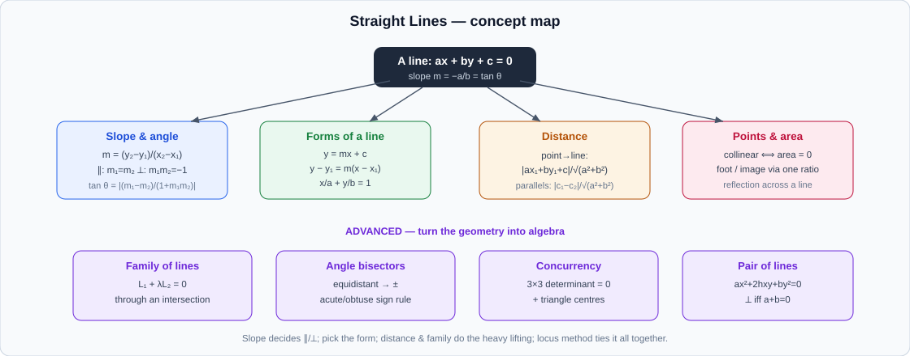

# Straight Lines — Concepts

> **Class 11 · Mathematics · Chapter 6** — Straight Lines (slope, forms of a line, distance, angle, family of lines)
> **Prerequisites:** coordinate geometry basics (distance, section formula), trigonometry (tan), basic algebra
> **JEE weightage:** High — slope/angle, the forms of a line, perpendicular distance and the family-of-lines idea appear every year in Main, and feed straight into conic sections, 3-D geometry and vectors.

<!-- RENDERING: inside math use \cdot (not ·), \to (not →), \sum, \frac, \geq/\leq. Concept map is an SVG. -->

---

## 📑 Index

1. [The coordinate plane, distance and slope](#1-slope)
2. [Angle between two lines; parallel & perpendicular](#2-angle)
3. [The five forms of a straight line](#3-forms)
4. [General form and converting between forms](#4-general)
5. [Distance of a point from a line; distance between parallels](#5-distance)
6. [Collinearity, foot of perpendicular and image of a point](#6-foot)
7. [The family of lines through an intersection](#7-family)

**Advanced (JEE Main & Advanced depth):**

8. [Angle bisectors of two lines](#8-bisectors)
9. [Concurrency and the locus method](#9-concurrency)
10. [Pair of straight lines (homogeneous second-degree)](#10-pair)

Related: [Solved Numericals](./02-solved-numericals.md) · [Practice Range](./03-practice.md) · [Deep Dive](./04-deep-dive.md) · [Formula Recap](./05-formula-recap.md)

---

## 🗺️ Concept map

---

## 1. The coordinate plane, distance and slope

For points $A(x_1, y_1)$ and $B(x_2, y_2)$:

$$\text{distance } AB = \sqrt{(x_2 - x_1)^2 + (y_2 - y_1)^2}, \qquad \text{slope } m = \frac{y_2 - y_1}{x_2 - x_1} = \tan\theta$$

where $\theta$ is the angle the line makes with the **positive $x$-axis** ($0 \le \theta < 180°$).

- A **horizontal** line has $m = 0$; a **vertical** line has slope **undefined** ($\theta = 90°$).
- Positive slope rises left-to-right; negative slope falls.

> [!TIP]
> Slope is the single most useful number for a line: it is $\tan\theta$, it decides parallel/perpendicular,
> and it drives the angle formula. When $x_2 = x_1$ the line is vertical and slope is undefined — handle that
> as a special case rather than dividing by zero.

---

## 2. Angle between two lines; parallel & perpendicular

If two lines have slopes $m_1$ and $m_2$, the angle $\theta$ between them satisfies

$$\tan\theta = \left|\frac{m_1 - m_2}{1 + m_1 m_2}\right|.$$

**Special cases:**
- **Parallel:** $m_1 = m_2$ (same slope).
- **Perpendicular:** $m_1 m_2 = -1$ (slopes are negative reciprocals).

> [!IMPORTANT]
> $m_1 m_2 = -1$ for perpendicular and $m_1 = m_2$ for parallel are the two conditions you will use
> constantly. The angle formula's **denominator $1 + m_1 m_2 = 0$** is exactly the perpendicular case (angle
> $90°$, $\tan$ undefined) — a neat consistency check.

---

## 3. The five forms of a straight line

Pick the form that matches the data you are given:

| Form | Equation | Use when you know |
|---|---|---|
| Slope–intercept | $y = mx + c$ | slope $m$ and $y$-intercept $c$ |
| Point–slope | $y - y_1 = m(x - x_1)$ | a point and the slope |
| Two–point | $y - y_1 = \dfrac{y_2 - y_1}{x_2 - x_1}(x - x_1)$ | two points |
| Intercept | $\dfrac xa + \dfrac yb = 1$ | $x$-intercept $a$, $y$-intercept $b$ |
| Normal | $x\cos\alpha + y\sin\alpha = p$ | perp. distance $p$ from origin and its angle $\alpha$ |

> [!IMPORTANT]
> **Choosing the right form is half the problem.** Point + slope → point–slope; two intercepts → intercept
> form; a perpendicular-from-origin description → normal form. All forms reduce to the general form
> $ax + by + c = 0$.

---

## 4. General form and converting between forms

Every line is $ax + by + c = 0$ (with $a, b$ not both zero). From it:

$$\text{slope } m = -\frac ab, \qquad x\text{-intercept} = -\frac ca, \qquad y\text{-intercept} = -\frac cb.$$

To get slope–intercept form, solve for $y$: $y = -\dfrac ab x - \dfrac cb$.

> [!TIP]
> From $ax + by + c = 0$, **slope $= -a/b$** instantly — no need to rearrange. This is the fastest way to test
> parallel/perpendicular between two general-form lines: $a_1 b_2 = a_2 b_1$ (parallel), $a_1 a_2 + b_1 b_2 = 0$
> (perpendicular).

---

## 5. Distance of a point from a line; distance between parallels

**Perpendicular distance** of $(x_1, y_1)$ from $ax + by + c = 0$:

$$\boxed{d = \frac{|a x_1 + b y_1 + c|}{\sqrt{a^2 + b^2}}}$$

**Distance between two parallel lines** $ax + by + c_1 = 0$ and $ax + by + c_2 = 0$ (same $a, b$):

$$d = \frac{|c_1 - c_2|}{\sqrt{a^2 + b^2}}.$$

> [!WARNING]
> For the parallel-lines formula the **coefficients of $x$ and $y$ must be identical** in both equations —
> scale one line first if they aren't (e.g. $2x + 4y + 3 = 0$ and $x + 2y + 1 = 0$ → make the second
> $2x + 4y + 2 = 0$). Always keep the absolute value: distance is non-negative.

---

## 6. Collinearity, foot of perpendicular and image of a point

- **Collinear points** $A, B, C$: slope $AB =$ slope $BC$ (equivalently, area of triangle $= 0$).
- **Area of triangle** with vertices $(x_1,y_1),(x_2,y_2),(x_3,y_3)$:
$$\text{Area} = \frac12\big|x_1(y_2 - y_3) + x_2(y_3 - y_1) + x_3(y_1 - y_2)\big|.$$
- **Foot of perpendicular** / **image (reflection)** of a point in a line use the formula
$$\frac{x - x_1}{a} = \frac{y - y_1}{b} = -\frac{a x_1 + b y_1 + c}{a^2 + b^2}$$
(the single ratio gives the foot; twice it gives the image).

> [!TIP]
> Collinearity = "zero area" = "equal slopes" — pick whichever is less algebra. The reflection formula is just
> "go perpendicular to the line and twice the distance across"; the $-\dfrac{ax_1+by_1+c}{a^2+b^2}$ ratio is the
> same quantity that appears in the distance formula.

---

## 7. The family of lines through an intersection

If $L_1: a_1 x + b_1 y + c_1 = 0$ and $L_2: a_2 x + b_2 y + c_2 = 0$ intersect, then **every** line through their
point of intersection is

$$L_1 + \lambda L_2 = 0 \quad (\lambda \in \mathbb{R}),$$

for some parameter $\lambda$. Choose $\lambda$ from one extra condition (passes through a point, has a given
slope, etc.).

> [!IMPORTANT]
> The **family-of-lines trick** lets you write the required line *without first finding the intersection
> point*. Form $L_1 + \lambda L_2 = 0$, impose the one remaining condition to pin $\lambda$, and you're done —
> a huge time-saver on JEE Main.

---

<!-- ===== ADVANCED CLUSTER (required on every chapter) ===== -->

## 8. Angle bisectors of two lines

The bisectors of the angles between $a_1x + b_1y + c_1 = 0$ and $a_2x + b_2y + c_2 = 0$ are

$$\frac{a_1 x + b_1 y + c_1}{\sqrt{a_1^2 + b_1^2}} = \pm\,\frac{a_2 x + b_2 y + c_2}{\sqrt{a_2^2 + b_2^2}}.$$

The $+$ and $-$ signs give the two (mutually perpendicular) bisectors.

> [!IMPORTANT]
> A bisector is the locus of points **equidistant** from the two lines — that is literally the distance
> formula set equal, hence the $\pm$. To pick the bisector of the **acute** angle vs the one containing the
> origin, make $c_1, c_2 > 0$ and compare $a_1a_2 + b_1b_2$ with $0$ (a standard sign rule).

---

## 9. Concurrency and the locus method

Three lines are **concurrent** (meet at one point) iff

$$\begin{vmatrix} a_1 & b_1 & c_1 \\ a_2 & b_2 & c_2 \\ a_3 & b_3 & c_3 \end{vmatrix} = 0.$$

**Locus method:** to find the path of a moving point under a condition, let it be $(h, k)$, write the condition
as an equation in $h, k$, then replace $(h, k) \to (x, y)$.

> [!TIP]
> The $3\times3$ determinant $= 0$ is the quick concurrency test. For a locus problem, the discipline is always
> the same: **call the point $(h,k)$, translate the geometric condition into algebra, eliminate parameters,
> then rename to $(x,y)$.**

---

## 10. Pair of straight lines (homogeneous second-degree)

A homogeneous equation $ax^2 + 2hxy + by^2 = 0$ represents **two straight lines through the origin**. If their
slopes are $m_1, m_2$:

$$m_1 + m_2 = -\frac{2h}{b}, \qquad m_1 m_2 = \frac ab.$$

The **angle** between them: $\tan\theta = \left|\dfrac{2\sqrt{h^2 - ab}}{a + b}\right|$. They are **perpendicular**
iff $a + b = 0$, and **coincident** iff $h^2 = ab$.

> [!IMPORTANT]
> A second-degree **homogeneous** equation is secretly two lines through the origin. Treat it like a quadratic
> in $(y/x)$: dividing by $x^2$ gives $b\,m^2 + 2h\,m + a = 0$ whose roots are the slopes. The conditions
> $a + b = 0$ (perpendicular) and $h^2 = ab$ (coincident) are high-yield.

---

## ✅ One-line summary

> A line's **slope** $m = \tan\theta = -a/b$ decides parallel ($m_1=m_2$) and perpendicular ($m_1m_2=-1$); pick
> the **form** that fits the data ($y=mx+c$, point–slope, intercept, normal), all reducing to $ax+by+c=0$.
> **Distance** of a point is $\tfrac{|ax_1+by_1+c|}{\sqrt{a^2+b^2}}$; the **family** $L_1+\lambda L_2=0$ hits any
> line through an intersection. Advanced: **angle bisectors** ($\pm$ distance), **concurrency** (determinant
> $=0$), and the **pair of lines** $ax^2+2hxy+by^2=0$ (slopes sum $-2h/b$, product $a/b$).

**Next:** [Solved Numericals →](./02-solved-numericals.md)
