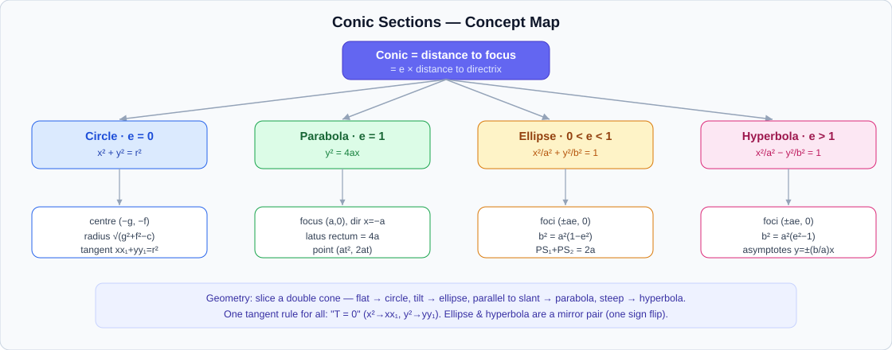
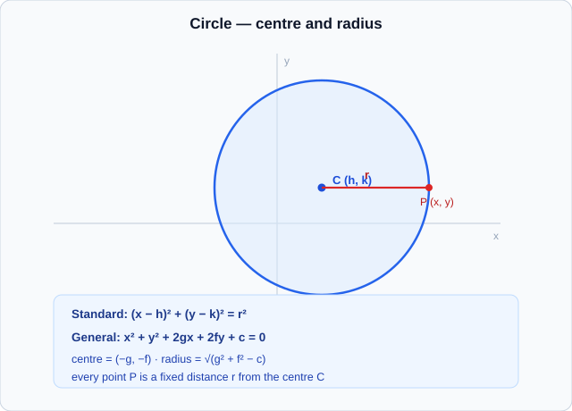
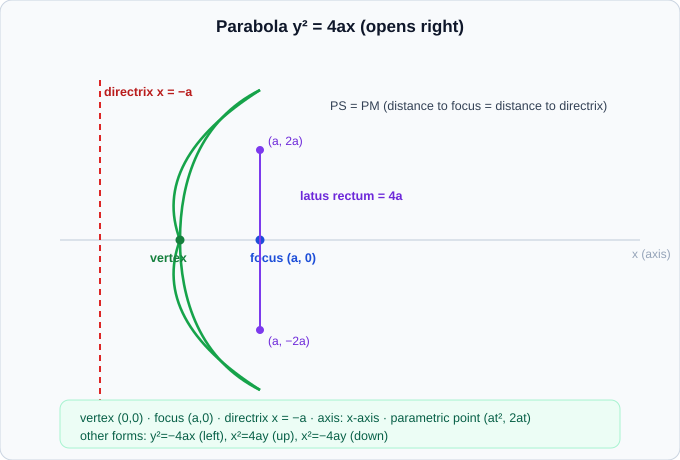
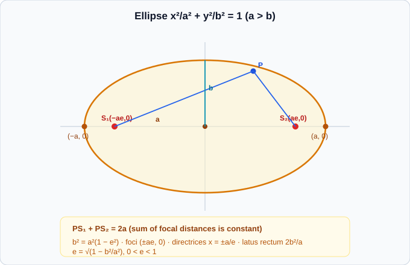
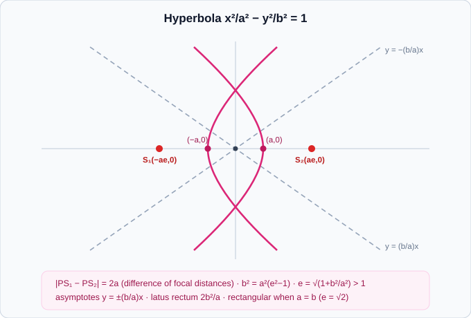

# Conic Sections — Concepts

> **Class 11 · Mathematics · Chapter 7** — Conic Sections
> **Branch:** Coordinate Geometry
> **Prerequisites:** straight lines, distance & section formulae, shifting of origin, basic algebra of quadratics
> **JEE weightage:** Very high — the parabola, ellipse and hyperbola together carry several questions every year in Main *and* Advanced, and the circle underpins all of coordinate geometry.

<!-- RENDERING: inside math use \cdot (not ·), \perp spelled as plain words, \to for arrows. Diagrams are SVGs. -->

---

## 📑 Index

1. [What is a conic? — slicing a cone](#1-what-is-a-conic--slicing-a-cone)
2. [The focus–directrix definition and eccentricity](#2-the-focusdirectrix-definition-and-eccentricity)
3. [The Circle](#3-the-circle)
4. [The Parabola](#4-the-parabola)
5. [The Ellipse](#5-the-ellipse)
6. [The Hyperbola](#6-the-hyperbola)
7. [The four conics side by side](#7-the-four-conics-side-by-side)

**Advanced (JEE Main & Advanced depth):**

8. [Position of a point and a line relative to a conic](#8-position-of-a-point-and-a-line)
9. [Tangents — point, slope and parametric forms](#9-tangents)
10. [Normals and co-normal points](#10-normals)
11. [Chords: chord of contact, mid-point chord, pole and polar](#11-chords-pole-and-polar)
12. [Special properties worth memorising](#12-special-properties)

Related: [Solved Numericals](./02-solved-numericals.md) · [Practice Range](./03-practice.md) · [Deep Dive](./04-deep-dive.md) · [Formula Recap](./05-formula-recap.md)

---

## 🗺️ Concept map

---

## 1. What is a conic? — slicing a cone

Take a **double cone** (two ice-cream cones joined tip to tip) and slice it with a flat plane. The
shape of the cut edge is a **conic section** — and which shape you get depends only on the *angle*
of the slice:

- Slice **straight across** (horizontal) → a **circle**.
- Tilt the slice a little → an **ellipse** (a squashed circle).
- Tilt until the plane is **parallel to the slant** of the cone → a **parabola** (it never closes).
- Tilt **steeper still**, so the plane cuts *both* cones → a **hyperbola** (two separate branches).

> [!NOTE]
> That's the geometric picture. But for solving problems we need *equations*, and for that there's
> one unifying idea — the **focus–directrix** definition — that produces all four conics from a
> single rule, just by changing one number (the eccentricity $e$).

---

## 2. The focus–directrix definition and eccentricity

> **A conic is the set of all points $P$ whose distance from a fixed point (the focus $S$) is a
> constant multiple $e$ of its distance from a fixed line (the directrix).**

$$\frac{PS}{PM} = e \qquad (PM = \text{perpendicular distance from } P \text{ to the directrix})$$

The constant $e$ is the **eccentricity**, and it alone decides the shape:

| Eccentricity | Conic |
|---|---|
| $e = 0$ | Circle (focus and centre coincide; directrix at infinity) |
| $0 < e < 1$ | Ellipse |
| $e = 1$ | Parabola |
| $e > 1$ | Hyperbola |

> [!IMPORTANT]
> Eccentricity is the single most important number in this chapter. "How round or how stretched"
> is entirely captured by $e$: a circle ($e=0$) is perfectly round, an ellipse is mildly stretched,
> a parabola ($e=1$) is the borderline open curve, and a hyperbola ($e>1$) flings apart into two
> branches. Many JEE questions reduce to "find $e$."

**The general second-degree equation.** Every conic can be written as
$$Ax^2 + Bxy + Cy^2 + Dx + Ey + F = 0.$$
With no $xy$ term ($B=0$) you can read off the type at a glance: $A = C$ → circle; only one square
term → parabola; both squares present with the *same sign* → ellipse; both squares with *opposite
signs* → hyperbola.

---

## 3. The Circle

A **circle** is the set of points at a fixed distance (the **radius** $r$) from a fixed point (the
**centre**). It's the conic with $e = 0$.

**Standard equation** (centre at origin): $\;x^2 + y^2 = r^2$.

**Centre–radius form** (centre $(h,k)$):
$$\boxed{(x-h)^2 + (y-k)^2 = r^2}$$

**General form:**
$$x^2 + y^2 + 2gx + 2fy + c = 0$$
with
$$\text{centre} = (-g,\,-f), \qquad \text{radius} = \sqrt{g^2 + f^2 - c}.$$

> [!TIP]
> To convert general → centre/radius: the centre is just "half the $x$-coefficient and half the
> $y$-coefficient, both negated." If $g^2 + f^2 - c < 0$ there's **no real circle** (imaginary); if
> it $= 0$ the "circle" is a single **point**.

**Other useful forms.**
- **Diameter form:** if $(x_1,y_1)$ and $(x_2,y_2)$ are ends of a diameter,
  $(x-x_1)(x-x_2) + (y-y_1)(y-y_2) = 0$.
- A circle needs **3 conditions** to be fixed (3 points, or centre + radius, etc.) — matching its 3 constants $g, f, c$.

**Line and circle.** Substitute the line into the circle to get a quadratic; its discriminant tells you:
secant (2 points), tangent (1 point), or no intersection. A line is tangent exactly when the
perpendicular distance from the centre equals the radius.

---

## 4. The Parabola

A **parabola** is the set of points **equidistant** from the focus and the directrix ($e = 1$). It's
the path of a thrown ball and the shape of a satellite dish.

**Standard form** (vertex at origin, opening right):
$$\boxed{y^2 = 4ax}$$

Here $a > 0$ is the distance from vertex to focus. Key features:

| Feature | For $y^2 = 4ax$ |
|---|---|
| Vertex | $(0,0)$ |
| Focus | $(a, 0)$ |
| Directrix | $x = -a$ |
| Axis | the $x$-axis ($y = 0$) |
| Latus rectum (length) | $4a$ |
| Endpoints of latus rectum | $(a, \pm 2a)$ |

**The four orientations** (vertex at origin):

| Equation | Opens | Focus | Directrix |
|---|---|---|---|
| $y^2 = 4ax$ | right | $(a,0)$ | $x=-a$ |
| $y^2 = -4ax$ | left | $(-a,0)$ | $x=a$ |
| $x^2 = 4ay$ | up | $(0,a)$ | $y=-a$ |
| $x^2 = -4ay$ | down | $(0,-a)$ | $y=a$ |

> [!IMPORTANT]
> The **latus rectum** is the chord through the focus perpendicular to the axis; its length $4a$
> sets the "width" of the parabola and appears constantly in problems. Remember: square term tells
> you the axis (if $y^2$ → horizontal axis; if $x^2$ → vertical axis), sign tells you the direction.

**Parametric form:** a point on $y^2 = 4ax$ is $(at^2,\ 2at)$ — extremely handy for chords and
tangents (see the [Deep Dive](./04-deep-dive.md)).

---

## 5. The Ellipse

An **ellipse** is the set of points whose distances from **two** fixed foci add up to a constant
($0 < e < 1$). Pin a loop of string over two tacks and trace it taut — that's an ellipse.

**Standard form** (centre at origin, major axis along $x$, with $a > b$):
$$\boxed{\frac{x^2}{a^2} + \frac{y^2}{b^2} = 1}$$

| Feature | Value |
|---|---|
| Semi-major axis | $a$ (along $x$) |
| Semi-minor axis | $b$ (along $y$) |
| Relation | $b^2 = a^2(1 - e^2)$ |
| Foci | $(\pm ae,\ 0)$ |
| Vertices | $(\pm a,\ 0)$ |
| Directrices | $x = \pm a/e$ |
| Eccentricity | $e = \sqrt{1 - b^2/a^2}$ |
| Latus rectum (length) | $2b^2/a$ |
| Sum of focal distances | $PS_1 + PS_2 = 2a$ |

> [!IMPORTANT]
> The **defining property** $PS_1 + PS_2 = 2a$ (sum of distances to the two foci is constant and
> equals the major axis length) is the single fact that unlocks most ellipse problems. Also note:
> if the **larger** denominator is under $y^2$, the major axis is vertical instead — always compare
> $a^2$ and $b^2$ first to see which way the ellipse is stretched.

**Relation to remember:** $c = ae$ where $c$ is the centre-to-focus distance, and $a^2 = b^2 + c^2$
(semi-major² = semi-minor² + focal-distance²) — the ellipse's own "Pythagoras."

---

## 6. The Hyperbola

A **hyperbola** is the set of points whose distances from two foci **differ** by a constant
($e > 1$). It has two separate branches and two **asymptotes** the curve approaches but never
touches.

**Standard form** (centre at origin, transverse axis along $x$):
$$\boxed{\frac{x^2}{a^2} - \frac{y^2}{b^2} = 1}$$

| Feature | Value |
|---|---|
| Transverse semi-axis | $a$ (along $x$, between the two vertices) |
| Conjugate semi-axis | $b$ (along $y$) |
| Relation | $b^2 = a^2(e^2 - 1)$ |
| Foci | $(\pm ae,\ 0)$ |
| Vertices | $(\pm a,\ 0)$ |
| Directrices | $x = \pm a/e$ |
| Eccentricity | $e = \sqrt{1 + b^2/a^2}$ |
| Latus rectum (length) | $2b^2/a$ |
| Asymptotes | $y = \pm \dfrac{b}{a}x$ |
| Difference of focal distances | $|PS_1 - PS_2| = 2a$ |

> [!IMPORTANT]
> Three things make the hyperbola different from the ellipse: (1) a **minus** sign between the
> squares, (2) the $+$ in $b^2 = a^2(e^2 - 1)$ (so $e > 1$ always), and (3) the **asymptotes**
> $y = \pm (b/a)x$, which the branches hug at infinity. The defining property is a *difference* of
> focal distances, not a sum.

**Rectangular (equilateral) hyperbola:** when $a = b$, the equation is $x^2 - y^2 = a^2$, the
asymptotes are perpendicular ($y = \pm x$), and $e = \sqrt{2}$. Its other common form is $xy = c^2$
(asymptotes along the axes).

---

## 7. The four conics side by side

| | Circle | Parabola | Ellipse | Hyperbola |
|---|---|---|---|---|
| Eccentricity $e$ | $0$ | $1$ | $0<e<1$ | $>1$ |
| Standard eqn | $x^2+y^2=r^2$ | $y^2=4ax$ | $\dfrac{x^2}{a^2}+\dfrac{y^2}{b^2}=1$ | $\dfrac{x^2}{a^2}-\dfrac{y^2}{b^2}=1$ |
| Foci | centre | $(a,0)$ | $(\pm ae,0)$ | $(\pm ae,0)$ |
| Defining property | fixed distance $r$ | $PS = PM$ | $PS_1+PS_2=2a$ | $|PS_1-PS_2|=2a$ |
| $b^2$ relation | — | — | $a^2(1-e^2)$ | $a^2(e^2-1)$ |
| Latus rectum | — | $4a$ | $2b^2/a$ | $2b^2/a$ |
| Asymptotes | none | none | none | $y=\pm(b/a)x$ |

> [!TIP]
> Notice how much the ellipse and hyperbola share — same foci form, same latus rectum, almost the
> same $b^2$ relation (just a sign flip). Learn them as a *pair* and you've nearly halved the work.

---

## ✅ One-line summary

> Every conic is "distance to a focus $= e \times$ distance to a directrix." The number $e$ picks the
> shape: $e=0$ circle, $e<1$ ellipse, $e=1$ parabola, $e>1$ hyperbola. Memorise each one's standard
> equation and its focus / directrix / latus-rectum / eccentricity package, and the ellipse and
> hyperbola as a mirror-image pair.

**Next:** [Solved Numericals →](./02-solved-numericals.md)
