# Conic Sections — Quick Formula Recap

> One-page revision for all four conics. If anything feels unfamiliar, jump back to
> [Concepts](./01-concepts.md) or the [Deep Dive](./04-deep-dive.md).

<!-- RENDERING: inside math use \cdot (not ·), \perp as plain words, \to for arrows. -->

---

## 📑 Index

- [Eccentricity → conic](#eccentricity)
- [Circle](#circle)
- [Parabola](#parabola)
- [Ellipse](#ellipse)
- [Hyperbola](#hyperbola)
- [Tangents & chords (all conics)](#tangents)
- [Master comparison table](#master-table)

---

## Eccentricity → conic

$$\frac{PS}{PM}=e:\quad e=0\ \text{circle},\quad 0<e<1\ \text{ellipse},\quad e=1\ \text{parabola},\quad e>1\ \text{hyperbola}$$

---

## Circle

- Centre $(h,k)$, radius $r$: $(x-h)^2+(y-k)^2=r^2$.
- General: $x^2+y^2+2gx+2fy+c=0$, centre $(-g,-f)$, radius $\sqrt{g^2+f^2-c}$.
- Diameter form: $(x-x_1)(x-x_2)+(y-y_1)(y-y_2)=0$.
- Tangent at $(x_1,y_1)$: $xx_1+yy_1=r^2$ (origin-centred).
- Tangent condition for $y=mx+c$: $c^2=r^2(1+m^2)$.
- Length of tangent from $(x_1,y_1)$: $\sqrt{x_1^2+y_1^2-r^2}$.

---

## Parabola $y^2=4ax$

| Item | Value |
|---|---|
| Vertex | $(0,0)$ |
| Focus | $(a,0)$ |
| Directrix | $x=-a$ |
| Latus rectum | $4a$ |
| Parametric point | $(at^2,\ 2at)$ |
| Focal distance of $(x,y)$ | $x+a$ |
| Tangent at $(x_1,y_1)$ | $yy_1=2a(x+x_1)$ |
| Tangent condition | $c=a/m$ |
| Focal chord ends | $t_1t_2=-1$ |

Orientations: $y^2=-4ax$ (left), $x^2=4ay$ (up), $x^2=-4ay$ (down).

---

## Ellipse $\dfrac{x^2}{a^2}+\dfrac{y^2}{b^2}=1$  $(a>b)$

| Item | Value |
|---|---|
| Vertices | $(\pm a,0)$ |
| Foci | $(\pm ae,0)$ |
| $b^2$ relation | $b^2=a^2(1-e^2)$ |
| Eccentricity | $\sqrt{1-b^2/a^2}$ |
| Directrices | $x=\pm a/e$ |
| Latus rectum | $2b^2/a$ |
| Sum of focal distances | $2a$ |
| Parametric point | $(a\cos\theta,\ b\sin\theta)$ |
| Tangent at $(x_1,y_1)$ | $\dfrac{xx_1}{a^2}+\dfrac{yy_1}{b^2}=1$ |
| Tangent condition | $c^2=a^2m^2+b^2$ |
| Director circle | $x^2+y^2=a^2+b^2$ |

> If the larger denominator is under $y^2$, the major axis is vertical (swap roles of $a,b$).

---

## Hyperbola $\dfrac{x^2}{a^2}-\dfrac{y^2}{b^2}=1$

| Item | Value |
|---|---|
| Vertices | $(\pm a,0)$ |
| Foci | $(\pm ae,0)$ |
| $b^2$ relation | $b^2=a^2(e^2-1)$ |
| Eccentricity | $\sqrt{1+b^2/a^2}$ |
| Directrices | $x=\pm a/e$ |
| Latus rectum | $2b^2/a$ |
| Difference of focal distances | $2a$ |
| Asymptotes | $y=\pm(b/a)x$ |
| Parametric point | $(a\sec\theta,\ b\tan\theta)$ |
| Tangent at $(x_1,y_1)$ | $\dfrac{xx_1}{a^2}-\dfrac{yy_1}{b^2}=1$ |
| Tangent condition | $c^2=a^2m^2-b^2$ |
| Director circle | $x^2+y^2=a^2-b^2$ (real if $a>b$) |

Rectangular hyperbola: $a=b$, $e=\sqrt2$, asymptotes $y=\pm x$; or $xy=c^2$.
Conjugate pair: $\dfrac{1}{e_1^2}+\dfrac{1}{e_2^2}=1$.

---

## Tangents & chords — the one rule

Form $T$ by splitting the curve's terms with the point $(x_1,y_1)$: $x^2\to xx_1$, $y^2\to yy_1$,
$x\to\tfrac{x+x_1}{2}$, $y\to\tfrac{y+y_1}{2}$.

- **Tangent at a point on the curve:** $T=0$.
- **Chord of contact from an external point:** $T=0$.
- **Point inside/outside:** sign of $S_1$ (plug point into $S$).

---

## Master comparison table

| | Circle | Parabola | Ellipse | Hyperbola |
|---|---|---|---|---|
| $e$ | $0$ | $1$ | $<1$ | $>1$ |
| Standard | $x^2+y^2=r^2$ | $y^2=4ax$ | $\frac{x^2}{a^2}+\frac{y^2}{b^2}=1$ | $\frac{x^2}{a^2}-\frac{y^2}{b^2}=1$ |
| Foci | centre | $(a,0)$ | $(\pm ae,0)$ | $(\pm ae,0)$ |
| Latus rectum | — | $4a$ | $2b^2/a$ | $2b^2/a$ |
| Defining | dist $=r$ | $PS=PM$ | $PS_1+PS_2=2a$ | $|PS_1-PS_2|=2a$ |
| Tangent cond. | $c^2=r^2(1+m^2)$ | $c=a/m$ | $c^2=a^2m^2+b^2$ | $c^2=a^2m^2-b^2$ |

> [!TIP]
> If stuck: write the standard equation → identify $a,b$ (or $g,f,c$) → use the relevant row. Nearly
> every conic question is "read off the right value from the standard form."

---

## 📸 Handwritten Notes (originals)

Scanned reference notes for this chapter, filed under [`notes/scans/`](./notes/scans/). These are the original handwritten sheets that back up the formulas above.

<b>Circle</b>

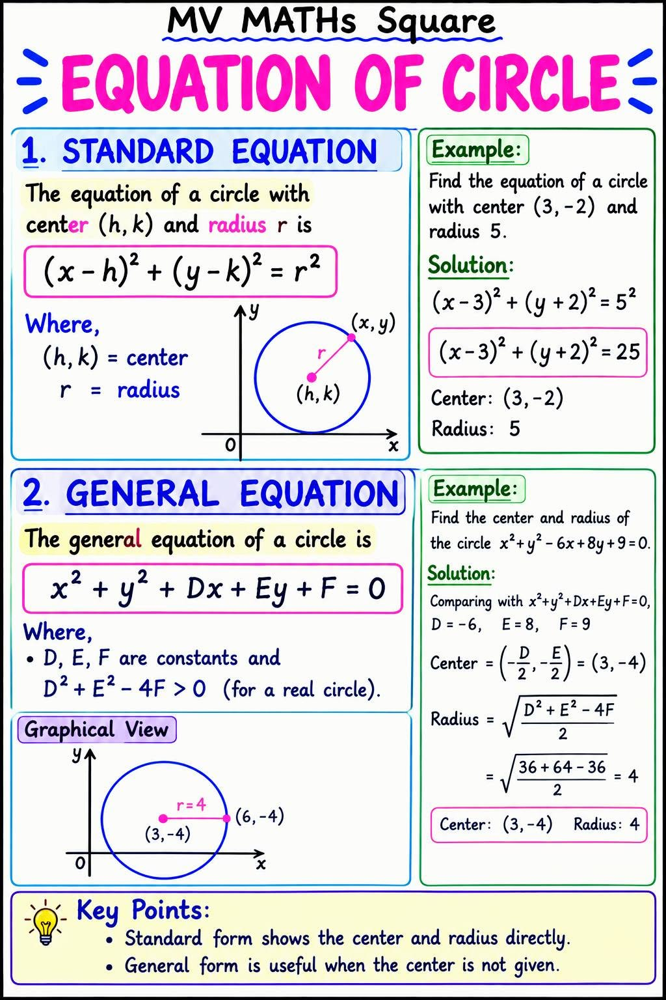
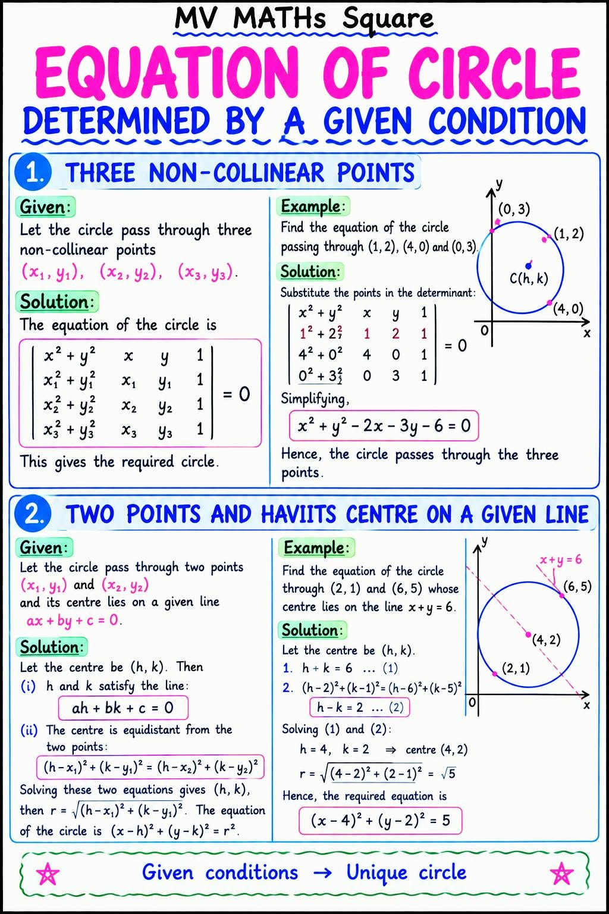
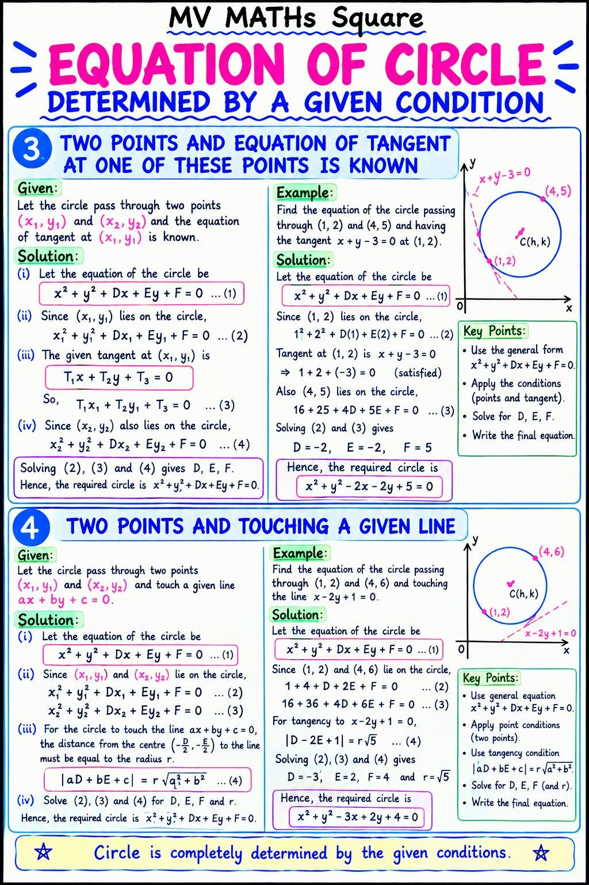
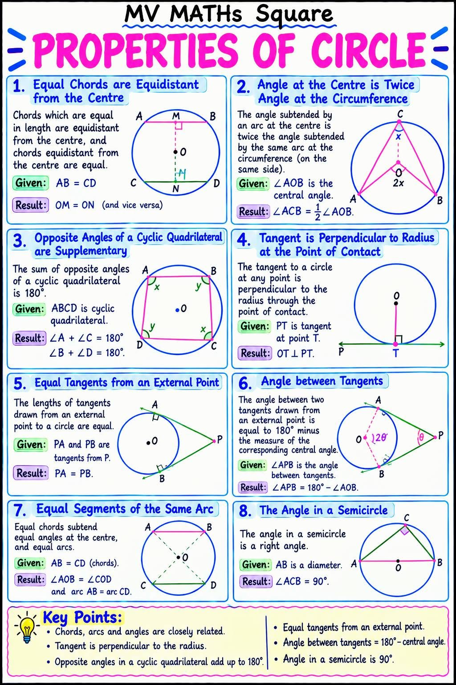
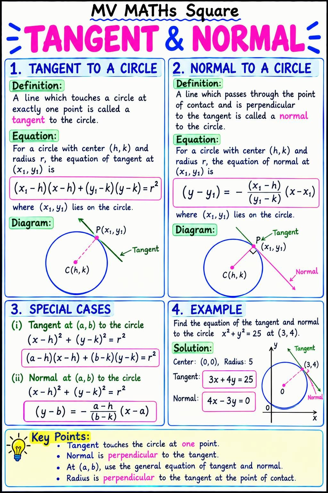

<b>Hyperbola</b>

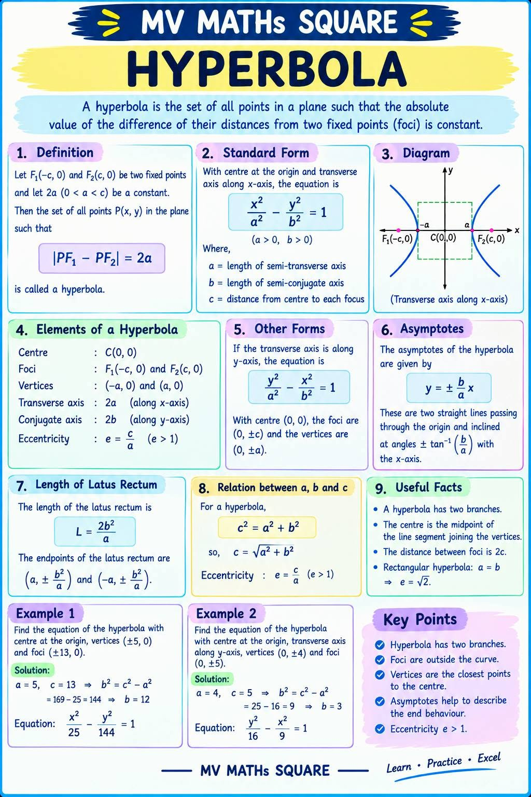
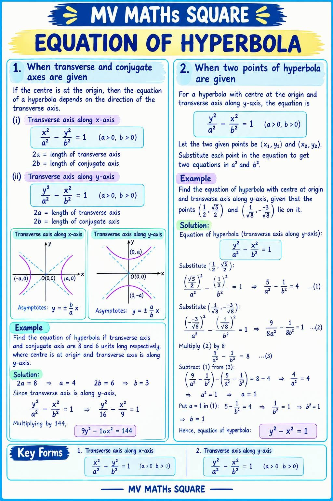
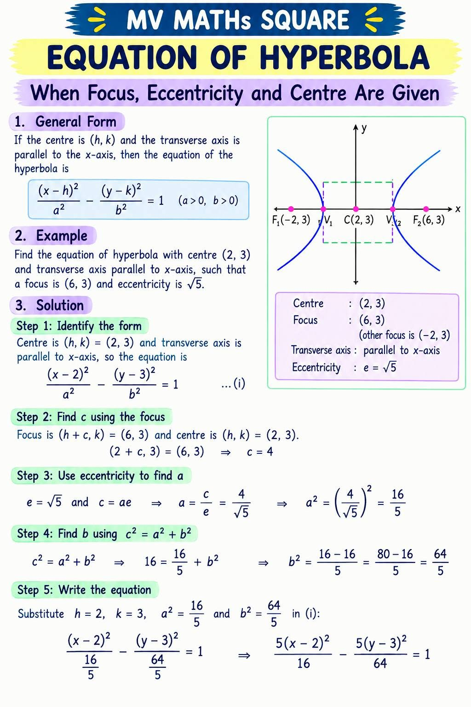
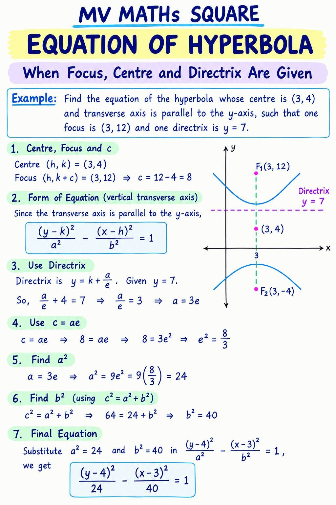
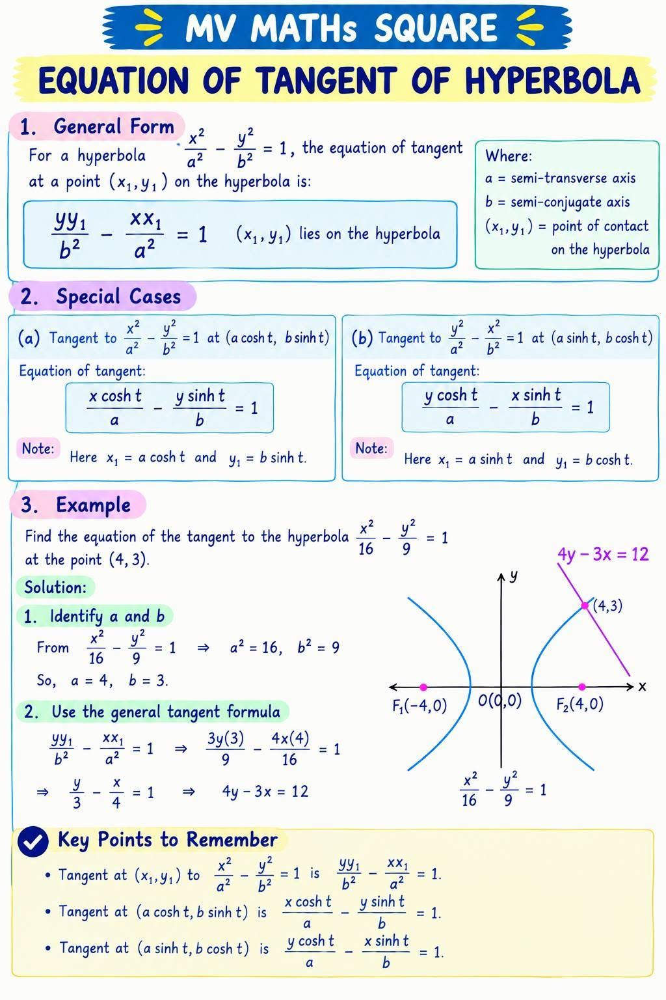
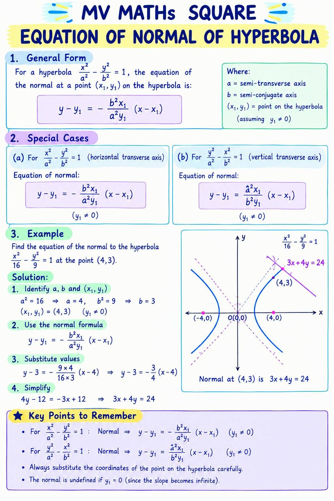
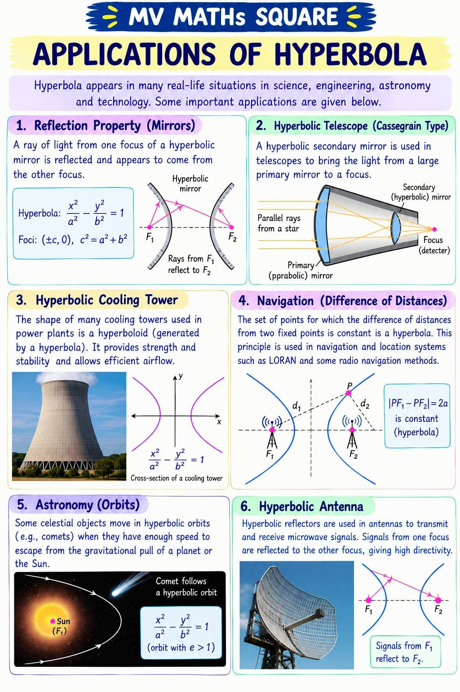
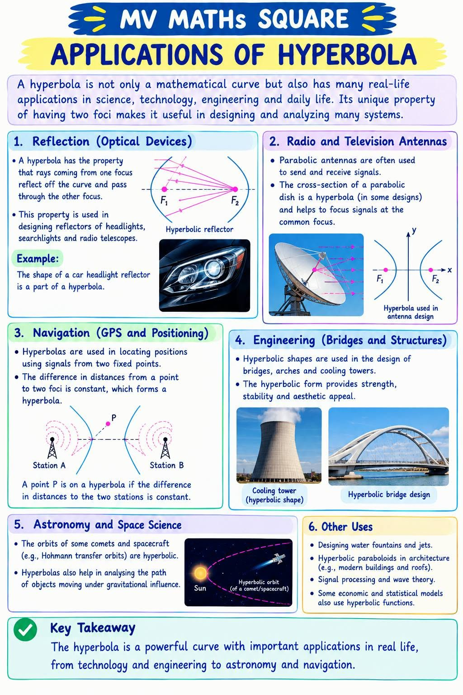

<b>Translation &amp; rotation of axes</b>

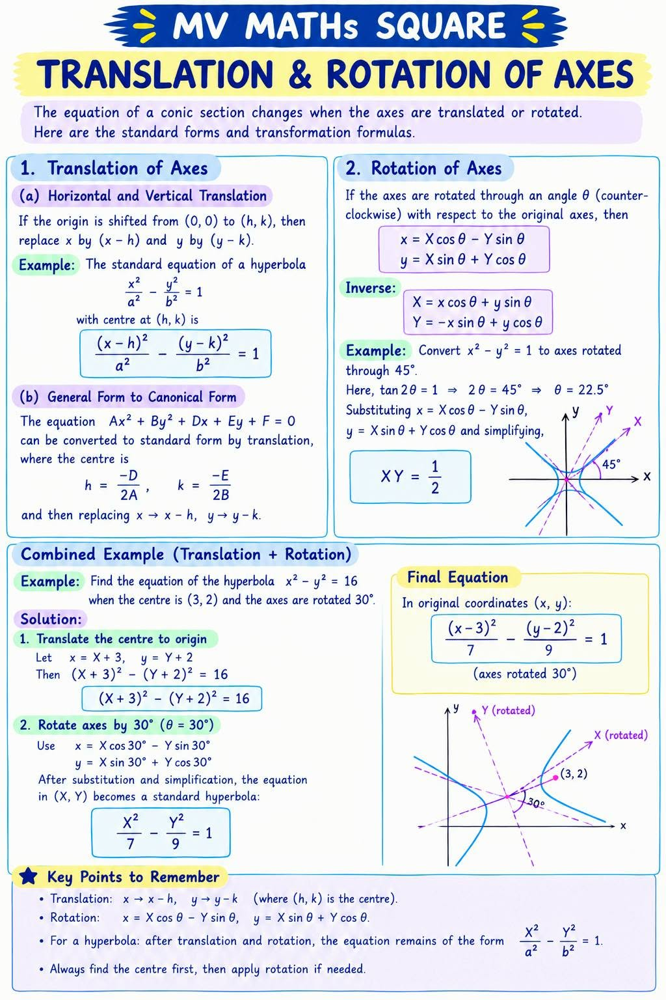
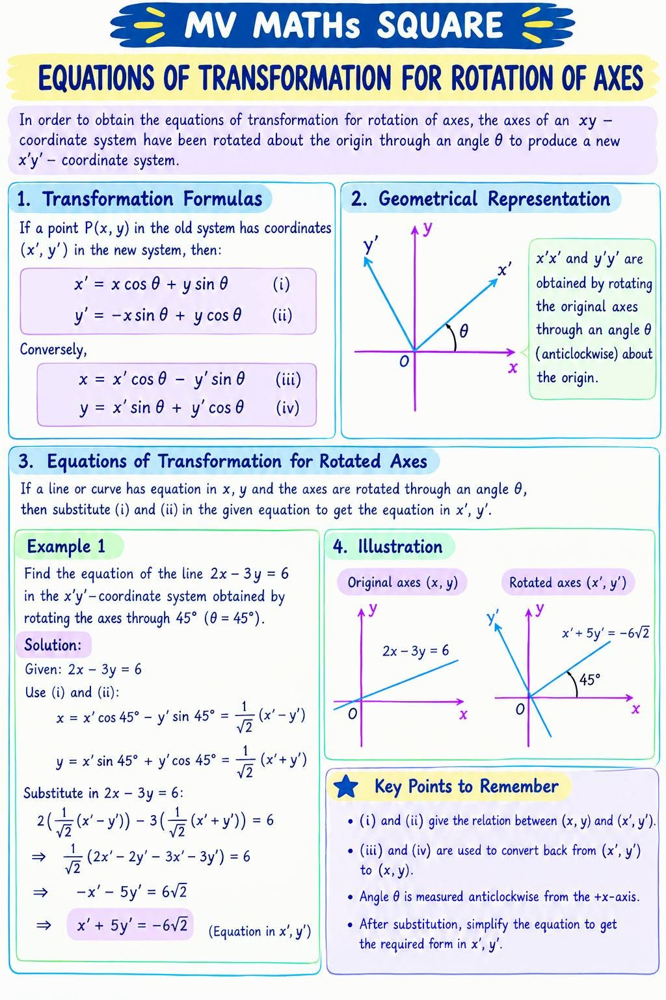

---

**Back to:** [Concepts](./01-concepts.md) · [Solved Numericals](./02-solved-numericals.md) · [Practice](./03-practice.md) · [Deep Dive](./04-deep-dive.md)
