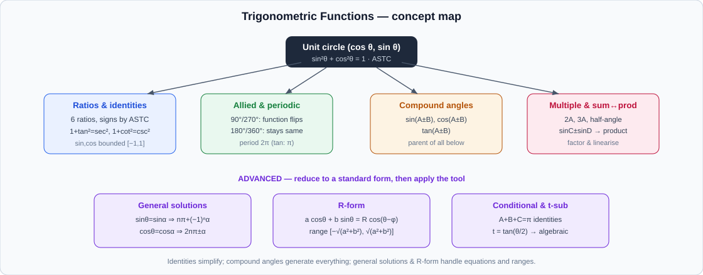

# Trigonometric Functions — Concepts

> **Class 11 · Mathematics · Chapter 8** — Trigonometric Functions (angles, identities, compound & multiple angles, equations)
> **Prerequisites:** right-triangle ratios, the number line/radians, basic algebra and the unit circle
> **JEE weightage:** Very High — identities, compound/multiple-angle formulae and general solutions appear every year in Main and are a core tool in calculus, complex numbers, vectors and coordinate geometry.

<!-- RENDERING: inside math use \cdot (not ·), \to (not →), \sum, \frac, \geq/\leq. Concept map is an SVG. -->

---

## 📑 Index

1. [Angles, radians and the unit circle](#1-angles)
2. [The six ratios, signs by quadrant, and ranges](#2-ratios)
3. [Fundamental (Pythagorean) identities](#3-identities)
4. [Allied angles and periodicity](#4-allied)
5. [Compound-angle formulae](#5-compound)
6. [Multiple- and sub-multiple-angle formulae](#6-multiple)
7. [Sum ↔ product transformations](#7-sumproduct)

**Advanced (JEE Main & Advanced depth):**

8. [General solutions of trigonometric equations](#8-general)
9. [Maxima/minima of $a\cos\theta + b\sin\theta$ and conditional identities](#9-maxmin)
10. [Inverse-ratio awareness and the law of sines/cosines link](#10-laws)

Related: [Solved Numericals](./02-solved-numericals.md) · [Practice Range](./03-practice.md) · [Deep Dive](./04-deep-dive.md) · [Formula Recap](./05-formula-recap.md)

---

## 🗺️ Concept map

---

## 1. Angles, radians and the unit circle

An angle in **standard position** has its vertex at the origin and initial side along the positive $x$-axis.
Positive angles turn anticlockwise.

- **Radian–degree:** $\pi \text{ rad} = 180°$, so $1 \text{ rad} = \tfrac{180°}{\pi} \approx 57.3°$ and
  $\theta_{\text{rad}} = \tfrac{\pi}{180}\theta_{\text{deg}}$.
- **Arc length** $\ell = r\theta$ and **area of a sector** $= \tfrac12 r^2\theta$ (with $\theta$ in radians).
- On the **unit circle**, a point at angle $\theta$ is $(\cos\theta, \sin\theta)$.

> [!TIP]
> Always work in **radians** for calculus and general solutions; convert at the end if a degree answer is
> wanted. The unit-circle picture $(\cos\theta, \sin\theta)$ is the single most useful mental model — signs,
> ranges and periodicity all read off it directly.

---

## 2. The six ratios, signs by quadrant, and ranges

$$\sin\theta, \cos\theta, \tan\theta = \frac{\sin\theta}{\cos\theta}, \quad \csc\theta = \frac1{\sin\theta}, \ \sec\theta = \frac1{\cos\theta}, \ \cot\theta = \frac{\cos\theta}{\sin\theta}.$$

**Signs by quadrant** — "**A**ll **S**ilver **T**ea **C**ups" (Q1 all +, Q2 sin +, Q3 tan +, Q4 cos +).

**Ranges:** $-1 \le \sin\theta, \cos\theta \le 1$; $\tan\theta, \cot\theta \in \mathbb{R}$; $|\csc\theta|, |\sec\theta| \ge 1$.

> [!IMPORTANT]
> The **ASTC** rule fixes the sign of every ratio in each quadrant — essential for allied angles and general
> solutions. Remember $\sin$ and $\cos$ are **bounded** in $[-1, 1]$ (so an equation like $\cos\theta = 2$ has
> no solution), while $\tan$ is unbounded.

---

## 3. Fundamental (Pythagorean) identities

$$\boxed{\sin^2\theta + \cos^2\theta = 1}, \qquad 1 + \tan^2\theta = \sec^2\theta, \qquad 1 + \cot^2\theta = \csc^2\theta.$$

These three come from the unit circle and are the backbone of every simplification.

> [!IMPORTANT]
> The second and third identities are just the first **divided by $\cos^2\theta$ and $\sin^2\theta$**. When you
> see a mix of $\tan$ and $\sec$ (or $\cot$ and $\csc$), reach for these. Most "prove the identity" problems
> are solved by converting everything to $\sin$ and $\cos$ first.

---

## 4. Allied angles and periodicity

Ratios of $-\theta$, $90°\pm\theta$, $180°\pm\theta$, $270°\pm\theta$, $360°\pm\theta$ reduce to ratios of
$\theta$:
- **Even/odd:** $\cos(-\theta) = \cos\theta$ (even); $\sin(-\theta) = -\sin\theta$, $\tan(-\theta) = -\tan\theta$ (odd).
- **Co-ratios at $90°\pm\theta$:** $\sin(90° - \theta) = \cos\theta$, $\tan(90° - \theta) = \cot\theta$, etc.
- **Periods:** $\sin, \cos, \sec, \csc$ have period $2\pi$; $\tan, \cot$ have period $\pi$.

> [!TIP]
> The rule for any allied angle: **for $90°$ or $270°$ shifts the ratio changes** (sin↔cos, tan↔cot); **for
> $180°$ or $360°$ it stays the same**. The sign is then fixed by ASTC for the quadrant the angle lands in.
> This "function-changes-or-not + sign" recipe handles every reduction.

---

## 5. Compound-angle formulae

$$\sin(A \pm B) = \sin A\cos B \pm \cos A\sin B$$
$$\cos(A \pm B) = \cos A\cos B \mp \sin A\sin B$$
$$\tan(A \pm B) = \frac{\tan A \pm \tan B}{1 \mp \tan A\tan B}$$

> [!IMPORTANT]
> Watch the **flipped sign** in $\cos(A\pm B)$ (the $\mp$) and in the denominator of $\tan(A\pm B)$. These
> formulae let you evaluate non-standard angles (e.g. $\sin 75° = \sin(45° + 30°)$) and are the parents of all
> the multiple-angle and sum-product results below.

---

## 6. Multiple- and sub-multiple-angle formulae

**Double angle** (set $B = A$):
$$\sin 2A = 2\sin A\cos A, \qquad \cos 2A = \cos^2 A - \sin^2 A = 1 - 2\sin^2 A = 2\cos^2 A - 1, \qquad \tan 2A = \frac{2\tan A}{1 - \tan^2 A}.$$

**In terms of $t = \tan A$:** $\sin 2A = \dfrac{2t}{1 + t^2}$, $\cos 2A = \dfrac{1 - t^2}{1 + t^2}$.

**Triple angle:** $\sin 3A = 3\sin A - 4\sin^3 A$, $\cos 3A = 4\cos^3 A - 3\cos A$, $\tan 3A = \dfrac{3\tan A - \tan^3 A}{1 - 3\tan^2 A}$.

> [!TIP]
> The three forms of $\cos 2A$ are chosen by what you want to eliminate: use $1 - 2\sin^2 A$ to kill cosines,
> $2\cos^2 A - 1$ to kill sines. The **half-angle / power-reduction** forms $\sin^2 A = \tfrac{1 - \cos 2A}{2}$
> and $\cos^2 A = \tfrac{1 + \cos 2A}{2}$ are indispensable in integration later.

---

## 7. Sum ↔ product transformations

**Sum to product:**
$$\sin C + \sin D = 2\sin\frac{C+D}{2}\cos\frac{C-D}{2}, \qquad \cos C + \cos D = 2\cos\frac{C+D}{2}\cos\frac{C-D}{2}$$
$$\sin C - \sin D = 2\cos\frac{C+D}{2}\sin\frac{C-D}{2}, \qquad \cos C - \cos D = -2\sin\frac{C+D}{2}\sin\frac{C-D}{2}$$

**Product to sum:** $2\sin A\cos B = \sin(A+B) + \sin(A-B)$, and similar for the others.

> [!IMPORTANT]
> Sum↔product is the key to **factorising** trig expressions and solving equations like $\sin 3x + \sin x = 0$
> (becomes $2\sin 2x\cos x = 0$). Going the other way, product→sum linearises products for integration. Both
> families come straight from the compound-angle formulae.

---

<!-- ===== ADVANCED CLUSTER (required on every chapter) ===== -->

## 8. General solutions of trigonometric equations

Because the ratios are periodic, an equation has **infinitely many** solutions, captured by a general formula
($n \in \mathbb{Z}$):

$$\sin\theta = \sin\alpha \Rightarrow \theta = n\pi + (-1)^n\alpha$$
$$\cos\theta = \cos\alpha \Rightarrow \theta = 2n\pi \pm \alpha$$
$$\tan\theta = \tan\alpha \Rightarrow \theta = n\pi + \alpha$$

> [!IMPORTANT]
> Memorise the three general-solution forms — the $(-1)^n$ for sine, the $\pm$ for cosine, and the clean
> $n\pi + \alpha$ for tangent. First reduce the equation to one of these shapes (using identities / sum-product),
> then write the family. Always state the particular-value $\alpha$ in the principal range.

---

## 9. Maxima/minima of $a\cos\theta + b\sin\theta$ and conditional identities

Any expression $a\cos\theta + b\sin\theta$ can be written as $R\cos(\theta - \phi)$ with $R = \sqrt{a^2 + b^2}$,
so its **range is $[-\sqrt{a^2+b^2},\ \sqrt{a^2+b^2}]$**.

**Conditional identities:** when $A + B + C = \pi$ (angles of a triangle), special relations hold, e.g.
$\tan A + \tan B + \tan C = \tan A\tan B\tan C$ and $\sin 2A + \sin 2B + \sin 2C = 4\sin A\sin B\sin C$.

> [!IMPORTANT]
> The $R$-form trick ($a\cos\theta + b\sin\theta = \sqrt{a^2+b^2}\cos(\theta - \phi)$) instantly gives the
> **max $\sqrt{a^2+b^2}$ and min $-\sqrt{a^2+b^2}$** — a very common JEE Main question. For conditional
> identities, use $C = \pi - (A+B)$ to convert one angle and then apply compound-angle formulae.

---

## 10. Inverse-ratio awareness and the law of sines/cosines link

A quick bridge to triangle trigonometry (expanded in Class 11 "Trigonometry II" / later chapters):
- **Law of sines:** $\dfrac{a}{\sin A} = \dfrac{b}{\sin B} = \dfrac{c}{\sin C} = 2R$.
- **Law of cosines:** $c^2 = a^2 + b^2 - 2ab\cos C$.
- Principal values of inverse ratios: $\sin^{-1}x \in [-\tfrac\pi2, \tfrac\pi2]$, $\cos^{-1}x \in [0, \pi]$.

> [!NOTE]
> These laws connect the **function** trigonometry of this chapter to **triangle** problems and appear in
> heights-and-distances and vector questions. Keep the principal ranges of the inverse ratios in mind — they
> become a full chapter in Class 12 but already show up when you "take $\sin^{-1}$" of both sides.

---

## ✅ One-line summary

> Trig ratios live on the **unit circle** $(\cos\theta, \sin\theta)$ with signs by **ASTC**; the Pythagorean
> identity $\sin^2+\cos^2=1$ (and its two cousins) drives every simplification. **Compound-angle** formulae
> generate the **double/triple-angle** and **sum↔product** families. Advanced: **general solutions**
> ($\sin\theta=\sin\alpha \Rightarrow n\pi+(-1)^n\alpha$, etc.), the **$R$-form** range
> $[-\sqrt{a^2+b^2},\sqrt{a^2+b^2}]$ for $a\cos\theta+b\sin\theta$, and the sine/cosine laws linking to triangles.

**Next:** [Solved Numericals →](./02-solved-numericals.md)
