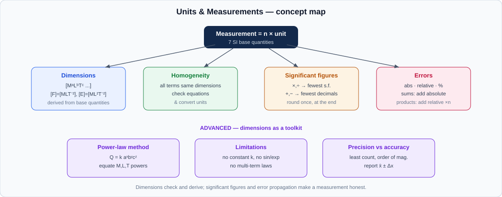

# Units & Measurements — Concepts

> **Class 11 · Physics · Chapter 1** — Units and Measurements (physical quantities, SI units, dimensions, errors, significant figures)
> **Prerequisites:** basic arithmetic, powers of ten, elementary algebra
> **JEE weightage:** Moderate but foundational — 1–2 direct questions in Main (dimensional formulae, error propagation, significant figures) and the bedrock skill set — dimensional analysis — that every later chapter relies on.

<!-- RENDERING: inside math use \cdot (not ·), \to (not →), \sum, \frac, \geq/\leq, \pm, \times. Concept map is an SVG. -->

---

## 📑 Index

1. [Physical quantities, units and the SI system](#1-quantities)
2. [Fundamental and derived quantities](#2-fundamental)
3. [Dimensions and dimensional formulae](#3-dimensions)
4. [The principle of homogeneity and dimensional analysis](#4-homogeneity)
5. [Significant figures and rounding](#5-sigfig)
6. [Errors in measurement](#6-errors)
7. [Propagation (combination) of errors](#7-propagation)

**Advanced (JEE Main & Advanced depth):**

8. [Finding relations by the dimensional method (and its limits)](#8-method)
9. [Order of magnitude, scientific notation and estimation](#9-order)
10. [Precision vs accuracy, least count and instrument errors](#10-precision)

Related: [Solved Numericals](./02-solved-numericals.md) · [Practice Range](./03-practice.md) · [Deep Dive](./04-deep-dive.md) · [Formula Recap](./05-formula-recap.md)

---

## 🗺️ Concept map

---

## 1. Physical quantities, units and the SI system

A **physical quantity** is anything that can be measured. Every measurement is

$$\text{Physical quantity} = \text{(numerical value)} \times \text{(unit)}.$$

The same quantity in a smaller unit has a proportionally larger number: $n_1 u_1 = n_2 u_2$ (so $n \propto 1/u$).

The **SI system** (Système International) uses **seven base units**, listed in §2. Units are written in lower case
(metre, kilogram) but their symbols after a person's name are capitalised (N, Pa, J).

> [!TIP]
> The relation $n_1 u_1 = n_2 u_2$ is the engine of **unit conversion**: a bigger unit ⟹ a smaller number.
> Always carry units through a calculation — they are your first check that an answer makes sense.

---

## 2. Fundamental and derived quantities

**Fundamental (base) quantities** are independent — they don't depend on others. There are **seven**:

| Quantity | SI unit | Symbol | Dimension |
|---|---|---|---|
| Length | metre | m | $[\text{L}]$ |
| Mass | kilogram | kg | $[\text{M}]$ |
| Time | second | s | $[\text{T}]$ |
| Electric current | ampere | A | $[\text{I}]$ (or $[\text{A}]$) |
| Temperature | kelvin | K | $[\Theta\,/\,\text{K}]$ |
| Amount of substance | mole | mol | $[\text{N}]$ |
| Luminous intensity | candela | cd | $[\text{J}]$ (or $[\text{cd}]$) |

**Derived quantities** are built from these by multiplication/division (area $= \text{L}^2$, speed $= \text{L/T}$, force $= \text{MLT}^{-2}$).

> [!IMPORTANT]
> Memorise the **seven base quantities** — mnemonic "**L**il **M**e **T**ime **I** **T**ook **S**ome **C**offee"
> (Length, Mass, Time, Current, Temperature, Substance-amount, Candela/luminous intensity). Everything else in
> physics is a **derived** quantity expressed in terms of these.

---

## 3. Dimensions and dimensional formulae

The **dimensions** of a quantity are the powers to which the base quantities are raised to represent it. The
**dimensional formula** writes this explicitly:

$$[\text{Force}] = [\text{M}^1\text{L}^1\text{T}^{-2}], \qquad [\text{Energy}] = [\text{M}^1\text{L}^2\text{T}^{-2}], \qquad [\text{Pressure}] = [\text{M}^1\text{L}^{-1}\text{T}^{-2}].$$

Dimensions can be positive, negative or zero — but **never fractional for base combinations of whole-number
powers** (a dimensionless quantity like strain has all powers zero).

> [!TIP]
> Build any dimensional formula from a **defining equation**: e.g. from $F = ma$, $[F] = [\text{M}][\text{LT}^{-2}] = [\text{MLT}^{-2}]$;
> from $P = F/A$, $[P] = [\text{MLT}^{-2}]/[\text{L}^2] = [\text{ML}^{-1}\text{T}^{-2}]$. Learn to *derive* rather than
> memorise all of them.

---

## 4. The principle of homogeneity and dimensional analysis

**Principle of homogeneity:** every term in a valid physical equation must have the **same dimensions** — you can
only add or equate quantities of like dimensions.

Uses of dimensional analysis:
1. **Check correctness** of an equation (both sides same dimensions).
2. **Convert units** between systems.
3. **Derive relations** between quantities (§8).

> [!IMPORTANT]
> Homogeneity is the single most useful idea in this chapter: if the dimensions of the two sides of an equation
> don't match, the equation is **wrong**. Note the converse fails — a dimensionally consistent equation can still
> be wrong (a missing dimensionless constant, or a wrong numerical factor).

---

## 5. Significant figures and rounding

**Significant figures** are the reliably known digits in a measurement plus one estimated digit.

**Rules:**
- All non-zero digits are significant.
- Zeros **between** non-zero digits are significant (205 → 3 s.f.).
- **Leading** zeros are **not** significant (0.0034 → 2 s.f.).
- **Trailing** zeros after a decimal point **are** significant (2.300 → 4 s.f.).

**Rounding:** if the digit dropped is $\ge 5$, round up; if $< 5$, keep the same.

**In calculations:**
- **Multiplication/division:** the result keeps the **fewest significant figures** of any factor.
- **Addition/subtraction:** the result keeps the **fewest decimal places**.

> [!IMPORTANT]
> Significant-figure rules differ for (×, ÷) vs (+, −): **count s.f.** for products/quotients, but **count decimal
> places** for sums/differences. Round only at the **final** step to avoid accumulating rounding error.

---

## 6. Errors in measurement

No measurement is exact. For a measured value $x_m$ with true value $x_t$ (or mean value $\bar{x}$):

| Error | Definition |
|---|---|
| **Absolute error** | $\Delta x = \lvert x_m - \bar{x}\rvert$ |
| **Mean absolute error** | $\overline{\Delta x} = \dfrac{1}{n}\sum \lvert\Delta x_i\rvert$ |
| **Relative (fractional) error** | $\dfrac{\overline{\Delta x}}{\bar{x}}$ |
| **Percentage error** | $\dfrac{\overline{\Delta x}}{\bar{x}} \times 100\%$ |

Errors are of two broad kinds: **systematic** (consistent bias — instrument zero error, etc.) and **random**
(scatter, reduced by averaging many readings).

> [!TIP]
> **Relative error is dimensionless** and is what you combine in formulas (§7). Taking the **mean of many
> readings** reduces random error; it does **not** remove systematic error — for that you must correct the
> instrument (e.g. subtract a zero error).

---

## 7. Propagation (combination) of errors

When measured quantities are combined, their errors combine too. For $Z$ formed from $A, B$:

| Operation | Rule for the error |
|---|---|
| $Z = A + B$ or $Z = A - B$ | **absolute** errors add: $\Delta Z = \Delta A + \Delta B$ |
| $Z = AB$ or $Z = A/B$ | **relative** errors add: $\dfrac{\Delta Z}{Z} = \dfrac{\Delta A}{A} + \dfrac{\Delta B}{B}$ |
| $Z = A^n$ | $\dfrac{\Delta Z}{Z} = \lvert n\rvert\dfrac{\Delta A}{A}$ |
| $Z = \dfrac{A^p B^q}{C^r}$ | $\dfrac{\Delta Z}{Z} = p\dfrac{\Delta A}{A} + q\dfrac{\Delta B}{B} + r\dfrac{\Delta C}{C}$ |

> [!IMPORTANT]
> The master rule: for **sums/differences add absolute errors**, for **products/quotients/powers add relative
> errors (weighted by the power)**. Always take the **magnitude** of the exponents — errors never cancel, they
> accumulate (worst-case). This is the most heavily tested idea in the chapter.

---

<!-- ===== ADVANCED CLUSTER (required on every chapter) ===== -->

## 8. Finding relations by the dimensional method (and its limits)

To find how a quantity $Q$ depends on others, assume a **power-law** $Q = k\,a^x b^y c^z$ (with $k$ a
dimensionless constant), write both sides dimensionally, and **equate the powers** of M, L, T to solve for
$x, y, z$.

**Example — period of a simple pendulum:** assume $T = k\,\ell^a g^b m^c$. Matching dimensions gives
$a = \tfrac12$, $b = -\tfrac12$, $c = 0$, so $T \propto \sqrt{\ell/g}$ (the constant $k = 2\pi$ is *not* found by
this method).

**Limitations:**
1. The dimensionless constant $k$ cannot be found.
2. It can't handle relations with $+$ (sums of terms) or with trig/exponential/log functions.
3. It fails if a quantity depends on more variables than there are base dimensions to equate.

> [!IMPORTANT]
> The dimensional method **gives the form** of a law (the exponents) but never the **numerical constant** or any
> dimensionless function. Set up one equation per base dimension (M, L, T) and solve the linear system for the
> exponents — a classic JEE Main question type.

---

## 9. Order of magnitude, scientific notation and estimation

**Scientific notation:** write a number as $N \times 10^n$ with $1 \le N < 10$. The **order of magnitude** is the
power $10^n$ after rounding $N$ (round $N$ to the nearest power of ten: if $N \ge \sqrt{10} \approx 3.16$ round
the exponent up).

This supports **Fermi estimation** — getting an answer to the nearest power of ten with minimal data.

> [!TIP]
> Order of magnitude strips a quantity to its power of ten — the fast way to compare very large/small numbers
> ($10^{-10}$ m atom vs $10^{21}$ m galaxy). Keeping numbers in scientific notation also makes significant-figure
> tracking trivial (the digits in $N$ are exactly the significant ones).

---

## 10. Precision vs accuracy, least count and instrument errors

- **Accuracy** = closeness to the *true* value; **precision** = closeness of repeated readings to *each other*. A
  measurement can be precise but inaccurate (consistent but biased).
- **Least count (LC)** = the smallest value an instrument can read (e.g. vernier calliper LC $= 0.01$ cm). The
  **least-count error** is of the order of one least count and sets the limit of precision.
- **Zero error** (a systematic instrument error) must be **subtracted** from every reading.

> [!NOTE]
> More significant figures ⟹ more **precise**, not necessarily more **accurate**. The least count caps how
> precisely you can report a reading; the error in a single reading is usually taken as half the least count (or
> one LC, by convention in your syllabus). Always report a measurement as $\bar{x} \pm \Delta x$ with consistent
> units and significant figures.

---

## ✅ One-line summary

> Every measurement is **(number) × (unit)**; the SI system rests on **seven base quantities**, and every other
> quantity's **dimensional formula** is built from M, L, T, … The **principle of homogeneity** checks equations
> and (via the **power-law method**) derives their form — but never the dimensionless constant. **Significant
> figures** track precision (count s.f. for ×/÷, decimal places for +/−), and **errors propagate** by adding
> absolute errors for sums and relative errors (× the power) for products — the chapter's most-tested skill.

**Next:** [Solved Numericals →](./02-solved-numericals.md)
