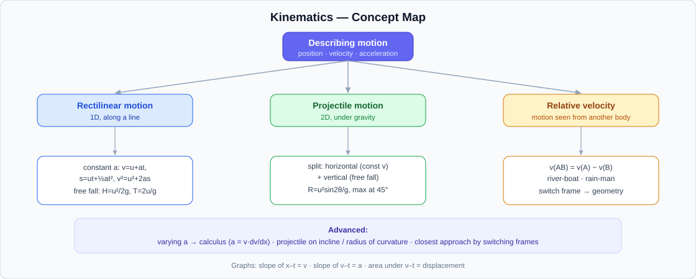
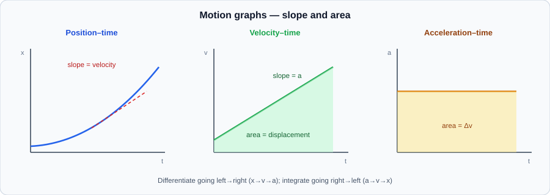
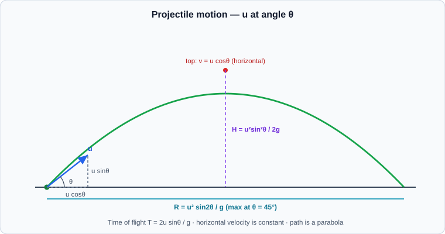
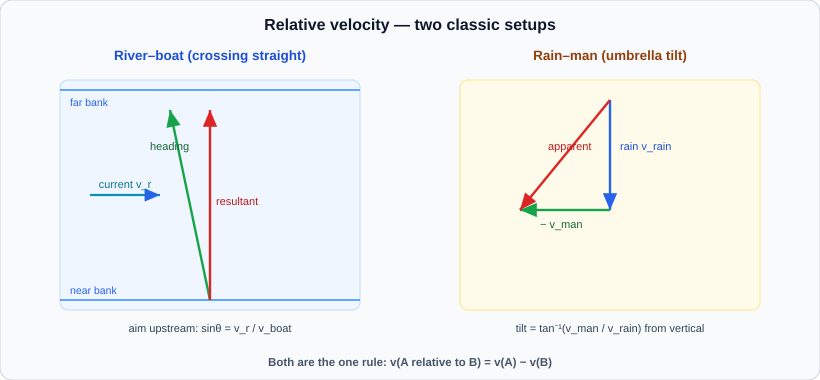

# Kinematics — Concepts

> **Class 11 · Physics · Chapter 2** — Kinematics (Motion in a Straight Line + Motion in a Plane)
> **Prerequisites:** basic vectors (addition, components, resolution), elementary algebra, intro differentiation & integration (for the advanced sections)
> **JEE weightage:** High — rectilinear motion, projectiles and relative velocity appear every year in Main and feed into Laws of Motion, Work-Energy and circular motion in Advanced.

<!-- RENDERING: inside math use \cdot (not ·), \perp spelled as plain words, \to for arrows, vectors with \vec{}. Diagrams are SVGs. -->

---

## 📑 Index

1. [The basic quantities: position, distance, displacement](#1-basic-quantities)
2. [Speed, velocity and acceleration](#2-speed-velocity-acceleration)
3. [Motion graphs and what their slopes/areas mean](#3-motion-graphs)
4. [Equations of uniformly accelerated motion (rectilinear)](#4-equations-of-motion)
5. [Motion under gravity (free fall)](#5-motion-under-gravity)
6. [Projectile motion](#6-projectile-motion)
7. [Relative velocity](#7-relative-velocity)

**Advanced (JEE Main & Advanced depth):**

8. [Non-uniform acceleration — the calculus of motion](#8-non-uniform-acceleration)
9. [Projectile, advanced — incline, from a height, radius of curvature](#9-projectile-advanced)
10. [Relative motion, advanced — closest approach, river & rain](#10-relative-motion-advanced)

Related: [Solved Numericals](./02-solved-numericals.md) · [Practice Range](./03-practice.md) · [Deep Dive](./04-deep-dive.md) · [Formula Recap](./05-formula-recap.md)

---

## 🗺️ Concept map

---

## 1. The basic quantities: position, distance, displacement

Kinematics describes *how* things move — without asking *why* (that's dynamics, next chapter).

- **Position** — where an object is, measured from a chosen origin. In 1D it's a single coordinate $x$; in a plane it's a position vector $\vec{r} = x\hat{i} + y\hat{j}$.
- **Distance** — the *total path length* travelled. A scalar, always positive, never decreases.
- **Displacement** — the *straight-line change in position*, $\Delta \vec{r} = \vec{r}_f - \vec{r}_i$. A vector; can be positive, negative or zero.

> [!IMPORTANT]
> Distance $\ge |{\text{displacement}}|$ **always**. They're equal only when the motion is along a
> straight line **without reversing direction**. A ball thrown up 5 m and caught back has travelled
> 10 m (distance) but has zero displacement — this gap is a classic trap.

---

## 2. Speed, velocity and acceleration

| Quantity | Definition | Type |
|---|---|---|
| Average speed | $\dfrac{\text{total distance}}{\text{total time}}$ | scalar |
| Average velocity | $\dfrac{\Delta \vec{r}}{\Delta t}$ | vector |
| Instantaneous velocity | $\vec{v} = \dfrac{d\vec{r}}{dt}$ | vector |
| Average acceleration | $\dfrac{\Delta \vec{v}}{\Delta t}$ | vector |
| Instantaneous acceleration | $\vec{a} = \dfrac{d\vec{v}}{dt} = \dfrac{d^2\vec{r}}{dt^2}$ | vector |

> [!NOTE]
> **Speed is the magnitude of velocity.** Average *speed* uses distance; average *velocity* uses
> displacement — so average speed $\ge$ |average velocity|, mirroring the distance–displacement rule.
> Velocity and acceleration need **not** point the same way: when they're opposite, the object slows
> (retardation); a thrown-up ball has upward velocity but downward acceleration throughout.

---

## 3. Motion graphs and what their slopes/areas mean

Graphs turn kinematics into "read the slope, read the area." This is the fastest route to many
JEE questions.

| Graph | Slope gives | Area under it gives |
|---|---|---|
| Position–time ($x$–$t$) | velocity | — |
| Velocity–time ($v$–$t$) | acceleration | displacement |
| Acceleration–time ($a$–$t$) | — | change in velocity |

> [!TIP]
> Reading a $v$–$t$ graph: the **slope** at a point is the acceleration there; the **signed area**
> between the curve and the time axis is the displacement (area below the axis is negative). For the
> *distance*, add the areas as positive. This single idea solves most "graph" problems without any
> equation.

---

## 4. Equations of uniformly accelerated motion (rectilinear)

When acceleration $a$ is **constant**, the three (plus one) equations of motion hold. With initial
velocity $u$, final velocity $v$, time $t$, displacement $s$:

$$\boxed{v = u + at} \qquad \boxed{s = ut + \tfrac{1}{2}at^2} \qquad \boxed{v^2 = u^2 + 2as}$$

**Displacement in the $n^{\text{th}}$ second** (a favourite in exams):
$$s_{n} = u + \tfrac{a}{2}(2n-1)$$

> [!WARNING]
> These apply **only when $a$ is constant**. For varying acceleration, use calculus (Section 8).
> Also: $s$ here is *displacement*, not distance — if the body reverses within the interval, split
> the motion at the turning point ($v=0$) and handle each part separately.

Sign convention: fix a positive direction first, then give $u$, $v$, $a$, $s$ their correct signs
and let the algebra handle the rest.

---

## 5. Motion under gravity (free fall)

Near Earth's surface, ignoring air resistance, every object has the **same** downward acceleration
$g \approx 9.8\ \mathrm{m/s^2}$ (often taken as $10$ for quick work). Just use the Section-4
equations with $a = \pm g$ (sign by your chosen direction).

Common results for a body thrown **up** with speed $u$:
- Time to highest point: $t = u/g$; total flight time (back to start): $2u/g$.
- Maximum height: $H = \dfrac{u^2}{2g}$.
- Speed on return to the launch level: $u$ again (symmetry).

> [!NOTE]
> At the highest point the **velocity is zero but the acceleration is still $g$ downward** — gravity
> never switches off. Up and down motion is symmetric in time and speed about the top point.

---

## 6. Projectile motion

A projectile moves under gravity alone after launch. The trick: **treat the horizontal and vertical
motions independently.** Horizontal has no acceleration (constant velocity); vertical is free fall.

For launch speed $u$ at angle $\theta$ to the horizontal (level ground):

| Quantity | Formula |
|---|---|
| Horizontal velocity | $u_x = u\cos\theta$ (constant) |
| Vertical velocity | $u_y = u\sin\theta - gt$ |
| Time of flight | $T = \dfrac{2u\sin\theta}{g}$ |
| Maximum height | $H = \dfrac{u^2\sin^2\theta}{2g}$ |
| Horizontal range | $R = \dfrac{u^2\sin 2\theta}{g}$ |
| Equation of path | $y = x\tan\theta - \dfrac{gx^2}{2u^2\cos^2\theta}$ |

> [!IMPORTANT]
> Key consequences, all heavily tested:
> - **Range is maximum at $\theta = 45°$**, where $R_{\max} = u^2/g$.
> - **Complementary angles give the same range:** $\theta$ and $(90° - \theta)$ (e.g. $30°$ and $60°$).
> - The path is a **parabola**; the horizontal velocity never changes; at the top, velocity is purely horizontal ($u\cos\theta$).

---

## 7. Relative velocity

The velocity of A **as seen from** B is
$$\boxed{\vec{v}_{AB} = \vec{v}_A - \vec{v}_B}$$

Everything is measured in B's frame: subtract B's velocity vector from A's.

- **1D (along a line):** same direction → subtract magnitudes; opposite → add. Two cars at $20$ and
  $30\ \mathrm{m/s}$ the same way approach/separate at $10\ \mathrm{m/s}$; head-on, at $50\ \mathrm{m/s}$.
- **River–boat:** the boat's velocity relative to ground $= \vec{v}_{\text{boat,water}} + \vec{v}_{\text{water,ground}}$ (vector sum). To go straight across, aim **upstream** so the upstream component cancels the current.
- **Rain–man:** the rain's velocity *relative to the walking person* is $\vec{v}_{\text{rain}} - \vec{v}_{\text{man}}$; that's the direction they must tilt the umbrella.

> [!TIP]
> Relative-velocity problems are vector-subtraction problems. Draw the two velocity vectors tail-to-
> tail, reverse the "frame" vector, and add. Nearly every river/rain/aeroplane question is this one
> picture.

---

<!-- ===== ADVANCED CLUSTER (required on every chapter) ===== -->

## 8. Non-uniform acceleration — the calculus of motion

When acceleration is **not** constant, the $v=u+at$ equations fail and you must go back to the
definitions as derivatives/integrals. The three master relations:

$$v = \frac{dx}{dt}, \qquad a = \frac{dv}{dt}, \qquad a = v\frac{dv}{dx}$$

The third ($a = v\,dv/dx$, from the chain rule) is the one students forget — use it whenever
acceleration is given as a function of **position**.

**Which relation to use (read off what the data depends on):**

| Given | Use | Then |
|---|---|---|
| $a = f(t)$ | $dv = a\,dt$ | integrate for $v(t)$, again for $x(t)$ |
| $a = f(x)$ | $v\,dv = a\,dx$ | integrate for $v(x)$ |
| $a = f(v)$ | $\dfrac{dv}{f(v)} = dt$ or $\dfrac{v\,dv}{f(v)} = dx$ | separate variables |

> [!IMPORTANT]
> Displacement and velocity are **areas and slopes** on graphs precisely because they are integrals
> and derivatives. "Velocity-dependent acceleration" (e.g. drag $a = -kv$ or $a = -kv^2$) is a
> standard Advanced setup — separate the variables and integrate. Always carry the limits
> (initial → final) rather than hunting for a constant of integration.

---

## 9. Projectile, advanced — incline, from a height, radius of curvature

**Projectile from a height $h$ (launched horizontally with speed $u$):**
- Time to land: $t = \sqrt{2h/g}$ (vertical motion alone sets this).
- Horizontal range: $x = u\sqrt{2h/g}$.
- Velocity on landing: $v = \sqrt{u^2 + 2gh}$, at angle $\tan^{-1}\!\big(\sqrt{2gh}/u\big)$ below horizontal.

**Projectile on an inclined plane (incline angle $\alpha$, launch speed $u$ at angle $\theta$ to the incline).** Resolve gravity *along* and *perpendicular to* the incline — then it's ordinary projectile motion with two "gravity components" $g\sin\alpha$ (along) and $g\cos\alpha$ (perpendicular). Range **up** the incline:
$$R = \frac{2u^2 \sin\theta\,\cos(\theta+\alpha)}{g\cos^2\alpha}$$

**Radius of curvature of the path.** At any point the projectile moves on an instantaneous circle;
the component of $g$ perpendicular to the velocity supplies the centripetal acceleration:
$$r = \frac{v^2}{a_\perp}, \qquad a_\perp = g\cos\phi$$
where $v$ is the speed there and $\phi$ is the angle of the velocity with the horizontal. At the top
of a ground-to-ground projectile, $v = u\cos\theta$ and $a_\perp = g$, so $r = \dfrac{u^2\cos^2\theta}{g}$.

> [!IMPORTANT]
> The reusable idea in all three: **split the vectors along directions that make one motion simple.**
> From a height → horizontal/vertical. On an incline → along/perpendicular to the incline. Radius of
> curvature → along/perpendicular to the *velocity*. Choosing the right pair of axes is the whole game.

---

## 10. Relative motion, advanced — closest approach, river & rain

**River crossing — two optimisations (don't confuse them):**
- **Shortest *time*:** head straight across (aim perpendicular to the bank). Time $= d/v_{\text{boat}}$; the current sweeps you downstream by $v_{\text{river}}\cdot t$ (drift), which you accept.
- **Shortest *path* (straight across, zero drift):** aim upstream at angle $\theta$ with $\sin\theta = v_{\text{river}}/v_{\text{boat}}$; possible only if $v_{\text{boat}} > v_{\text{river}}$. Crossing time is longer: $d/\sqrt{v_{\text{boat}}^2 - v_{\text{river}}^2}$.

**Minimum distance / closest approach between two moving bodies.** Work in the frame of one body:
the other then moves in a **straight line** with the relative velocity $\vec{v}_{AB}$. The closest
approach is the perpendicular distance from the (now stationary) body to that straight-line path —
pure geometry once you've switched frames.

**Rain problems.** If rain falls with velocity $\vec{v}_r$ and the person walks with $\vec{v}_m$, the
umbrella must point along $\vec{v}_r - \vec{v}_m$. A common result: if rain falls vertically at speed
$v_r$ and you walk horizontally at $v_m$, tilt the umbrella at $\tan^{-1}(v_m/v_r)$ from the vertical.

> [!WARNING]
> The single most powerful trick in this chapter: **transform to the frame of one object.** The other
> object's motion becomes a straight line at constant relative velocity, turning "two things moving"
> into "one point and a line" — and minimum-distance, collision and crossing problems collapse to
> geometry. Recognise when to switch frames and these problems become one-liners.

---

## ✅ One-line summary

> Kinematics = describing motion with position, velocity and acceleration. For **constant** $a$ use
> $v=u+at$, $s=ut+\tfrac12 at^2$, $v^2=u^2+2as$; for **varying** $a$ use calculus ($a=v\,dv/dx$).
> Projectiles split into independent horizontal (constant-$v$) and vertical (free-fall) motions;
> relative velocity is vector subtraction $\vec{v}_{AB}=\vec{v}_A-\vec{v}_B$, and switching to one
> body's frame turns the hardest problems into geometry.

**Next:** [Solved Numericals →](./02-solved-numericals.md)
