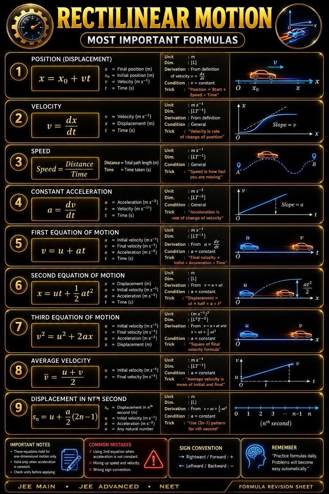
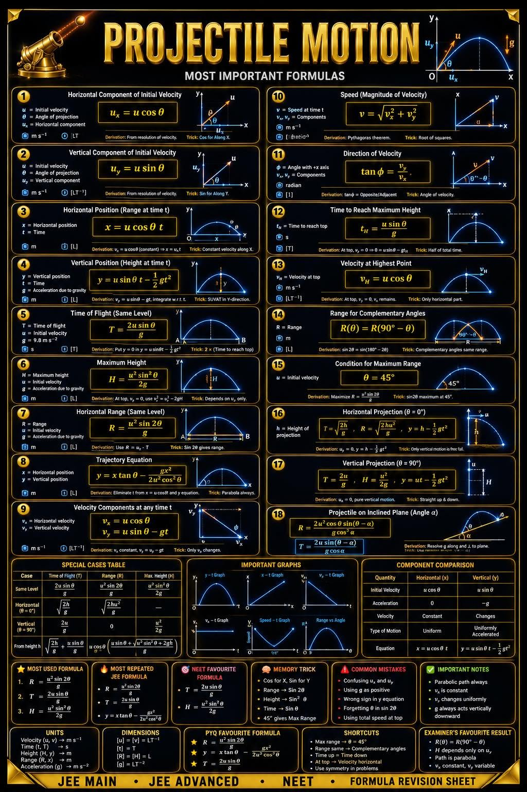
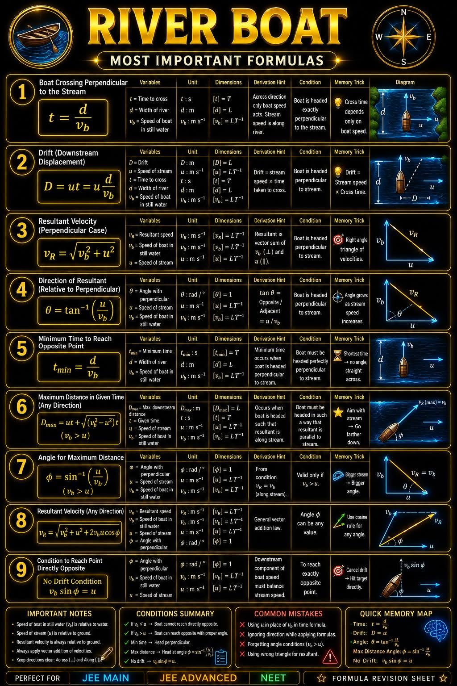

# Kinematics — Quick Formula Recap

> One-page revision for rectilinear motion, projectiles and relative velocity. If anything is
> unfamiliar, jump back to [Concepts](./01-concepts.md) or the [Deep Dive](./04-deep-dive.md).

<!-- RENDERING: inside math use \cdot (not ·), \perp as plain words, \to for arrows. g = 10 m/s². -->

---

## 📑 Index

- [Definitions](#definitions)
- [Equations of motion (constant a)](#equations)
- [Motion under gravity](#gravity)
- [Projectile motion](#projectile)
- [Non-uniform acceleration](#non-uniform)
- [Relative velocity](#relative)
- [Graphs](#graphs)

---

## Definitions

$$v = \frac{dx}{dt}, \qquad a = \frac{dv}{dt} = \frac{d^2x}{dt^2}$$

- Average speed $= \dfrac{\text{distance}}{\text{time}}$; average velocity $= \dfrac{\text{displacement}}{\text{time}}$.
- Distance $\ge |\text{displacement}|$; speed $\ge |\text{velocity}|$ (averages).

---

## Equations of motion (constant $a$)

$$v = u + at \qquad s = ut + \tfrac12 at^2 \qquad v^2 = u^2 + 2as$$
$$s_n = u + \tfrac{a}{2}(2n-1) \quad(\text{distance in the } n\text{th second})$$

---

## Motion under gravity (thrown up with speed $u$)

| Quantity | Value |
|---|---|
| Time to top | $u/g$ |
| Total flight time | $2u/g$ |
| Max height | $u^2/2g$ |
| Speed back at start | $u$ |

Dropped from rest: $v = gt$, $h = \tfrac12 gt^2$, $v = \sqrt{2gh}$.

---

## Projectile motion (speed $u$, angle $\theta$, level ground)

| Quantity | Formula |
|---|---|
| Horizontal velocity | $u\cos\theta$ (constant) |
| Vertical velocity | $u\sin\theta - gt$ |
| Time of flight | $\dfrac{2u\sin\theta}{g}$ |
| Max height | $\dfrac{u^2\sin^2\theta}{2g}$ |
| Range | $\dfrac{u^2\sin2\theta}{g}$ |
| Max range | $\dfrac{u^2}{g}$ at $\theta = 45°$ |
| Trajectory | $y = x\tan\theta - \dfrac{gx^2}{2u^2\cos^2\theta}$ |

- Complementary angles ($\theta$, $90°-\theta$) → same range.
- From height $h$, horizontal $u$: $t = \sqrt{2h/g}$, $x = u\sqrt{2h/g}$.
- Incline (angle $\alpha$, launch $\theta$ to incline): $R = \dfrac{2u^2\sin\theta\cos(\theta+\alpha)}{g\cos^2\alpha}$.
- Radius of curvature: $r = \dfrac{v^2}{a_\perp}$, $a_\perp = g\cos\phi$ ($\phi$ = velocity angle to horizontal).

---

## Non-uniform acceleration

$$a = \frac{dv}{dt}, \qquad a = v\frac{dv}{dx}$$

| Given | Use |
|---|---|
| $a = f(t)$ | $dv = a\,dt$ |
| $a = f(x)$ | $v\,dv = a\,dx$ |
| $a = f(v)$ | $\dfrac{dv}{f(v)} = dt$ or $\dfrac{v\,dv}{f(v)} = dx$ |

---

## Relative velocity

$$\vec v_{AB} = \vec v_A - \vec v_B$$

- 1D: same direction → subtract; opposite → add.
- River, min **time**: head across, $t = d/v_b$, drift $= v_r d/v_b$.
- River, min **path** (zero drift): aim upstream $\sin\theta = v_r/v_b$, $t = d/\sqrt{v_b^2 - v_r^2}$.
- Rain: umbrella along $\vec v_{\text{rain}} - \vec v_{\text{man}}$; vertical rain + horizontal walk → tilt $\tan^{-1}(v_m/v_r)$.
- Closest approach: $d_{\min} = \dfrac{|\vec r_0 \times \vec v_{AB}|}{|\vec v_{AB}|}$ at $t = -\dfrac{\vec r_0\cdot\vec v_{AB}}{|\vec v_{AB}|^2}$.

---

## Graphs

| Graph | Slope = | Area = |
|---|---|---|
| $x$–$t$ | velocity | — |
| $v$–$t$ | acceleration | displacement |
| $a$–$t$ | — | change in velocity |

> [!TIP]
> If stuck: identify constant-$a$ vs varying-$a$; for projectiles split into horizontal & vertical;
> for relative motion subtract the vectors (or switch frames). Three habits, most problems solved.

---

## 📸 Handwritten Notes (originals)

Scanned reference notes for this chapter, filed under [`notes/scans/`](./notes/scans/). These are the original handwritten sheets that back up the formulas above.

---

**Back to:** [Concepts](./01-concepts.md) · [Solved Numericals](./02-solved-numericals.md) · [Practice](./03-practice.md) · [Deep Dive](./04-deep-dive.md)
