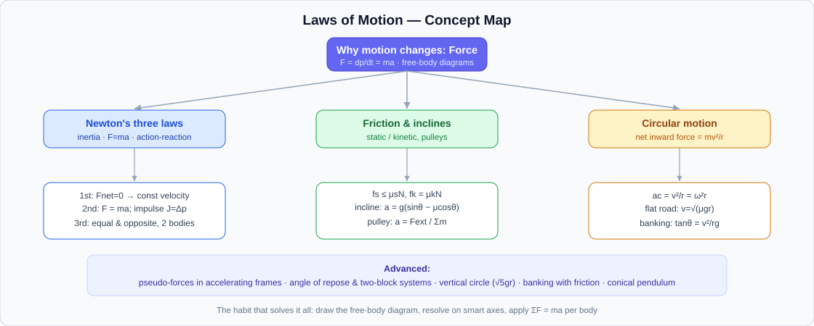
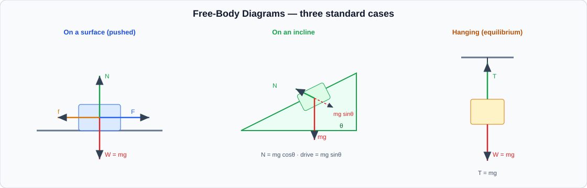
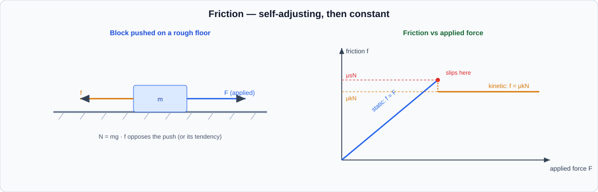

# Laws of Motion — Concepts

> **Class 11 · Physics · Chapter 3** — Laws of Motion (Newton's laws, friction, dynamics of connected bodies, circular motion)
> **Prerequisites:** [Kinematics](../02-kinematics/01-concepts.md) (especially acceleration and vectors), vector addition & resolution, free-body thinking
> **JEE weightage:** Very High — the backbone of mechanics. Newton's laws, friction, pulley systems and circular dynamics appear every year in Main and feed directly into Work-Energy, Rotational Motion and Gravitation in Advanced.

<!-- RENDERING: inside math use \cdot (not ·), \perp spelled as plain words, \to for arrows, vectors with \vec{}. Diagrams are SVGs. -->

---

## 📑 Index

1. [Force, inertia and Newton's first law](#1-first-law)
2. [Linear momentum and Newton's second law](#2-second-law)
3. [Newton's third law and action–reaction](#3-third-law)
4. [Free-body diagrams and equilibrium](#4-free-body-diagrams)
5. [Friction — static and kinetic](#5-friction)
6. [Connected bodies — pulleys, strings and contact](#6-connected-bodies)
7. [Dynamics of circular motion](#7-circular-motion)

**Advanced (JEE Main & Advanced depth):**

8. [Pseudo-forces and non-inertial frames](#8-pseudo-forces)
9. [Friction, advanced — angle of friction, inclines, two-block systems](#9-friction-advanced)
10. [Circular motion, advanced — vertical circle, banking, conical pendulum](#10-circular-advanced)

Related: [Solved Numericals](./02-solved-numericals.md) · [Practice Range](./03-practice.md) · [Deep Dive](./04-deep-dive.md) · [Formula Recap](./05-formula-recap.md)

---

## 🗺️ Concept map

---

## 1. Force, inertia and Newton's first law

Dynamics asks *why* motion changes — the answer is **force**.

- **Force** — a push or pull; a vector measured in newtons ($1\ \mathrm{N} = 1\ \mathrm{kg\,m/s^2}$). Forces add as vectors.
- **Inertia** — the tendency of a body to resist a change in its state of motion; measured by its **mass**.
- **Newton's first law:** a body continues at rest or in uniform straight-line motion **unless acted on by a net external force.**

$$\vec{F}_{\text{net}} = 0 \iff \vec{v} = \text{constant}$$

> [!IMPORTANT]
> The first law defines an **inertial frame** — one in which it holds. "No net force" does **not** mean
> "no forces": a book on a table has gravity and normal force that cancel. Equilibrium ($\vec F_{\text{net}}=0$)
> allows rest **or** constant velocity, not just rest.

---

## 2. Linear momentum and Newton's second law

**Linear momentum** $\vec{p} = m\vec{v}$ (vector, $\mathrm{kg\,m/s}$) is the "quantity of motion." Newton's
second law, in its exact form:

$$\boxed{\vec{F}_{\text{net}} = \frac{d\vec{p}}{dt}}$$

For **constant mass** this becomes the familiar

$$\boxed{\vec{F}_{\text{net}} = m\vec{a}}$$

**Impulse** is the change in momentum, $\vec{J} = \int \vec{F}\,dt = \Delta\vec{p}$.

| Quantity | Relation |
|---|---|
| Momentum | $\vec p = m\vec v$ |
| Second law | $\vec F = d\vec p/dt = m\vec a$ (constant $m$) |
| Impulse | $\vec J = \int \vec F\,dt = \Delta \vec p = \vec F_{\text{avg}}\,\Delta t$ |

> [!NOTE]
> The $d\vec p/dt$ form is the general one — use it for **variable-mass** problems (rockets, falling
> chains, conveyor belts) where $m$ changes. Force and acceleration are always **parallel** (constant
> mass); a large force over a tiny time (a bat hitting a ball) is best handled by **impulse**.

---

## 3. Newton's third law and action–reaction

> **To every action there is an equal and opposite reaction.** If A pushes B with force $\vec F$, then B
> pushes A with $-\vec F$.

$$\vec{F}_{AB} = -\vec{F}_{BA}$$

> [!WARNING]
> Action and reaction act on **different bodies**, so they **never cancel each other** — cancellation
> needs two forces on the *same* body. This is the single most common third-law error. The two forces
> are also always of the **same type** (both gravitational, both normal, etc.).

A direct consequence: for a system with no external force, total momentum is conserved
($\vec F_{\text{ext}} = 0 \Rightarrow \vec p_{\text{total}} = \text{const}$) — the basis of recoil and collision problems.

---

## 4. Free-body diagrams and equilibrium

A **free-body diagram (FBD)** isolates one body and draws **every** force on it. It is the starting move
for nearly every problem in this chapter.

**Common forces:**
- **Weight** $W = mg$, always vertically down.
- **Normal force** $N$, perpendicular to the contact surface (a constraint force — solve for it, don't assume $N=mg$).
- **Tension** $T$, along a string, pulling away from the body.
- **Friction** $f$, along the surface, opposing relative motion/tendency.

**Equilibrium (at rest or constant velocity):** resolve along two perpendicular axes and set each sum to zero.
$$\sum F_x = 0, \qquad \sum F_y = 0$$

> [!TIP]
> Choose axes to make the algebra easy: for an incline, tilt the axes **along and perpendicular to the
> slope** so gravity splits into $mg\sin\theta$ (down the slope) and $mg\cos\theta$ (into the slope).
> Then the normal force balances only $mg\cos\theta$.

---

## 5. Friction — static and kinetic

Friction is the contact force parallel to a surface that opposes relative sliding (or its tendency).

- **Static friction** $f_s$ adjusts itself to prevent motion, up to a maximum:
  $$f_s \le \mu_s N \qquad (f_{s,\max} = \mu_s N)$$
- **Kinetic friction** acts once sliding starts, roughly constant:
  $$f_k = \mu_k N$$

Typically $\mu_s > \mu_k$ (harder to start sliding than to keep it going).

| Feature | Static | Kinetic |
|---|---|---|
| When | no sliding yet | sliding |
| Value | self-adjusting, $\le \mu_s N$ | $\mu_k N$ (fixed) |
| Direction | opposes *tendency* of motion | opposes *actual* motion |

> [!IMPORTANT]
> Friction is **independent of contact area** and of speed (to a good approximation) — it depends only on
> $\mu$ and the normal force $N$. Before assuming the body slides, check whether the applied force exceeds
> $f_{s,\max} = \mu_s N$; if not, the body stays put and $f_s$ equals the applied force.

---

## 6. Connected bodies — pulleys, strings and contact

When bodies are linked by strings over (ideal, massless, frictionless) pulleys or pushed in contact, they
share a **common acceleration magnitude** (the constraint).

**Standard method:**
1. Draw an FBD for **each** body.
2. Write $F_{\text{net}} = ma$ for each, along the direction of motion.
3. Use the constraint (same $a$; equal tension in an ideal string) to solve the simultaneous equations.

**Two blocks on a table, connected over a pulley to a hanging mass $m_2$ (block $m_1$ on frictionless table):**
$$a = \frac{m_2 g}{m_1 + m_2}, \qquad T = \frac{m_1 m_2 g}{m_1 + m_2}$$

> [!TIP]
> For an **ideal string**, tension is the same throughout and the magnitudes of acceleration of connected
> bodies are equal. Treating the whole system as one block ($a = F_{\text{net,ext}}/M_{\text{total}}$)
> gives the acceleration fast; then isolate one body to find the internal tension/contact force.

---

## 7. Dynamics of circular motion

A body in a circle is **accelerating** (its velocity direction changes) even at constant speed. The
acceleration points to the centre — **centripetal acceleration**:
$$a_c = \frac{v^2}{r} = \omega^2 r$$

So a net inward ("centripetal") force is required:
$$\boxed{F_c = \frac{mv^2}{r} = m\omega^2 r}$$

> [!WARNING]
> **"Centripetal force" is not a new force** — it is the *name for the net inward force*, provided by real
> forces (tension, gravity, friction, normal). "Centrifugal force" is **not real** in an inertial frame;
> it only appears as a pseudo-force when you sit in the rotating frame (Section 8). Never add both a real
> inward force *and* a centrifugal force in the ground frame.

**Examples of what supplies $F_c$:**
- Stone on a string (horizontal): tension.
- Car on a flat road turning: static friction.
- Satellite: gravity.

---

<!-- ===== ADVANCED CLUSTER (required on every chapter) ===== -->

## 8. Pseudo-forces and non-inertial frames

Newton's laws hold only in **inertial frames**. If you insist on working in an **accelerating frame**
(acceleration $\vec a_0$), you must add a **pseudo-force** $-m\vec a_0$ to every body to make $F=ma$ work:
$$\vec F_{\text{real}} + (-m\vec a_0) = m\vec a_{\text{rel}}$$

- In a car accelerating forward at $a_0$, a hanging bob swings back; in the car's frame a pseudo-force
  $ma_0$ (backward) balances the string's horizontal component: $\tan\theta = a_0/g$.
- In a rotating frame, the pseudo-force is the **centrifugal force** $m\omega^2 r$ outward.

> [!IMPORTANT]
> Pseudo-forces are a *bookkeeping* device, not real interactions — they have no third-law partner. Use
> them only when you deliberately work in the accelerating frame; in the ground (inertial) frame they must
> **not** appear. Either frame gives the same answer if used consistently.

---

## 9. Friction, advanced — angle of friction, inclines, two-block systems

**Angle of friction $\lambda$:** the angle the resultant of $N$ and $f_{s,\max}$ makes with the normal,
$\tan\lambda = \mu_s$. **Angle of repose $\alpha$** is the incline angle at which a body just begins to
slide: $\tan\alpha = \mu_s$ — so **angle of repose = angle of friction.**

**Block on an incline (angle $\theta$):**
- Stays at rest if $\tan\theta \le \mu_s$.
- If sliding down, acceleration $a = g(\sin\theta - \mu_k\cos\theta)$.
- To drag it **up** at constant speed needs force $mg(\sin\theta + \mu_k\cos\theta)$.

**Two-block (block on block):** friction between them must provide the lower/upper block's acceleration.
Check whether they move together ($a = F/(m_1+m_2)$, then test if required friction $\le \mu_s N$) or slip
relative to each other (then each has its own $f_k$).

> [!TIP]
> The reusable test: **assume no slipping, compute the friction needed, then compare with $\mu_s N$.** If
> the required friction exceeds the maximum, your assumption is wrong — the surfaces slip and you switch to
> kinetic friction. This "assume, check, correct" loop handles almost every friction puzzle.

---

## 10. Circular motion, advanced — vertical circle, banking, conical pendulum

**Vertical circle (mass on a string, radius $r$):** gravity helps/opposes tension around the loop.
- At the **top**: $T + mg = \dfrac{mv_{\text{top}}^2}{r}$. Minimum speed to complete the loop (string just taut, $T=0$): $v_{\text{top}} = \sqrt{gr}$.
- At the **bottom**: $T - mg = \dfrac{mv_{\text{bot}}^2}{r}$, with $v_{\text{bot}} = \sqrt{5gr}$ for the minimum case (from energy conservation).

**Banking of roads (angle $\theta$):** tilting the road lets the normal force supply part of $F_c$.
- No friction, design speed: $\tan\theta = \dfrac{v^2}{rg}$.
- With friction $\mu_s$, a *range* of safe speeds:
  $$v_{\min} = \sqrt{rg\,\frac{\tan\theta - \mu_s}{1 + \mu_s\tan\theta}}, \qquad v_{\max} = \sqrt{rg\,\frac{\tan\theta + \mu_s}{1 - \mu_s\tan\theta}}$$

**Conical pendulum (string sweeps a cone, half-angle $\theta$):** $\tan\theta = \dfrac{v^2}{rg}$, time period $T = 2\pi\sqrt{\dfrac{L\cos\theta}{g}}$.

> [!IMPORTANT]
> The method for every circular-dynamics problem is the same: **net inward (radial) force $= mv^2/r$, net
> tangential force $= ma_t$.** Resolve all real forces into radial and tangential components, apply these two
> equations, and bring in energy conservation when the speed varies around the loop (vertical circle).

---

## ✅ One-line summary

> Dynamics = $\vec F_{\text{net}} = d\vec p/dt = m\vec a$. Draw a **free-body diagram**, resolve along smart
> axes, and apply $\sum F = ma$ per body; friction is self-adjusting up to $\mu_s N$ then $\mu_k N$;
> connected bodies share one acceleration with equal string tension; circular motion needs a net inward
> force $mv^2/r$ supplied by real forces — and in an accelerating frame you add the pseudo-force $-m\vec a_0$.

**Next:** [Solved Numericals →](./02-solved-numericals.md)
