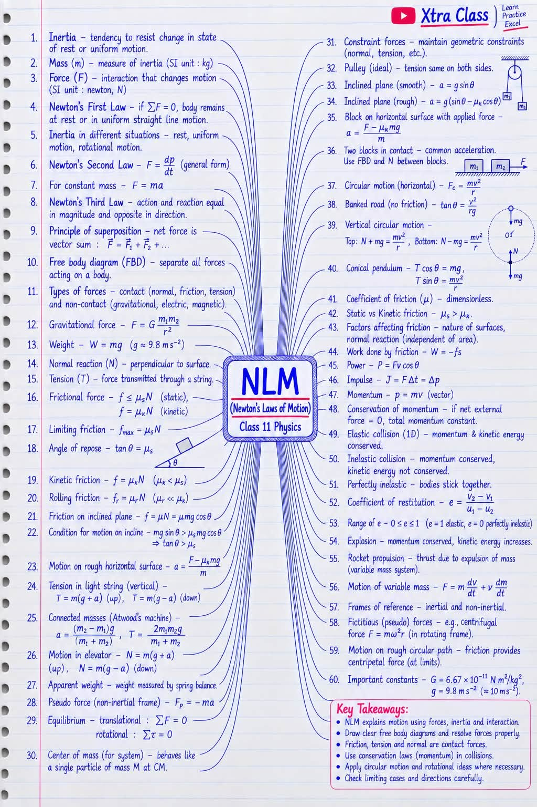
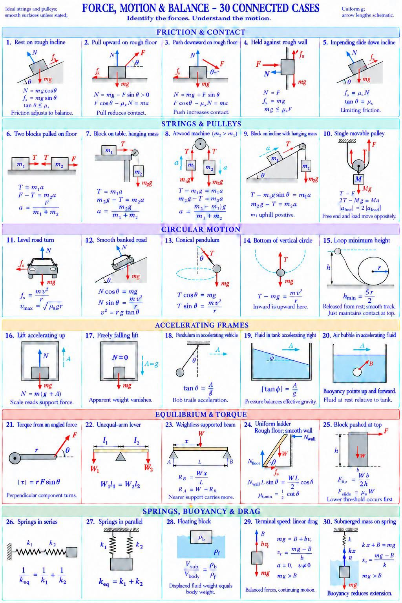
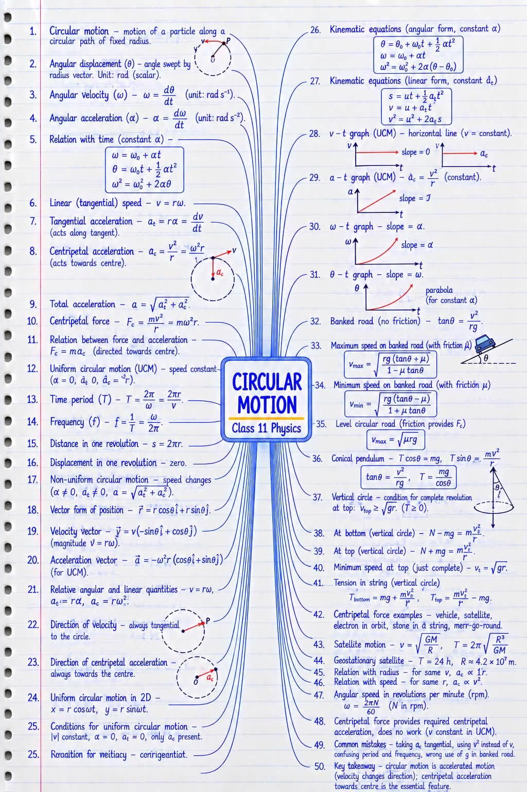

# Laws of Motion — Quick Formula Recap

> One-page revision for Newton's laws, friction, connected bodies and circular motion. If anything is
> unfamiliar, jump back to [Concepts](./01-concepts.md) or the [Deep Dive](./04-deep-dive.md).

<!-- RENDERING: inside math use \cdot (not ·), \perp as plain words, \to for arrows. g = 10 m/s². -->

---

## 📑 Index

- [Newton's laws](#laws)
- [Momentum & impulse](#momentum)
- [Friction](#friction)
- [Inclined plane](#incline)
- [Connected bodies & lift](#connected)
- [Circular motion](#circular)
- [Non-inertial frames](#frames)

---

## Newton's laws

$$\vec F_{\text{net}} = 0 \Rightarrow \vec v = \text{const} \quad(\text{1st}) \qquad \vec F_{\text{net}} = \frac{d\vec p}{dt} = m\vec a \quad(\text{2nd}) \qquad \vec F_{AB} = -\vec F_{BA} \quad(\text{3rd})$$

- Weight $W = mg$ (down); normal $N \perp$ surface; tension $T$ along string.
- Equilibrium: $\sum F_x = 0$, $\sum F_y = 0$.

---

## Momentum & impulse

$$\vec p = m\vec v, \qquad \vec J = \int \vec F\,dt = \Delta\vec p = \vec F_{\text{avg}}\Delta t$$

- No external force → $\vec p_{\text{total}} = $ const (recoil: $m_g v_g = m_b v_b$).
- Variable mass: $F = v\dfrac{dm}{dt} + m\dfrac{dv}{dt}$.

---

## Friction

$$f_s \le \mu_s N \ (\text{max } \mu_s N), \qquad f_k = \mu_k N, \qquad \mu_s > \mu_k$$

- Angle of friction: $\tan\lambda = \mu_s$. Angle of repose $\alpha$: $\tan\alpha = \mu_s$ (equal).
- Independent of contact area and (approximately) speed.

---

## Inclined plane (angle $\theta$)

| Situation | Result |
|---|---|
| Frictionless, sliding | $a = g\sin\theta$ |
| Stays at rest | $\tan\theta \le \mu_s$ |
| Sliding down (rough) | $a = g(\sin\theta - \mu_k\cos\theta)$ |
| Pushed up (rough) | $a = g(\sin\theta + \mu_k\cos\theta)$ |
| Normal force | $N = mg\cos\theta$ |

---

## Connected bodies & lift

$$\text{System: } a = \frac{F_{\text{ext}}}{\sum m} \qquad \text{Atwood: } a = \frac{(m_2 - m_1)g}{m_1 + m_2}$$

- Table block $m_1$ + hanging $m_2$ (frictionless): $a = \dfrac{m_2 g}{m_1+m_2}$, $T = \dfrac{m_1 m_2 g}{m_1+m_2}$.
- Lift apparent weight: up $N = m(g+a)$; down $N = m(g-a)$; free fall $N = 0$.

---

## Circular motion

$$a_c = \frac{v^2}{r} = \omega^2 r, \qquad F_c = \frac{mv^2}{r} = m\omega^2 r$$

| Case | Result |
|---|---|
| Flat road (friction) | $v_{\max} = \sqrt{\mu_s g r}$ |
| Banking (no friction) | $\tan\theta = \dfrac{v^2}{rg}$ |
| Vertical circle, top (min) | $v_{\text{top}} = \sqrt{gr}$, $T=0$ |
| Vertical circle, bottom (min) | $v_{\text{bot}} = \sqrt{5gr}$, $T = 6mg$ |
| Conical pendulum | $\tan\theta = \dfrac{v^2}{rg}$, $T_{\text{period}} = 2\pi\sqrt{\dfrac{L\cos\theta}{g}}$ |

---

## Non-inertial frames

$$\vec F_{\text{real}} + (-m\vec a_0) = m\vec a_{\text{rel}}$$

- Pendulum in a horizontally accelerating car: $\tan\theta = a_0/g$.
- Rotating frame: centrifugal pseudo-force $m\omega^2 r$ outward (not real in ground frame).

> [!TIP]
> If stuck: **draw the FBD, resolve on smart axes, apply $\sum F = ma$ per body.** For friction use the
> assume-check-correct loop; for circular motion set the net inward force $= mv^2/r$.

---

## 📸 Handwritten Notes (originals)

Scanned reference sheets for this chapter, filed under [`notes/scans/`](./notes/scans/). These are the original formula sheets that back up the formulas above, plus the full chapter notes PDF.

📄 Full chapter notes (from Google Drive): [`class_11_phy_ch03_laws-of-motion.pdf`](./notes/scans/class_11_phy_ch03_laws-of-motion.pdf)

---

**Back to:** [Concepts](./01-concepts.md) · [Solved Numericals](./02-solved-numericals.md) · [Practice](./03-practice.md) · [Deep Dive](./04-deep-dive.md)
