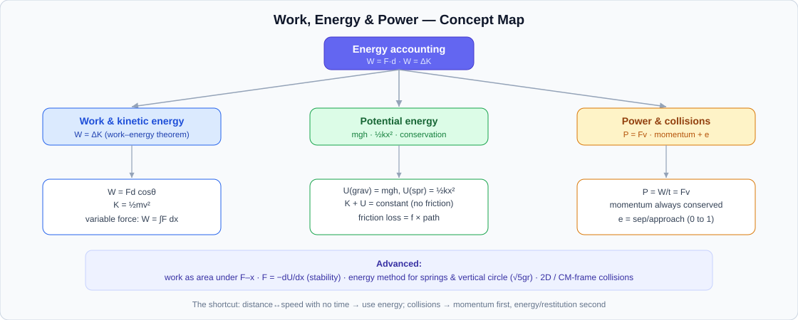
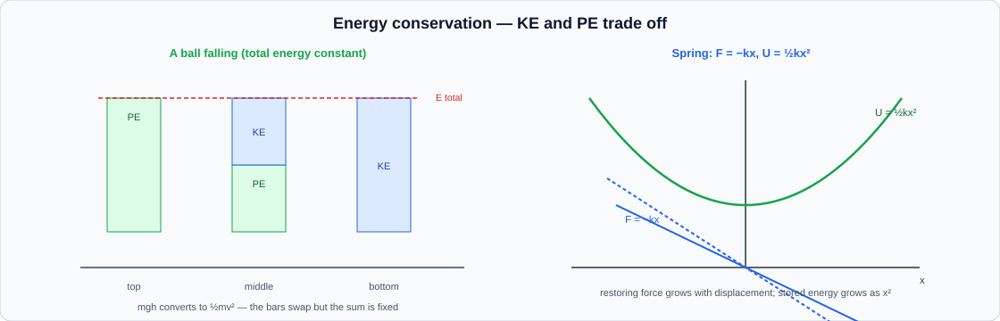
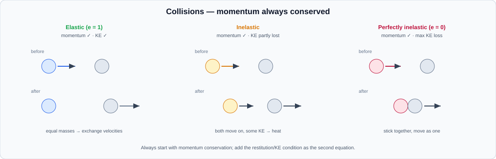

# Work, Energy & Power — Concepts

> **Class 11 · Physics · Chapter 4** — Work, Energy & Power (work–energy theorem, potential energy, conservation of energy, collisions)
> **Prerequisites:** [Kinematics](../02-kinematics/01-concepts.md), [Laws of Motion](../03-laws-of-motion/01-concepts.md), vectors (dot product), basic integration (for variable force)
> **JEE weightage:** Very High — the work–energy theorem and energy conservation shortcut huge numbers of problems; collisions and the spring/vertical-circle setups are Advanced staples.

<!-- RENDERING: inside math use \cdot (not ·), \perp spelled as plain words, \to for arrows, vectors with \vec{}. Diagrams are SVGs. -->

---

## 📑 Index

1. [Work done by a force](#1-work)
2. [Kinetic energy and the work–energy theorem](#2-work-energy-theorem)
3. [Potential energy — gravitational and spring](#3-potential-energy)
4. [Conservative vs non-conservative forces](#4-conservative)
5. [Conservation of mechanical energy](#5-conservation)
6. [Power](#6-power)
7. [Collisions and coefficient of restitution](#7-collisions)

**Advanced (JEE Main & Advanced depth):**

8. [Variable force, and force from a potential](#8-variable-force)
9. [Energy method for springs and vertical circles](#9-energy-method)
10. [Collisions in two dimensions and the CM frame](#10-collisions-advanced)

Related: [Solved Numericals](./02-solved-numericals.md) · [Practice Range](./03-practice.md) · [Deep Dive](./04-deep-dive.md) · [Formula Recap](./05-formula-recap.md)

---

## 🗺️ Concept map

---

## 1. Work done by a force

Work is done when a force moves its point of application. For a **constant** force $\vec F$ over
displacement $\vec d$:

$$\boxed{W = \vec F \cdot \vec d = Fd\cos\theta}$$

where $\theta$ is the angle between force and displacement. Work is a **scalar** (joules, $\mathrm{J}$).

| $\theta$ | $\cos\theta$ | Work |
|---|---|---|
| $0°$ | $+1$ | positive (force aids motion) |
| $90°$ | $0$ | zero (force $\perp$ to motion) |
| $180°$ | $-1$ | negative (force opposes motion) |

> [!IMPORTANT]
> Three ways work is **zero**: no displacement ($d=0$), force perpendicular to motion ($\theta=90°$, e.g.
> centripetal force, or normal force on a flat path), or no force. Friction and gravity-against-rise do
> **negative** work. For a **variable** force, $W = \int \vec F \cdot d\vec r$ (Section 8).

---

## 2. Kinetic energy and the work–energy theorem

**Kinetic energy** is the energy of motion:
$$K = \tfrac12 m v^2 \qquad (\text{also } K = \tfrac{p^2}{2m})$$

The **work–energy theorem**: the net work done on a body equals its change in kinetic energy.
$$\boxed{W_{\text{net}} = \Delta K = \tfrac12 m v^2 - \tfrac12 m u^2}$$

> [!TIP]
> This is the single most useful shortcut in mechanics. It links force and distance to speed **without
> time** — ideal when you don't care about (or can't easily find) the time taken. "Net work" means the
> work of **all** forces added together (or the work of the net force).

---

## 3. Potential energy — gravitational and spring

**Potential energy (PE)** is stored energy of configuration/position.

- **Gravitational PE** (near Earth): $U = mgh$ (relative to a chosen reference level).
- **Elastic (spring) PE**: for a spring of stiffness $k$ stretched/compressed by $x$,
  $$U_{\text{spring}} = \tfrac12 k x^2$$
  and the spring force is $F = -kx$ (Hooke's law; the minus sign means it restores).

> [!NOTE]
> Only **changes** in PE have physical meaning — you choose the zero level. Spring PE is **always
> positive** (depends on $x^2$), whether stretched or compressed. The spring force does negative work as
> you stretch it (storing energy) and positive work as it returns.

---

## 4. Conservative vs non-conservative forces

- **Conservative force:** work done is **path-independent** (depends only on endpoints); work around any
  closed loop is zero. Examples: gravity, spring force, electrostatic force. A potential energy can be
  defined for it.
- **Non-conservative force:** work depends on the **path**; mechanical energy is lost (usually to heat).
  Examples: friction, air drag, viscous force.

$$W_{\text{conservative}} = -\Delta U$$

> [!WARNING]
> You can define a potential energy **only** for a conservative force. Friction has no "potential energy"
> — the energy it removes becomes heat and can't be recovered. In energy accounting, friction appears as a
> loss term, not as a PE.

---

## 5. Conservation of mechanical energy

When **only conservative forces** do work, total mechanical energy $E = K + U$ is constant:
$$\boxed{K_1 + U_1 = K_2 + U_2}$$

If non-conservative forces (friction) also act, they account for the change:
$$\Delta(K + U) = W_{\text{non-conservative}} \ (= -\,\text{energy lost to friction})$$

> [!TIP]
> Energy conservation turns many two-step force problems into a one-line equation: **"initial KE + initial
> PE = final KE + final PE."** A ball falling, a block on a spring, a pendulum swing, a loop-the-loop —
> all collapse to this, provided you include every form of energy and any friction loss.

---

## 6. Power

**Power** is the rate of doing work (watts, $\mathrm{W} = \mathrm{J/s}$):
$$P_{\text{avg}} = \frac{W}{t}, \qquad P_{\text{inst}} = \frac{dW}{dt} = \vec F \cdot \vec v = Fv\cos\theta$$

> [!NOTE]
> $1\ \mathrm{hp} = 746\ \mathrm{W}$. The relation $P = Fv$ is why a car's maximum speed is set by engine
> power and drag: at top speed the driving force (= power/speed) just balances resistance. The
> commercial "unit" of energy is $1\ \mathrm{kWh} = 3.6\times10^6\ \mathrm{J}$.

---

## 7. Collisions and coefficient of restitution

In **every** collision (no external force during impact), **momentum is conserved**. Kinetic energy may or
may not be.

| Type | Momentum | Kinetic energy |
|---|---|---|
| Elastic | conserved | conserved |
| Inelastic | conserved | partly lost |
| Perfectly inelastic (stick together) | conserved | maximum loss |

**Coefficient of restitution** $e = \dfrac{\text{relative speed of separation}}{\text{relative speed of approach}} = \dfrac{v_2 - v_1}{u_1 - u_2}$, with $0 \le e \le 1$ ($e=1$ elastic, $e=0$ perfectly inelastic).

**1D elastic collision** (masses $m_1, m_2$, initial $u_1, u_2$):
$$v_1 = \frac{(m_1-m_2)u_1 + 2m_2 u_2}{m_1+m_2}, \qquad v_2 = \frac{(m_2-m_1)u_2 + 2m_1 u_1}{m_1+m_2}$$

> [!IMPORTANT]
> Equal masses in an elastic collision **exchange velocities** (why Newton's cradle works). A light body
> hitting a very heavy one bounces back with nearly its own speed; a heavy body hitting a light one
> barely slows. Always start a collision problem with **momentum conservation**, then add the energy
> condition ($e$ or KE) as the second equation.

---

<!-- ===== ADVANCED CLUSTER (required on every chapter) ===== -->

## 8. Variable force, and force from a potential

For a force that varies with position, work is the **area under the force–displacement graph**:
$$W = \int_{x_1}^{x_2} F(x)\,dx$$

This is how spring PE comes out: $W = \int_0^x (-kx')\,dx' = -\tfrac12 kx^2$ (work by the spring), so the
PE **stored** is $+\tfrac12 kx^2$.

The inverse relation — **force is the negative gradient of potential energy**:
$$\boxed{F_x = -\frac{dU}{dx}}$$

Equilibrium is where $F=0$, i.e. $dU/dx = 0$: a **minimum** of $U$ is stable, a **maximum** is unstable.

> [!IMPORTANT]
> $F = -dU/dx$ is a two-way street: integrate a conservative force to get its PE, or differentiate a PE to
> recover the force. The sign of $d^2U/dx^2$ tells you stability — this is the gateway to oscillations
> (SHM sits in the bottom of a potential well, where $U \approx \tfrac12 k x^2$).

---

## 9. Energy method for springs and vertical circles

**Spring–mass:** a block of mass $m$ pushed against a spring (compression $x$) and released leaves with
$\tfrac12 kx^2 = \tfrac12 mv^2 \Rightarrow v = x\sqrt{k/m}$. On a rough surface, subtract the friction work
$\mu mg d$.

**Vertical circle by energy:** for a ball on a string/track of radius $r$, combine energy conservation
with the radial equation:
- Minimum speed at the top: $v_{\text{top}} = \sqrt{gr}$ (string just taut).
- Energy conservation bottom → top: $\tfrac12 m v_{\text{bot}}^2 = \tfrac12 m v_{\text{top}}^2 + mg(2r) \Rightarrow v_{\text{bot}} = \sqrt{5gr}$.
- Minimum height to complete a loop from rest (smooth track): $h_{\min} = \tfrac{5r}{2}$.

> [!TIP]
> Whenever speed changes around a curve or on a spring, reach for **energy conservation first** (it gives
> the speed), then apply the force equation ($mv^2/r$ for circles, Hooke's law for springs) only where you
> actually need a force or tension. Two tools, in that order, crack almost every setup.

---

## 10. Collisions in two dimensions and the CM frame

**Oblique (2D) collisions:** conserve momentum **along each axis separately** ($x$ and $y$). For an elastic
collision between equal masses where one is initially at rest, the two move off at **90° to each other**.

**Centre-of-mass (CM) frame:** the total momentum is zero in the CM frame, which simplifies collisions —
in an elastic collision the speeds are merely reversed in that frame. The CM moves at
$\vec v_{\text{cm}} = \dfrac{m_1\vec u_1 + m_2\vec u_2}{m_1+m_2}$ throughout (no external force).

> [!IMPORTANT]
> In 2D, **resolve momentum into components** and conserve each independently; energy (if elastic) gives
> one more scalar equation. The CM frame is the elegant route: there, total momentum is zero, the collision
> is symmetric, and you transform back by adding $\vec v_{\text{cm}}$. Recognising when to switch to the CM
> frame turns messy oblique collisions into clean ones.

---

## ✅ One-line summary

> Work $W = \vec F\cdot\vec d$ (area under $F$–$x$ for variable force); the **work–energy theorem**
> $W_{\text{net}} = \Delta K$ links force·distance to speed without time. For conservative forces define a
> PE ($mgh$, $\tfrac12 kx^2$) with $F=-dU/dx$, and **mechanical energy $K+U$ is conserved** (friction
> appears as a loss). Power $P = Fv$. In collisions **momentum is always conserved**; kinetic energy is
> conserved only if elastic ($e=1$).

**Next:** [Solved Numericals →](./02-solved-numericals.md)
