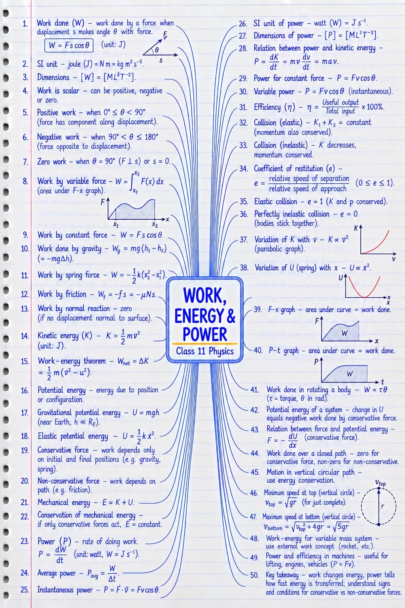
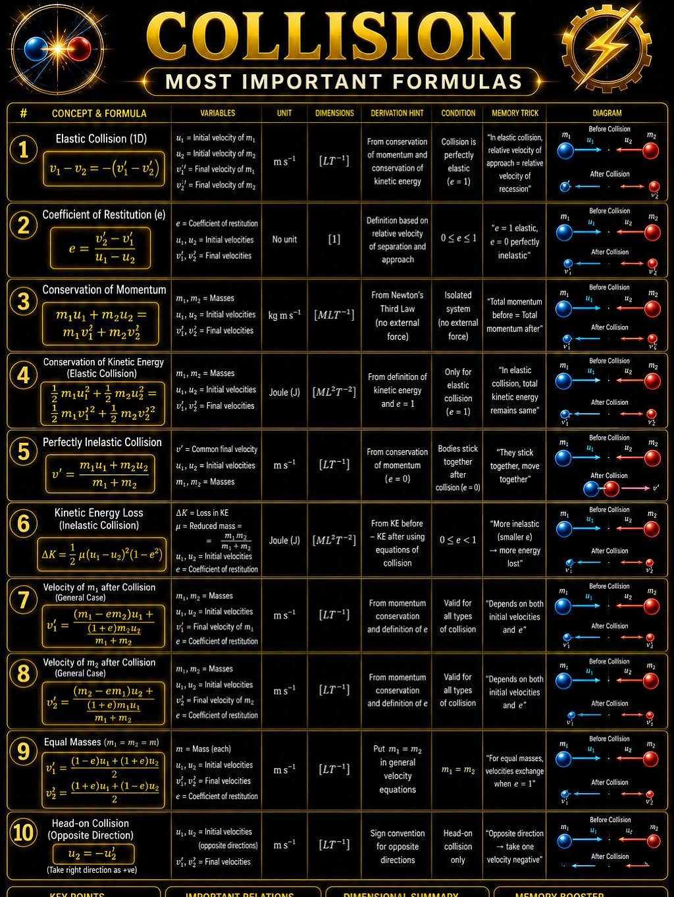

# Work, Energy & Power — Quick Formula Recap

> One-page revision for work, energy, power and collisions. If anything is unfamiliar, jump back to
> [Concepts](./01-concepts.md) or the [Deep Dive](./04-deep-dive.md).

<!-- RENDERING: inside math use \cdot (not ·), \perp as plain words, \to for arrows. g = 10 m/s². -->

---

## 📑 Index

- [Work](#work)
- [Kinetic energy & work–energy theorem](#ke)
- [Potential energy](#pe)
- [Conservation of energy](#conservation)
- [Power](#power)
- [Collisions](#collisions)
- [Force from potential](#force-potential)

---

## Work

$$W = \vec F \cdot \vec d = Fd\cos\theta \qquad W = \int_{x_1}^{x_2} F(x)\,dx \ (\text{variable force})$$

- $\theta = 0$: positive; $\theta = 90°$: zero; $\theta = 180°$: negative.
- Zero work: no displacement, or force $\perp$ to motion.

---

## Kinetic energy & work–energy theorem

$$K = \tfrac12 mv^2 = \frac{p^2}{2m}, \qquad W_{\text{net}} = \Delta K = \tfrac12 mv^2 - \tfrac12 mu^2$$

---

## Potential energy

$$U_{\text{grav}} = mgh, \qquad U_{\text{spring}} = \tfrac12 kx^2 \ (F = -kx)$$

- Spring PE always positive; only changes in PE matter.

---

## Conservation of energy

$$K_1 + U_1 = K_2 + U_2 \quad(\text{conservative only})$$
$$(K_1+U_1) - (K_2+U_2) = f\cdot d \quad(\text{with friction})$$

| Setup | Result |
|---|---|
| Free fall / incline (smooth) | $v = \sqrt{2gh}$ |
| Pendulum from horizontal | $v = \sqrt{2gL}$ |
| Stopping on rough floor | $d = \dfrac{v^2}{2\mu_k g}$ |
| Vertical circle, top / bottom (min) | $\sqrt{gr}$ / $\sqrt{5gr}$ |
| Loop min release height (from rest) | $h = \dfrac{5r}{2}$ |

---

## Power

$$P_{\text{avg}} = \frac{W}{t}, \qquad P_{\text{inst}} = \vec F\cdot\vec v = Fv\cos\theta$$

- Lifting water: $P = mgh/t$. Top speed: $v_{\max} = P/F_{\text{resist}}$.
- $1\ \mathrm{hp} = 746\ \mathrm{W}$; $1\ \mathrm{kWh} = 3.6\times10^6\ \mathrm{J}$.

---

## Collisions (momentum always conserved)

$$e = \frac{v_2 - v_1}{u_1 - u_2}\ (0 \le e \le 1), \qquad e = \sqrt{\frac{h_{\text{rebound}}}{h_{\text{drop}}}}\ (\text{floor bounce})$$

**1D elastic** ($m_1,m_2$; $u_1,u_2$):
$$v_1 = \frac{(m_1-m_2)u_1 + 2m_2u_2}{m_1+m_2}, \qquad v_2 = \frac{(m_2-m_1)u_2 + 2m_1u_1}{m_1+m_2}$$

| Type | Momentum | KE |
|---|---|---|
| Elastic ($e=1$) | ✓ | ✓ |
| Inelastic | ✓ | partly lost |
| Perfectly inelastic ($e=0$) | ✓ | max loss |

- Equal masses, elastic → exchange velocities. One at rest, equal masses, 2D → separate at $90°$.

---

## Force from potential

$$F_x = -\frac{dU}{dx}$$

- Equilibrium: $dU/dx = 0$; stable at a **minimum** ($d^2U/dx^2 > 0$), unstable at a maximum.

> [!TIP]
> If stuck: distance↔speed with no time → **work–energy / conservation**; collisions → **momentum first**,
> then restitution; stability → sign of $d^2U/dx^2$.

---

## 📸 Handwritten Notes (originals)

Scanned reference sheets for this chapter, filed under [`notes/scans/`](./notes/scans/), plus the full chapter notes PDF.

📄 Full chapter notes (from Google Drive): [`class_11_phy_ch04_work-energy-and-power.pdf`](./notes/scans/class_11_phy_ch04_work-energy-and-power.pdf)

---

**Back to:** [Concepts](./01-concepts.md) · [Solved Numericals](./02-solved-numericals.md) · [Practice](./03-practice.md) · [Deep Dive](./04-deep-dive.md)
