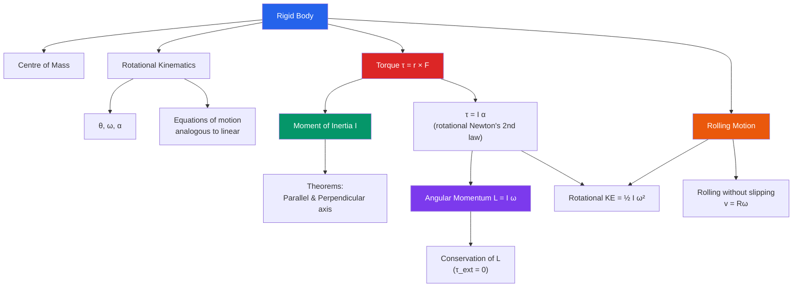
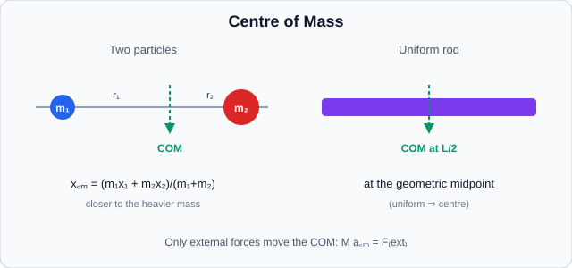
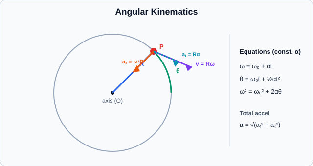
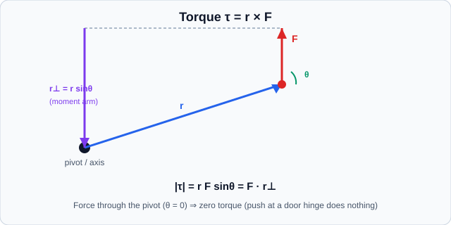
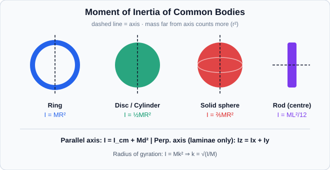
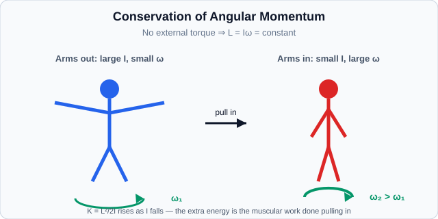
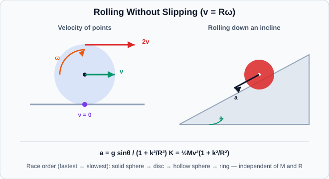

# Rotational Motion — Concepts

> **Class 11 · Physics · Chapter 5** — System of Particles & Rotational Motion
> **Prerequisites:** Vectors, Kinematics, Newton's Laws, Work–Energy theorem
> **JEE weightage:** High — a core mechanics chapter, heavily tested in both Main & Advanced.

---

## 📑 Index

1. [The rigid body idea](#1-the-rigid-body-idea)
2. [Centre of mass (COM)](#2-centre-of-mass-com)
3. [Angular kinematics](#3-angular-kinematics)
4. [Torque — the cause of rotation](#4-torque--the-cause-of-rotation)
5. [Moment of inertia — rotational mass](#5-moment-of-inertia--rotational-mass)
6. [Rotational Newton's second law](#6-rotational-newtons-second-law)
7. [Angular momentum](#7-angular-momentum)
8. [Rolling motion](#8-rolling-motion)
9. [The full linear ↔ rotational dictionary](#9-the-full-linear--rotational-dictionary)

Related: [Solved Numericals](./02-solved-numericals.md) · [Practice Range](./03-practice.md) · [Deep Dive](./04-deep-dive.md) · [Formula Recap](./05-formula-recap.md)

---

## 🗺️ Concept map

---

## 1. The rigid body idea

A **rigid body** is an idealised object in which the distance between any two
particles stays fixed, no matter what forces act. Real bodies deform a little;
we ignore that.

A rigid body can have two kinds of motion:

- **Translation** — every particle moves with the same velocity (the whole body shifts).
- **Rotation** — every particle moves in a circle about a common fixed line called the **axis of rotation**. Particles farther from the axis move faster.

General motion = translation of the centre of mass **+** rotation about the centre of mass. This decomposition is the single most useful idea in the chapter.

> [!NOTE]
> In **pure rotation** about a fixed axis, each particle traces a circle whose plane is perpendicular to the axis and whose centre lies on the axis. All particles share the **same** angular displacement, angular velocity and angular acceleration — only their *linear* quantities differ.

---

## 2. Centre of mass (COM)

The centre of mass is the mass-weighted average position of a system — the point that moves as if all mass and all external force were concentrated there.

**Discrete system:**
$$\vec{r}_{cm} = \frac{\sum_i m_i \vec{r}_i}{\sum_i m_i} = \frac{m_1\vec{r}_1 + m_2\vec{r}_2 + \cdots}{m_1 + m_2 + \cdots}$$

**Continuous body:**
$$\vec{r}_{cm} = \frac{1}{M}\int \vec{r}\,dm$$

**Key results (COM of standard bodies):**

| Body | Location of COM |
|---|---|
| Uniform rod (length $L$) | midpoint, $L/2$ |
| Uniform ring / disc / sphere | geometric centre |
| Triangular lamina | centroid (intersection of medians) |
| Semicircular ring (radius $R$) | $\dfrac{2R}{\pi}$ from centre |
| Semicircular disc (radius $R$) | $\dfrac{4R}{3\pi}$ from centre |
| Solid hemisphere (radius $R$) | $\dfrac{3R}{8}$ from centre |

**Motion of the COM:**
$$M\vec{a}_{cm} = \vec{F}_{ext}$$

Internal forces cancel in pairs (Newton's third law), so only **external** forces move the COM. If $\vec{F}_{ext}=0$, the COM velocity is constant — this is why an exploding shell's COM keeps following the original parabola.

---

## 3. Angular kinematics

For rotation about a fixed axis we use **angular** quantities, each the rotational twin of a linear quantity.

| Linear | Angular | Relation |
|---|---|---|
| displacement $s$ | angular displacement $\theta$ (rad) | $s = R\theta$ |
| velocity $v$ | angular velocity $\omega = \dfrac{d\theta}{dt}$ | $v = R\omega$ |
| acceleration $a$ | angular acceleration $\alpha = \dfrac{d\omega}{dt}$ | $a_t = R\alpha$ |

- $\omega$ and $\alpha$ are **vectors** along the axis; direction by the **right-hand rule** (curl fingers along rotation, thumb gives $\vec\omega$).
- A point at distance $R$ from the axis has **tangential** acceleration $a_t = R\alpha$ and **centripetal** (radial) acceleration $a_c = \omega^2 R = v^2/R$. Total linear acceleration $a = \sqrt{a_t^2 + a_c^2}$.

**Equations of rotational motion** (constant $\alpha$) — identical in form to the linear SUVAT equations:

$$\omega = \omega_0 + \alpha t$$
$$\theta = \omega_0 t + \tfrac{1}{2}\alpha t^2$$
$$\omega^2 = \omega_0^2 + 2\alpha\theta$$
$$\theta_{n^{th}} = \omega_0 + \tfrac{\alpha}{2}(2n-1)$$

> [!TIP]
> Whenever you can write a linear equation, there is a rotational one with the swap
> $s\to\theta,\ v\to\omega,\ a\to\alpha,\ m\to I,\ F\to\tau,\ p\to L$. Learn the
> dictionary once and half this chapter is free.

---

## 4. Torque — the cause of rotation

A force makes a body rotate only through its **turning effect**, the **torque** (moment of force):

$$\boxed{\vec{\tau} = \vec{r}\times\vec{F}}\qquad |\vec\tau| = rF\sin\theta = F\cdot r_\perp$$

- $\vec r$ = position vector from the axis/pivot to the point where $\vec F$ acts.
- $r_\perp = r\sin\theta$ is the **moment arm** (perpendicular distance from axis to the line of force).
- SI unit: $\mathrm{N\cdot m}$. Direction: perpendicular to the plane of $\vec r$ and $\vec F$ (right-hand rule).

Only the component of force **perpendicular** to $\vec r$ produces torque. A force whose line passes through the axis ($\theta = 0$) gives zero torque — that is why pushing a door at the hinge does nothing.

> [!IMPORTANT]
> Torque is **always** defined about a point or axis. "The torque of this force"
> is meaningless until you say *about which point*. The same force has different
> torques about different axes.

---

## 5. Moment of inertia — rotational mass

**Moment of inertia** $I$ measures how hard it is to change a body's rotation — the rotational analogue of mass.

$$I = \sum_i m_i r_i^2 \qquad\text{or}\qquad I = \int r^2\,dm$$

where $r$ is each mass element's **perpendicular distance from the axis**. Unit: $\mathrm{kg\cdot m^2}$.

Unlike mass, $I$ depends on the **axis chosen** and on **how mass is distributed** — mass far from the axis counts much more ($r^2$).

**Radius of gyration** $k$: the single distance at which the whole mass could sit to give the same $I$:
$$I = Mk^2 \quad\Rightarrow\quad k = \sqrt{I/M}$$

### Standard moments of inertia (memorise these)

| Body (mass $M$) | Axis | $I$ |
|---|---|---|
| Thin rod, length $L$ | through centre, ⟂ to rod | $\dfrac{1}{12}ML^2$ |
| Thin rod, length $L$ | through one end, ⟂ to rod | $\dfrac{1}{3}ML^2$ |
| Ring, radius $R$ | through centre, ⟂ to plane | $MR^2$ |
| Ring, radius $R$ | any diameter | $\dfrac{1}{2}MR^2$ |
| Disc, radius $R$ | through centre, ⟂ to plane | $\dfrac{1}{2}MR^2$ |
| Disc, radius $R$ | any diameter | $\dfrac{1}{4}MR^2$ |
| Solid sphere, radius $R$ | through centre (diameter) | $\dfrac{2}{5}MR^2$ |
| Hollow sphere, radius $R$ | through centre (diameter) | $\dfrac{2}{3}MR^2$ |
| Solid cylinder, radius $R$ | central (long) axis | $\dfrac{1}{2}MR^2$ |
| Hollow cylinder / shell | central axis | $MR^2$ |

### The two axis theorems

**Parallel axis theorem** — for an axis parallel to one through the COM, a distance $d$ away:
$$\boxed{I = I_{cm} + Md^2}$$

**Perpendicular axis theorem** — for a **planar (2-D) lamina** only, with $z$ perpendicular to the plane and $x,y$ in the plane through the same point:
$$\boxed{I_z = I_x + I_y}$$

> [!WARNING]
> The perpendicular-axis theorem works **only for flat laminae** (ring, disc, square plate) — never for 3-D bodies like a sphere or solid cylinder. The parallel-axis theorem works for **any** body but $I_{cm}$ must be the moment of inertia about the parallel axis **through the centre of mass**.

**Example — disc diameter from perpendicular axis theorem:** For a disc, $I_z=\tfrac12 MR^2$. By symmetry $I_x=I_y$, so $I_z=2I_x \Rightarrow I_x=\tfrac14 MR^2$. ✔ matches the table.

---

## 6. Rotational Newton's second law

Torque produces angular acceleration exactly as force produces linear acceleration:

$$\boxed{\vec\tau_{net} = I\vec\alpha}$$

This is derived from $\vec\tau = \vec r \times \vec F$ summed over all particles; internal torques cancel in pairs, leaving only external torque.

**Rotational work and power:**
$$W = \int \tau\,d\theta, \qquad P = \tau\omega$$

**Rotational kinetic energy:**
$$\boxed{K_{rot} = \tfrac{1}{2}I\omega^2}$$

**Work–energy theorem (rotational):** $W_{net} = \Delta K_{rot} = \tfrac12 I\omega_f^2 - \tfrac12 I\omega_i^2$.

---

## 7. Angular momentum

The rotational analogue of linear momentum:

$$\vec L = \vec r \times \vec p \qquad\text{(particle)}, \qquad \vec L = I\vec\omega \qquad\text{(rigid body, fixed axis)}$$

Unit: $\mathrm{kg\cdot m^2/s}$. The rotational Newton's law in its most general form is:

$$\boxed{\vec\tau_{ext} = \frac{d\vec L}{dt}}$$

### Conservation of angular momentum

If the **net external torque is zero**, angular momentum is conserved:

$$\tau_{ext}=0 \;\Rightarrow\; \vec L = \text{constant} \;\Rightarrow\; I_1\omega_1 = I_2\omega_2$$

This is why a spinning skater speeds up on pulling the arms in ($I$ drops, $\omega$ rises so $I\omega$ stays fixed), and why a diver tucks to spin faster.

> [!NOTE]
> $K_{rot}=\tfrac12 I\omega^2 = \dfrac{L^2}{2I}$. When $I$ decreases at constant $L$, kinetic energy **increases** — the extra energy comes from the work the skater does pulling the arms in. Momentum is conserved; energy is not "automatically" conserved.

---

## 8. Rolling motion

Rolling = translation of the COM **+** rotation about the COM.

**Rolling without slipping** (the contact point is instantaneously at rest):
$$\boxed{v_{cm} = R\omega}, \qquad a_{cm} = R\alpha$$

**Velocity of points on a rolling wheel:** topmost point moves at $2v_{cm}$, centre at $v_{cm}$, contact point at $0$.

**Total kinetic energy of a rolling body:**
$$K = \underbrace{\tfrac12 Mv_{cm}^2}_{\text{translation}} + \underbrace{\tfrac12 I_{cm}\omega^2}_{\text{rotation}} = \tfrac12 Mv_{cm}^2\left(1 + \frac{I_{cm}}{MR^2}\right) = \tfrac12 Mv_{cm}^2\left(1+\frac{k^2}{R^2}\right)$$

**Rolling down an incline** (angle $\theta$, no slipping):
$$a_{cm} = \frac{g\sin\theta}{1 + \dfrac{k^2}{R^2}}, \qquad v = \sqrt{\frac{2gh}{1+\dfrac{k^2}{R^2}}}$$

The factor $k^2/R^2$ (the **shape factor**) decides the race down the incline — it is independent of mass and radius:

| Body | $k^2/R^2$ | $a_{cm}$ (as fraction of $g\sin\theta$) | Finishing order |
|---|---|---|---|
| Solid sphere | $2/5$ | $0.714$ | 🥇 fastest |
| Solid cylinder/disc | $1/2$ | $0.667$ | 🥈 |
| Hollow sphere | $2/3$ | $0.600$ | 🥉 |
| Ring/hollow cylinder | $1$ | $0.500$ | slowest |

Minimum friction coefficient needed to roll without slipping:
$$\mu_{min} = \frac{\tan\theta}{1+\dfrac{R^2}{k^2}} = \frac{(k^2/R^2)\tan\theta}{1+k^2/R^2}$$

> [!TIP]
> The **solid sphere always wins** the roll-down race because it has the smallest
> $k^2/R^2$ — the most mass concentrated near the axis. Mass and radius cancel
> out entirely, so a marble and a bowling ball (both solid spheres) tie.

---

## 9. The full linear ↔ rotational dictionary

| Quantity | Linear | Rotational |
|---|---|---|
| Inertia | mass $m$ | moment of inertia $I$ |
| Cause of change | force $F$ | torque $\tau$ |
| Newton's 2nd law | $F = ma$ | $\tau = I\alpha$ |
| Momentum | $p = mv$ | $L = I\omega$ |
| Law of motion | $F = dp/dt$ | $\tau = dL/dt$ |
| Kinetic energy | $\tfrac12 mv^2$ | $\tfrac12 I\omega^2$ |
| Work | $Fs$ | $\tau\theta$ |
| Power | $Fv$ | $\tau\omega$ |
| Equilibrium | $\sum F = 0$ | $\sum \tau = 0$ |

---

## ✅ One-line summary

> Replace mass with $I$, force with $\tau$, and momentum with $L$ — Newtonian
> mechanics carries over whole. Add $v=R\omega$ for rolling, the two axis theorems
> for $I$, and conservation of $L$ when $\tau_{ext}=0$, and you have the entire chapter.

**Next:** [Solved Numericals →](./02-solved-numericals.md)
