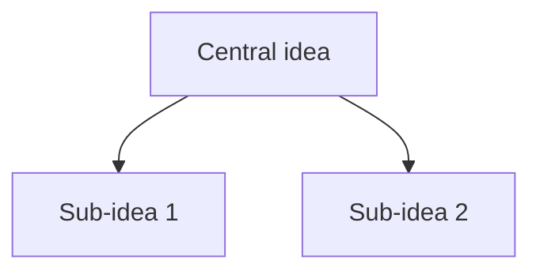

# <Topic> — Concepts

> **Class <11/12> · <Subject> · Chapter <n>** — <full chapter name>
> **Prerequisites:** <...>
> **JEE weightage:** <High/Medium/Low — one line>

<!-- RENDERING: inside math use \cdot (not ·), \perp (not ⟂), \to (not →). Units as \mathrm{}. -->

---

## 📑 Index

1. [<Section 1>](#1-section-1)
2. [<Section 2>](#2-section-2)
3. [<Section 3>](#3-section-3)

Related: [Solved Numericals](./02-solved-numericals.md) · [Practice Range](./03-practice.md) · [Deep Dive](./04-deep-dive.md) · [Formula Recap](./05-formula-recap.md)

---

## 🗺️ Concept map

---

## 1. <Section 1>

<Plain-English explanation first. Then the formula.>

$$<equation>$$

> [!NOTE]
> <Key insight or common point of confusion.>

---

## 2. <Section 2>

<...>

---

## 3. <Section 3>

<...>

---

## ✅ One-line summary

> <The whole topic compressed into one or two sentences.>

**Next:** [Solved Numericals →](./02-solved-numericals.md)
